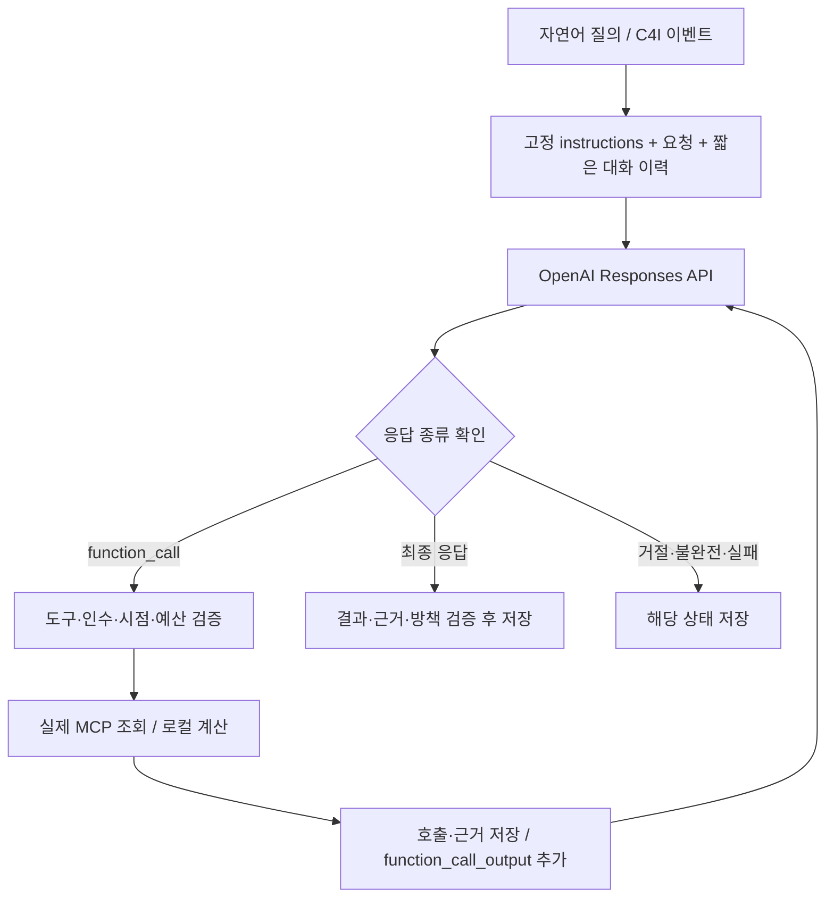

# 단일 동적 분석 Agent 설계

## 실행 파일 로그 (2026-10-22)

Runtime은 실행별 `RunLog`를 소유하고 AgentLoop의 선택적 `on_event`로 discovery·모델·도구·출력 검증/종료 이벤트를 기록한다. 기존 `on_progress`는 DB/UI 상태 저장용으로 유지한다. 별도 Agent나 모델 호출을 추가하지 않는다. 준비 실패·취소는 Runtime 경계에서, 재시작 중단은 Repository 복구에서 기록한다. OFF/ON은 runId별 파일로 분리하고 terminal summary는 한 실행 구간에 한 번 기록한다.

로그는 UTF-8·한글 이벤트 제목·들여쓰기된 필드 형식이며 블록별 8,000자 생략과 비밀값 마스킹을 적용한다. 모델 요청 횟수와 응답 횟수를 구분하고 usage 미제공/부분 집계는 명시한다. 공개 실행 이벤트만 기록하며 비공개 사고 과정·전체 과거 대화·SDK 원본 payload를 덤프하지 않는다. I/O 오류는 분석 실패로 전파하지 않고 runId/오류 종류만 stderr에 남긴다. 설정은 README를 따른다.

## v3 도구·컨텍스트 구현 (2026-10-22)

기존 Python 단일 `AgentLoop`와 OpenAI Responses native function calling을 유지한다. 새로운 Orchestrator·전문 Agent·고정 시나리오 workflow는 없다. 서버 discovery 설명/입력 schema를 strict 함수로 변환하고 모델이 다음 도구 또는 최종 답변을 선택한다. 시스템 지시는 앱 내 분석 역할·근거 책임·반복 실행 원칙을, MCP 서버는 개별 도구 계약을 소유한다.

- 공통: 육군 native 8개, 해군 native 10개를 서버별 namespace로 discovery한다. `read_evidence`, `aggregate_evidence`는 현재 run evidence만 받는 로컬 도구다.
- ON: Semantic 7개와 `evaluate_evidence`를 추가한다. 조건 DSL(AND/OR/EQ/EXISTS/BEFORE), 명시적 값 매핑·분류만 지원하며 임의 코드 실행은 없다. 누락 근거는 unknown이다.
- OFF: Semantic 연결·helper·해석 계산 인자를 거부한다. native 문서 조회·일반 필드 집계와 모델 추론은 가능하다.
- 매 반복에서 assistant function call, 검증된 function output/evidence가 컨텍스트에 누적된다. source snapshot 집합과 선택한 기준보고/T0를 run에 고정한다. 다른 run의 evidence ID는 사용할 수 없다.
- ON 통합 집계는 resolved 조직 범위, 해당 범위를 모두 조회한 객체 참조 페이지, native 페이지 완결성, 상태 평가, 정책 근거를 요구한다. 중첩 지원 관계는 canonical 자산 1개로 병합한다. 유형·상태 교차 집계는 계산 결과로 반환한다.
- 최종 `claims[]`의 observation/inference/semantic/calculation 배지는 주장 성격과 evidenceRefs/ruleRefs를 표시한다. 참조 유효성 검사는 자연어 주장 자체의 정답 검증을 대신하지 않는다.
- 위치 tick은 자동 분석을 만들지 않는다. 상태·구조·활동·보고·전문 사건은 고정 snapshot으로 큐에 들어간다. 기존 멀티턴·세 방책 선택은 재사용한다.

아래 v2 설명은 호환 경로의 기록이며 v3의 현재 도구·정책 경계는 위 내용과 `domain_tools.py`가 기준이다.

- 문서 상태: v0.6 S8 — native OFF / Semantic 근거 ON (2026-10-16)
- 2026-10-16 R6: 시스템 instructions는 정체성·앱 역할·동적 실행 원칙, 도구 description/schema는 개별 사용 계약을 담당한다. C4I 설명은 MCP 서비스 내부 c4i_mcp/tool_instructions.py에, 인수 schema는 서버의 typed 함수에 둔다. 플랫폼은 공유 설명 파일을 import하지 않고 실제 tools/list를 통해 정의를 발견한다.
- 기준: [PRD](./PRD.md), [아키텍처](./ARCHITECTURE.md)
- 단계: docs/STEP.md 참조. R1–R5 후속 구현은 docs/IMPLEMENTATION_REPORT.md에 기록한다.
- 사용자 확정 방향: 프론트엔드 외 Python 구현, 단일 동적 분석 Agent, OpenAI native tool calling, Agent loop, 간단한 멀티턴·하네스.

## v0.6 실행 설계 — 우선 적용

### 역할과 도구 계약의 분리

정체성은 기존 `battlefield_analyst` 하나다. 시스템 instructions에는 앱의 상황 분석 역할, 필요 도구 선택→관측→추가 조회/최종 답변의 반복, 근거/한계 표기 원칙을 둔다. 조직 계층·코드표·ER crosswalk를 거대한 시스템 프롬프트에 넣지 않는다. 개별 도구의 사용 조건·필터·해석·오류는 해당 MCP 서버 description/schema가 소유한다.

두 모드의 역할 프롬프트와 loop는 동일하다. Runtime이 실행 메타데이터(모드·기준 snapshot·사용 가능 원천·Graph 버전)를 제공하고 모드별 capability를 서버 측에서 제한한다. “처음에 무조건 Semantic Tool” 같은 고정 워크플로를 만들지 않는다. 일반 설명은 직접 답할 수 있고 source/semantic 도구의 선택과 반복은 모델이 관측에 따라 결정한다.

### 다중 MCP discovery와 허용 범위

| 모드 | discovery / 호출 가능한 서버 | 로컬 도구 |
| --- | --- | --- |
| OFF | atcis, knccs | read_evidence, geo_measure, aggregate_evidence |
| ON | atcis, knccs, semantic | 같은 로컬 도구 |

원천별 실제 MCP에서 tools/list 전체 페이지를 발견하고 `(trustedServerId, originalToolName)`별 allowlist를 적용한다. 서버 ID와 URL은 앱 설정이며 모델·Tool 응답이 추가하지 못한다. native 함수 이름은 `atcis__<name>`, `knccs__<name>`, `semantic__<name>`으로 바인딩한다. 이름 길이/문자 제한을 검증하고, 축약이 필요하면 고정 hash를 포함해 run registry에 원래 바인딩을 저장한다. 같은 원래 이름이 다른 서버에 있어도 충돌하지 않아야 한다.

원천 MCP는 snapshot·객체 목록/상세/집계·변경/이벤트/이력이라는 기존 7종 기능을 재사용하고 원시 조직 목록·조직 관계·배속·식별 정보 조회를 추가한다. 구체 native schema는 이종 체계 필드를 반영한다. 아래 v0.4의 `c4i_*` 7개 고정 목록은 baseline이며 전체 목표 목록이 아니다. Semantic Tool 계약은 [Semantic API/MCP 표](./SEMANTIC_ARCHITECTURE.md)의 5종 조회를 따른다.

각 서버의 발견/호출은 같은 run 세션, strict 변환과 원래 schema 재검증을 유지한다. 발견은 서버별 최대 5초를 초기값으로 하되 전체 준비 예산도 제한한다. 독립 발견 요청은 병렬 가능하지만 발견 완료 뒤 registry를 고정한다. 연결 실패는 해당 capability 부재로 기록하고 나머지 조회는 허용한다. 잘못된 schema/바인딩은 노출하지 않고 진단한다. 부분 capability 상태의 결과는 coverage를 밝히며 완전한 쌍 비교로 평가하지 않는다. 로컬 C4I 정의 복사·직접 REST fallback은 없다.

OFF는 Semantic MCP 세션/discovery뿐 아니라 Semantic helper의 간접 호출도 금지한다. 원천 MCP의 typeCode/statusCode는 native 값만 비교하며 조직 예하 확장·코드 의미 해석·동일성 확정을 하지 않는다. 원시 공통 식별참조/조직 관계는 제공한다. Semantic 규칙을 원천 description이나 시스템 프롬프트로 옮겨 OFF를 보강하지 않는다.

### 컨텍스트·시점·근거

RunContext에 `semanticMode, SourceSnapshotSet, graphVersion?, registryBindings, evidenceStore, budgets`를 둔다. source snapshot은 serverId별로 검증하고, Semantic 응답은 고정 graphVersion/규칙 버전과 비교한다. ToolRunner가 필수 기준 인수를 주입/검증하며 모델이 최신 snapshot으로 교체하지 못한다. Graph build가 snapshot의 안정 정보와 일치하는지는 실행 준비에서 검증한다.

컨텍스트는 질문/최근 대화 → 실행 기준 → model output(function_call) → 검증된 tool output → 다음 model output 순서로 누적된다. 관측은 source/semantic/computed evidence를 구분하며 원문·호출 인수·시점·버전·call_id를 보관한다. Semantic 근거는 조직/동일성 주장에, source 근거는 현재 상태 주장에 사용한다. 근거 ID가 있다는 것만으로 해당 주장을 뒷받침한다고 간주하지 않는다.

`aggregate_evidence`의 native 계산은 완결된 현재 run 목록의 rawRecordCount와 native 필드값 빈도(groupBy)/동등 필터(filters)만 제공한다. 체계 내 중복 페이지는 native 키로 제거하지만 서로 다른 체계 레코드를 병합하지 않는다. OFF는 identityEvidenceIds/scopeEvidenceIds/conceptEvidenceIds 및 공통 kind/unitIds 해석 인자를 거부한다. canonical ID/공통 가용 상태를 출력하지 않는다.

ON의 Semantic 집계는 실제 Semantic MCP의 find_equipment_refs/resolve_entity 근거, interpret_concept의 sourceMappings·규칙 버전, 필요 시 resolve_unit_scope 근거를 요구한다. 로컬 계산 모듈은 검증된 canonical 그룹/코드 대응을 적용할 뿐 normalize_equipment·resolve_identity를 호출하거나 Graph/원천을 직접 조회하지 않는다. 해당 그룹의 모든 원천 관측과 전체 페이지가 있어야 한다. 누락·미해결은 오류/한계로 반환하며 숨은 해석 helper로 fallback하지 않는다. 산출 근거는 입력 evidence에 연결한다.

OFF/ON 일반 대화는 모드별 conversation으로 분리한다. 모드 또는 semanticPolicyVersion이 바뀌면 새 대화를 시작한다. 과거 공유 helper 정책의 OFF 답변도 새 정책 대화의 history로 읽지 않는다. 비교는 동일 질문의 빈 대화 2개와 별도 근거를 사용한다. 지도 projection·Graph canonical ID는 OFF 컨텍스트에 넣지 않으며 read_evidence는 현재 run의 근거만 읽는다. 최근 6쌍/8,000 UTF-8 bytes 정책은 같은 모드·정책 내부에만 적용한다.

### 동적 실행 예시 (고정 순서가 아님)

ON에서 조직 범위/장비 refs·개념/코드 해석 → 고정 원천 관측 → 근거 적용 집계 → 답변이 가능하다. OFF는 native 조직/관계/장비/식별참조를 조회하고 일반 계산 또는 모델 추론으로 답한다. 서버가 조직이나 동일성을 대신 확정하지 않으며 모델 추론은 원천 근거와 구분한다. 사실이 부족하면 명확화/부분 답변으로 남기고 Graph에 추정 관계를 만들지 않는다. 이 예시는 호출 순서를 강제하지 않는다.

기존 model 12회/tool 20회/120초를 최초 측정 기준으로 사용했다. Implement의 실제 GPT 평가에서 S2 OFF의 정상 원시 관계 조회가 12회 한도에 걸려, 고도화 기본값은 model 24회/tool 20회/120초로 조정한다. AGENT_MAX_ITERATIONS·AGENT_MAX_TOOLS·AGENT_DEADLINE_SECONDS로 설정하고 양 모드에 같은 값과 기록을 적용한다. 세 서버 탐색과 Graph 준비는 별도 상태/지표로 남긴다. 비교는 독립 single-Agent run 두 개이며 Multi-Agent가 아니다. 오류가 ON/OFF 모드를 변경하지 않는다.

### 결과와 검증 추가

기존 outcome/answer/findings/limitations/courses 계약을 유지하고 run metadata에 모드·source snapshot 집합·Graph/규칙 버전·coverage를 추가한다. courses는 요청 때만 유효한 3개다. ON/OFF 분석 비교 두 열은 세 방책 비교/선택과 별개다.

검증: 서버별 namespace 충돌, 실제 다중 MCP discovery/call, OFF Semantic 미연결, 과거 ON 근거 차단, source/Graph 시점 불일치 거부, 부분 페이지 집계 거부, 충돌/미확인 집계, 동명 조직 명확화, 동적 추가 조회와 loop 종료를 포함한다. fake model tests와 실제 GPT 효용 평가를 구분한다. [SEMANTIC_DEMO](./SEMANTIC_DEMO.md)를 수용 기준으로 삼는다.

---

아래 1~9절은 유지하는 v0.4 Agent 기본/회귀 설계다. 단일 원천 registry·고정 7개 MCP·로컬 2개 도구·단일 snapshot 표현은 위 v0.6 절로 대체한다. 그 외 native loop·결과 검증·최소 하네스 정책은 유지한다.

## 1. 정체성과 범위

Agent ID는 battlefield_analyst, 표시명은 `상황 분석 Agent`다. 하나의 instructions와 하나의 실행 컨텍스트에서 상황 인지·변화 분석·위험 검토·세 방책 생성을 수행한다.

- 사용자의 목적에 맞춰 필요한 정보를 조회하고 사실·해석·가정·한계를 구분해 답한다.
- C4I 사실은 실제 MCP 조회 근거와 기준 시각에 연결한다. 적군·아군 소속은 원천 속성이며 위험 평가와 구분한다.
- 필요하면 관찰 결과를 바탕으로 추가 도구를 호출한다. 도구 없이 설명하거나 정보가 부족하면 사용자에게 명확화를 요청할 수 있다.
- 방책 요청을 처리할 때는 서로 구분되는 세 방책을 동일 형식으로 제공한다. 방책 선택·C4I 제어는 수행하지 않는다.
- 원천 객체 이름·메모·Tool 출력은 데이터이며 instructions와 도구 권한을 변경하지 않는다.

별도 Orchestrator·전문 Agent·위임 Tool·역할 라우팅은 구성하지 않는다. 분석 능력을 각각의 Agent로 흉내 내는 추가 LLM 호출도 만들지 않는다.

## 2. Native tool calling

OpenAI 공식 Python SDK의 AsyncOpenAI와 Responses API를 사용한다. Agent loop·도구 핸들러·컨텍스트·모델 어댑터는 모두 Python async 코드로 구현한다. 함수 이름·설명·strict JSON Schema를 `tools`로 전달하고 `tool_choice: auto`로 모델이 호출 여부·종류·순서를 선택한다. 초기에는 `parallel_tool_calls: false`로 한 번에 하나의 호출을 처리한다.

- 실제 실행 대상은 API 응답의 `function_call` 항목이다. 본문에서 JSON 행동 명령을 파싱하거나 텍스트의 도구명을 추출하지 않는다.
- Runtime은 허용된 함수 이름·인수·snapshot·예산을 확인한 뒤 실행한다.
- C4I 함수는 공식 MCP Python SDK의 비동기 Client를 통해 tools/call로 연결한다. OpenAI 서버가 localhost MCP에 접속하지 않아도 된다.
- run 시작 시 tools/list의 전체 페이지를 읽어 허용된 C4I 정의를 native strict 함수로 변환한다. 정의·schema는 run 내 고정되고 다음 run에서 다시 발견한다. 로컬 정의는 read_evidence·geo_measure뿐이다.
- 변환은 명시된 object 필드·참조·enum·nullable·기본값·범위를 보존한다. optional 필드는 모델 입력에서는 required+nullable, 호출 시에는 원천 schema의 생략/기본값으로 정규화하고 다시 검증한다. open object·외부 참조·지원하지 않는 schema는 명시적으로 거부한다.
- 발견은 최대 5초이며 연결 실패 시 C4I 정의를 로컬 복사로 대체하지 않는다. 조회 불가를 컨텍스트에 알리고 내부 도구만 노출해 일반 설명을 허용한다. 잘못된 발견 schema·이름 충돌은 실행 실패로 기록한다.
- 도구 결과는 원래 call_id에 연결한 function_call_output으로 반환한다. 모델 응답에 포함된 후속 입력용 output 항목도 공식 SDK 규칙에 맞게 유지한다.
- native function calling은 LLM→Runtime 구간, MCP는 Runtime→C4I 어댑터 구간이다. 일반 함수에서 C4I REST를 직접 호출해 MCP를 우회하지 않는다.
- 별도 update_plan·delegate_*·finish_run 같은 제어 Tool은 두지 않는다. 호출할 도구가 없고 유효한 최종 응답이 있으면 종료한다.

## 3. 단일 Agent loop

1. run을 만들고 같은 Agent instructions·사용자 요청 또는 이벤트 설명·최소 맥락을 구성한다.
2. 모델이 직접 답변하거나 필요한 함수를 선택한다.
3. 서버는 도구 결과 또는 검증 오류를 같은 loop에 돌려준다.
4. 모델은 결과를 관찰한 뒤 추가 조회·분석·답변을 결정한다.
5. 완료 응답을 검증·저장하고 UI에 결과와 도구 이력을 제공한다.

상황 인지→위협 분석→방책 추천의 순서를 강제하지 않는다. 고정 실행 계획·계획 버전·DAG·재계획 워크플로 엔진은 만들지 않는다. 동적 동작은 관찰 결과에 따른 다음 native Tool 선택으로 구현한다.

## 4. 도구 목록과 실행 경계

| 함수 | 연결 | 목적 |
| --- | --- | --- |
| c4i_get_snapshot | MCP | 현재 또는 지정 snapshot의 기준 시각·revision·이벤트 상한 확보 |
| c4i_list_entities | MCP | 동일 snapshot에서 소속·유형·가용 상태·운용 상태·영역으로 객체 조회 |
| c4i_summarize_entities | MCP | 동일 필터의 전체 일치 수·유형/소속/가용 상태별 집계 조회 |
| c4i_get_entity | MCP | 동일 snapshot의 특정 객체 상세 조회 |
| c4i_get_changes | MCP | 명시된 비교 snapshot과 현재 분석 snapshot 간 변화 조회 |
| c4i_list_events | MCP | epoch·sequence 상한·개수를 제한한 이벤트 조회 |
| c4i_list_entity_history | MCP | 고정 epoch·상한 sequence 안에서 한 객체의 snapshot별 위치·상태 이력 조회; nextAfter로 페이지 이동 |
| read_evidence | 로컬 | 현재 run에서 MCP로 확보한 근거의 필요한 부분 재열람 |
| geo_measure | 로컬 | 근거 좌표의 거리·방위 계산, 입력 근거와 단위 기록 |

- 모든 도구는 읽기 또는 결정론적 계산이다. 임의 HTTP·SQL·코드 실행·C4I 제어 도구는 제공하지 않는다.
- Tool Registry는 함수명→입력 스키마→핸들러의 단순 매핑이다. 역할별 Registry나 동적 권한 확장은 없다.
- snapshot 조회는 기준 메타데이터와 제한된 요약을 반환하고 객체 전체 조회는 목록·상세 Tool로 나눈다. 큰 응답은 개수·페이지·필드로 제한한다.
- read_evidence는 임의 DB 조회가 아니다. 서버가 현재 run의 근거 ID와 필드 접근만 허용한다. geo_measure는 Python pyproj.Geod의 거리·방위 계산을 사용하고 결과는 원천 근거와 구분한 파생 근거다.

### 유형·가용 상태 질의 예시

| 사용자 요청 | 가능한 native Tool 흐름 |
| --- | --- |
| 가용한 아군 탱크 보여줘 | snapshot 확보 → list_entities(kind=tank, affiliation=friendly, availability=available) |
| 적 탱크가 몇 대야? | snapshot 확보 → summarize_entities(kind=tank, affiliation=hostile), 가용 필터 없음 |
| 가용한 함정만 보여줘 | 소속이 불명확하면 확인하거나 문서화된 기본 아군 범위를 명시 → 유형·가용 필터 조회 |
| 그중 가용 불가는 몇 대야? | 최근 질문의 유형·소속·영역을 이어받아 새 snapshot에서 availability=unavailable 집계 |

- 예시 흐름은 고정 라우터가 아니다. 모델이 native 함수 인수를 선택하고 결과에 따라 추가 조회한다.
- 초기 제안은 소속 없는 ‘가용 장비’ 질문을 아군으로 해석하되 답변에 `아군 기준`을 명시하는 것이다. 문맥상 대상이 불명확하면 먼저 확인한다.
- 가용은 원천 availability 값으로 판단한다. active·정지·속도·객체 이름으로 추정하지 않는다.
- 수량은 서버 집계나 목록의 matchedCount를 사용한다. 현재 페이지의 길이·LLM의 수작업 계산으로 전체 수를 단정하지 않는다. 적 탱크 총수는 별도 요청이 없는 한 가용 상태 전체를 포함한다.
- 답변에 적용한 소속·유형·가용 필터·영역·snapshot 시각을 명시하고 `등록된/관측된 객체 기준`의 범위를 유지한다. 적 가용성이 unknown이면 알려지지 않았다고 답한다.
- 후속 질문이 가용 조건을 바꾸면 이전 availability 조건을 새 값으로 교체한다. available과 unavailable을 동시에 누적하지 않는다.

### 시점 고정 규칙

- 일반 질의는 C4I 조회가 처음 필요할 때 c4i_get_snapshot으로 기준을 확보한다. 이후 Tool은 고정된 snapshot을 사용한다.
- 아직 snapshot이 없는데 상세 조회 등을 요청하면 snapshot_required 오류를 반환해 모델이 먼저 기준을 확보하게 한다. 숨겨진 C4I REST 조회를 추가하지 않는다.
- 이벤트 실행은 이벤트에 연결된 snapshot을 처음부터 기준으로 제공한다. 필요한 사실 조회는 여전히 MCP로 수행한다.
- 변화 분석의 baselineSnapshotId는 명시적으로 기록한다. 비교 데이터가 없으면 변화 분석 한계를 표시한다.
- 후속 Tool 인수의 기준 시점은 서버가 검증한다. 다른 시점으로 바꾸거나 snapshot 부재를 최신 상태로 대체하지 않는다.
- C4I 조회가 없는 일반 답변은 snapshot이 없어도 된다.

## 5. 간단한 멀티턴

Conversation은 사용자 후속 질의의 맥락을 유지하는 단위, run은 한 번의 질의 또는 이벤트 분석 단위다. 한 run 안의 Tool loop와 사용자 멀티턴을 구분한다.

- conversationId 아래 사용자 질문·완료 답변·runId·분석 시각을 순서대로 저장한다.
- 후속 질의에는 최근 완료된 6개 턴(사용자 질문+답변), 최대 UTF-8 8,000바이트의 간단한 이력을 사용한다. runId·선택한 courseId·방책 내용을 포함하며 과거 분석임을 명시한다. 요청·instructions·현재 run의 Tool 결과 공간을 우선 확보한다. UI 대화 이력은 이 모델 입력 제한 및 전역 실행 이력 200개 제한과 별개로 복원한다.
- 길이를 초과하면 가장 오래된 완료 턴부터 제외한다. 별도 요약 LLM·장기 메모리·벡터 DB·메모리 Agent는 만들지 않는다.
- 제외된 대화가 꼭 필요하면 범위를 다시 묻거나 사용자가 분석 이력을 명시적으로 참조하도록 한다. 필요한 맥락이 복구됐다고 가정하지 않는다.
- 실행 중인 Tool 호출과 대응 결과는 자르지 않는다. 현재 run이 예산을 넘으면 명시적으로 종료하고 새 질의를 받는다.
- 이전 답변은 대화 맥락이며 최신 C4I 사실의 근거가 아니다. 현재 상황 질문은 새 run에서 MCP로 다시 조회한다. 특정 과거 분석 질문은 해당 snapshot을 MCP로 재조회한다.
- 같은 대화에는 한 번에 사용자 run 하나만 실행한다. 실행 중 후속 입력은 제출 불가 상태로 표시하고 작성 중 텍스트는 유지한다. 별도 분기·동시 대화 병합은 없다.
- 자동 이벤트 분석은 독립 run으로 실행한다. 사용자 대화에 자동 삽입하거나 기준 snapshot을 바꾸지 않는다. 사용자는 이벤트 분석을 명시적으로 참조할 수 있다.

## 6. 최소 하네스

하네스는 Agent 실행을 감싸는 서버 코드이며 다음 네 책임만 둔다.

| 모듈 | 책임 |
| --- | --- |
| agent.py | 한 Agent의 instructions·최종 결과 스키마·모델 설정 |
| loop.py | OpenAI 호출→Tool 실행→관찰 반복, 완료·오류·예산 처리 |
| tools.py | 함수 정의·입력 검증·MCP 및 계산 핸들러 연결 |
| conversation.py | 최근 완료 턴 로드·저장과 입력 길이 제한 |

OpenAI Python SDK와 MCP Python SDK는 얇은 Python 어댑터로 연결한다. HTTP 호출은 비동기 SDK·HTTPX, DB 접근은 aiosqlite를 사용해 API·SSE event loop를 막지 않게 한다. 기존 서버의 작업 큐·DB·SSE를 재사용하며 일반화된 Agent 프레임워크·플러그인 시스템·Artifact Store·ContextPacket 계층을 별도 구축하지 않는다.

### 초기 제한·오류 정책 — 제안

- run당 모델 응답 최대 12회, Tool 실행 최대 20회, 전체 deadline 120초. 정확한 값은 모델 지연 측정 후 조정한다.
- 입력·출력 토큰 상한을 설정한다. 재시도·출력 교정도 같은 run 예산에 포함한다.
- 같은 입력·같은 결과의 무진전 호출이 연속 2회 반복되면 제한 상태로 종료한다.
- 읽기 MCP의 일시 오류는 같은 인수로 1회 재시도하고 오류를 기록한다. 데이터 없음과 연결 실패는 구분한다.
- 잘못된 함수 인수는 오류 결과로 돌려주어 loop 안에서 교정할 수 있게 한다. 미허가 도구는 실행하지 않는다.
- refusal·incomplete·timeout·rate limit·프로세스 중단을 성공과 구분한다. 실패를 임의 답변으로 대체하지 않는다.
- 직접 답변은 native 응답으로 완료한다. 별도 완료 Tool이나 추가 검토 Agent를 요구하지 않는다.

## 7. 결과·기록 계약

최종 응답은 Structured Outputs로 outcome(answer / partial / clarification), answer, findings, evidenceIds, limitations, courses를 반환한다. courses는 null 또는 유효한 방책 3개다. Python Pydantic 모델로 결과를 검증하고 근거 ID·시점·필수 필드를 확인한다. Python 내부는 snake_case, 공개 JSON은 camelCase alias로 직렬화한다.

- 일반 질의에는 방책 생성을 강제하지 않는다. 방책 요청이면 세 개가 모두 유효할 때만 비교 UI를 공개한다.
- 근거가 부족한 경우 partial 또는 clarification과 부족한 정보를 표시한다. 세 개를 맞추려고 근거 없는 내용을 채우지 않는다.
- 잘못된 최종 스키마·존재하지 않는 근거 참조는 같은 loop에서 1회 교정하고 계속 실패하면 validation_failed로 저장한다.
- 모델 메시지에 관찰 가능한 Tool 호출과 최종 응답이 함께 있으면 pending Tool 호출을 먼저 처리한다. 미처리 호출이 있는 결과를 완료로 공개하지 않는다.
- 기록은 conversation→run→loop iteration→OpenAI response→function call→MCP request→evidence→result로 연결한다.
- model ID·prompt 버전·Tool 스키마 버전·시각·사용량을 저장한다. API 키·모델 내부 사고 과정은 UI에 노출하지 않는다.
- store=false와 앱 소유 입력 이력을 기본 제안으로 사용한다. 같은 run 안에서 SDK가 요구하는 output 항목은 보존하며 필요한 opaque 상태는 추론 근거나 사용자 대화로 취급하지 않는다. store=false가 제공자의 전체 데이터 보관 정책을 뜻하지는 않는다.

## 8. 검증 기준

Implement 단계에서 pytest·pytest-asyncio·HTTPX 기반 TDD로 다음을 검증한다. OpenAI·MCP 비동기 어댑터는 테스트에서 주입·대체 가능하게 하고 fake clock으로 timeout·반복 제한을 확인한다.

| 범위 | 검증 |
| --- | --- |
| 직접 답변 | Tool 없이 완료 가능, C4I 조회 기록을 꾸며내지 않음 |
| native 호출 | 실제 function_call 항목만 실행, call_id와 output 정확히 연결 |
| 동적 loop | 첫 조회 결과에 따라 다른 Tool·추가 조회·즉시 답변 선택 |
| 실제 MCP | OpenAI 함수 호출→MCP Server→C4I API 기록, MCP 장애 시 우회 없음 |
| 시점·근거 | 현재 run 기준 유지, 잘못된 근거·시점 거부, 과거 답변을 최신 상태로 재사용하지 않음 |
| 멀티턴 | 후속 질문의 지시 대상 유지, 새 run 재조회, 오래된 턴 제외·대화 격리 |
| 최소 제한 | 무진전 반복·예산·timeout 종료, 잘못된 인수 교정·불완전 응답 처리 |
| 방책 | 요청 시 유효한 3개 생성·세 열 선택 UI, 부분 결과는 완성된 세트로 공개하지 않음 |
| 유형·가용 질의 | 이름에 탱크가 없어도 kind=tank로 조회, active와 availability 구분, 적 탱크 수·unknown·0건·페이지 전체 수·후속 질의 범위 유지 |

단위 테스트는 결정론적 OpenAI 어댑터로 분기·오류를 검증하고 최종 데모는 실제 GPT와 MCP를 사용한다. 별도 대규모 평가 하네스는 만들지 않고 소수의 모의 질의·이벤트로 직접 답변·다단계 조회·세 방책·후속 질의를 확인한다.

## 9. 공식 참고

- [공식 MCP Python SDK](https://github.com/modelcontextprotocol/python-sdk): Python 서버·비동기 Client 연결 참고.
- [OpenAI Function calling](https://developers.openai.com/api/docs/guides/function-calling): native 함수 호출과 결과 반환 loop.
- [OpenAI Conversation state](https://developers.openai.com/api/docs/guides/conversation-state): 앱이 대화 이력을 구성하는 방법 참고.
- [OpenAI Structured Outputs](https://developers.openai.com/api/docs/guides/structured-outputs): 최종 응답 스키마 참고.

