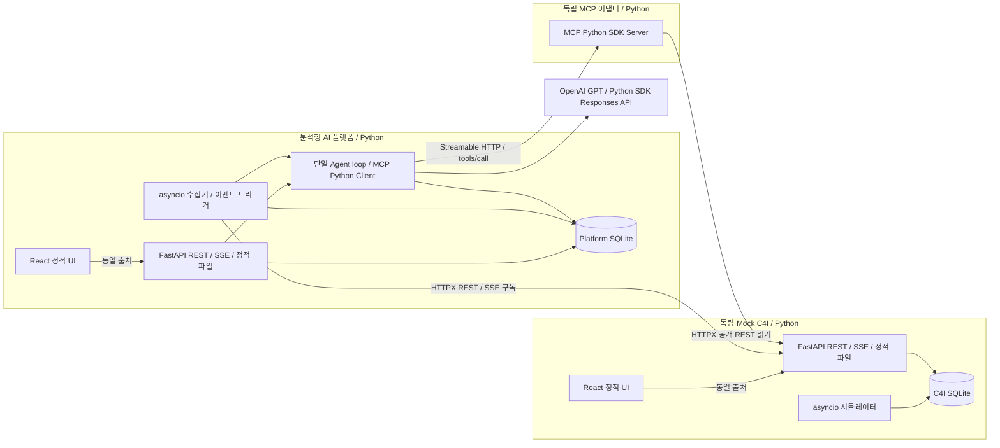
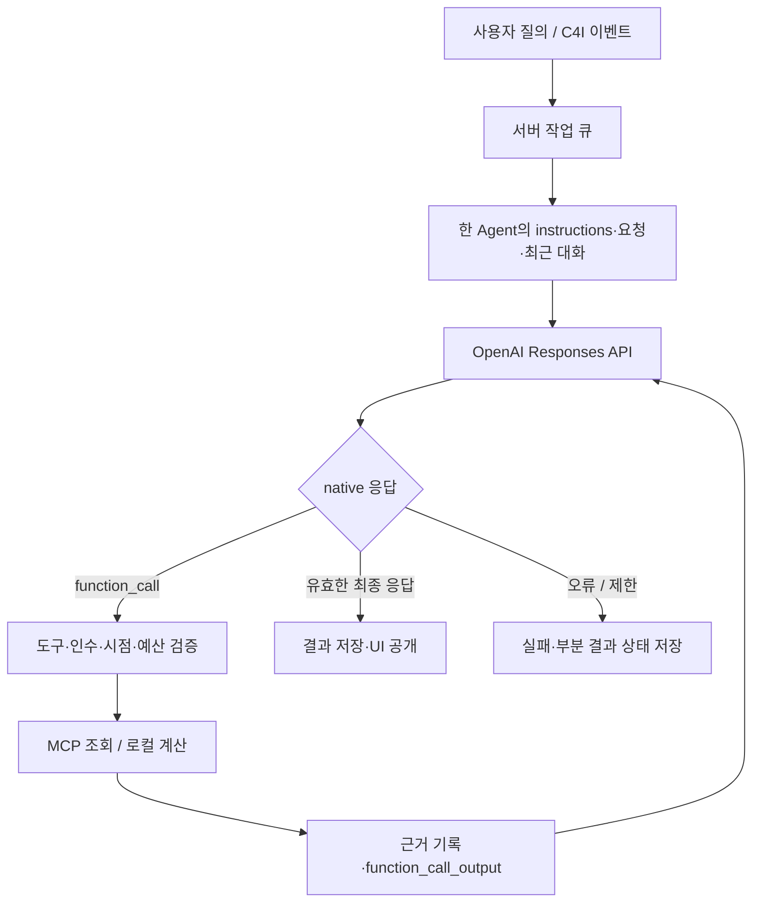

# 아키텍처: Agentic Battlefield Intelligence Platform

- 문서 상태: v0.6 S8 — 이종 C4I·Semantic 실행 경계 (2026-10-16)
- 작성일: 2026-10-15
- 기준: [PRD](./PRD.md), [UI 가이드](./UI_GUIDE.md)
- Agent 상세: [단일 Agent 설계](./AGENT_DESIGN.md)
- SDD 단계: [STEP](./STEP.md)를 따른다. 고도화 검증은 IMPLEMENTATION_REPORT.md에 기록한다.

## v0.6 아키텍처 변경 — 우선 적용

이번 목표 구성·서비스 책임·시점·Graph 동기화·API·장애 정책은 **[SEMANTIC_ARCHITECTURE](./SEMANTIC_ARCHITECTURE.md)**가 기준이다. [ONTOLOGY_DESIGN](./ONTOLOGY_DESIGN.md)은 개념/매핑/동일성, [SEMANTIC_DEMO](./SEMANTIC_DEMO.md)는 비교 fixture·평가를 정의한다.

S8에서는 OFF의 원천 MCP/계산 경로에서 의미 매핑·조직 해소·ER helper를 제거했다. ON만 Semantic API/MCP의 버전 있는 해석·연결 근거를 추가 사용하며 플랫폼은 그 결과를 계산에 적용한다. source-runtime의 지도/시뮬레이션/안정 export 변환은 별도 경로이며 OFF 분석 근거로 제공하지 않는다. 기본은 무충돌 semantic-demo-v2이고 이전 DB/Graph/대화/평가를 보존한다. 다른 정책의 대화는 이어 쓰지 않는다.

| 기존 v0.4 | v0.6 목표 | 재사용 |
| --- | --- | --- |
| Mock C4I 1개 | 독립 Mock ATCIS + Mock KNCCS | Python FastAPI·SQLite·시뮬레이터·정적 UI·원천 snapshot/SSE |
| C4I MCP 1개 | ATCIS MCP + KNCCS MCP + Semantic MCP | 실제 HTTP MCP·typed 서버 계약·discovery/strict 변환 |
| 원천 snapshot 1개 | 원천별 snapshot 집합 + 안정 정보에 대응하는 Graph build | 불변 근거·run 고정·epoch 검증 |
| 원천 조회와 로컬 지리 도구 | 모드별 registry, Semantic scope/동일성 조회 | 단일 Agent·native loop·얇은 하네스 |
| 두 UI·Python 서비스 3개 | 원천 UI 2개 + 플랫폼 UI, 별도 의미 서비스/Builder/Neo4j | UI 시각 언어·지도·대화·방책 선택 |
| 원천/플랫폼 SQLite | 원천별/플랫폼 SQLite 유지 + 관계용 Neo4j | 원천 live 데이터의 소유권 유지 |

독립 제공·Python 경계·MCP 경유 조회·단일 Agent 원칙은 유지한다. Graph Builder만 공개 원천 API에서 안정 정보를 읽어 Graph를 작성한다. Semantic API는 공통 Python 서비스 계층으로 재사용하며 MCP는 해당 API의 읽기 어댑터다. Graph를 원천 live 상태의 새 master DB로 사용하지 않는다.

아래 1~14절은 **v0.4 기존 구현/회귀 기준**으로 보존한다. 단일 원천·3프로세스·고정 7개 도구·단일 snapshot 및 기존 미결 항목은 고도화 구성에 적용하지 않는다. 충돌 시 위 연결 문서의 v0.6 설계가 우선한다. 기존 동작 회귀와 전환 근거를 잃지 않기 위한 기록이다.

## 1. 핵심 원칙

1. **Mock C4I는 단독 제품 단위다.** 자체 UI, 서버, 시뮬레이터, 저장소를 가지며 분석 플랫폼·MCP Server·LLM 없이 실행 가능해야 한다. 이는 사용자가 명시한 확정 요구사항이다.
2. MCP Server는 C4I의 공개 API를 사용하는 별도 어댑터다. C4I 내부 모듈이나 DB를 직접 읽지 않는다.
3. 상황판 동기화와 Agent 조회는 별도 경로다. 상황판은 REST + SSE, Agent의 C4I 조회는 실제 MCP 연결을 사용한다.
4. 서버가 원천 상태와 분석 실행을 소유한다. 브라우저를 닫아도 시뮬레이션과 자동 분석은 계속된다.
5. 분석은 기준 시점이 고정된 데이터와 추적 가능한 도구 호출을 사용한다.
6. 방책 선택은 분석 플랫폼의 선택 기록이다. C4I 명령 전송으로 연결하지 않는다.
7. 프론트엔드 외 모든 실행 로직은 Python으로 구현한다. Mock C4I·MCP·API·Agent·시뮬레이션·지리 계산·작업 큐가 여기에 포함된다.
8. 실제 지리 지도에 아군·적군 모의 객체를 벡터 심벌로 표시하고 지리 좌표에서 이동시킨다. LLM Provider는 OpenAI GPT API를 사용한다.

독립 제공 원칙과 PRD에서 정한 매초 이동·단일 동적 분석 Agent·요청 시 세 방책 등은 요구사항이다. 이를 구현하기 위한 아래 스택·추가 수치·정책은 설계 제안이며 사용자 검토 후 확정한다. PRD의 미결 사항을 묵시적으로 확정하지 않는다.

## 2. 시스템 구성



화살표는 호출·구독의 시작 방향이다. SSE는 구독 연결로 수신한다. 프론트엔드는 브라우저에서 실행되는 정적 앱이며 별도 Node 백엔드를 구성하지 않는다.

### 실행 단위와 책임

| Python 실행 단위 | 기본 주소 제안 | 책임 |
| --- | --- | --- |
| mock-c4i | 127.0.0.1:4100 | FastAPI 자체 UI·REST·SSE·시뮬레이션·DB. 플랫폼·MCP·LLM 없이 실행 |
| c4i-mcp | 127.0.0.1:4200/mcp | 공식 MCP Python SDK의 독립 ASGI 서비스, C4I 공개 읽기 API만 사용 |
| platform-api | 127.0.0.1:4300 | FastAPI 분석 UI·API·SSE·수집기·큐·Agent loop·DB |

배포·데모의 기본은 Python 프로세스 세 개다. UI는 빌드 후 각 Python 서비스가 제공한다. 개발 시에만 Vite UI 서버를 선택적으로 실행한다(분석 UI :3000, C4I UI :3100). 개발 프록시는 Python API로 전달만 하며 도메인 로직을 두지 않는다.

상황 분석 Agent 하나가 상황 인지·변화 분석·위험 검토·방책 추천을 수행한다. 한 실행 안에서 모델을 여러 번 호출할 수 있으나 모두 같은 Agent loop다.

## 3. 기술 스택과 언어 경계

**확정 원칙: 프론트엔드 외에는 Python.** 아래 라이브러리·버전 선택은 이 원칙을 구현하는 제안이다.

| 영역 | 제안 | 책임 |
| --- | --- | --- |
| 백엔드 언어·관리 | Python 3.12+·타입 힌트·uv workspace·pyproject.toml·uv.lock | Python 서비스와 공통 패키지 관리 |
| API·정적 파일 | FastAPI + Uvicorn | C4I·플랫폼 REST/SSE와 빌드된 UI 제공 |
| 비동기 실행 | asyncio + HTTPX | 시뮬레이션·수집·Agent loop·비차단 HTTP 호출 |
| MCP | 공식 MCP Python SDK, Streamable HTTP | 독립 서버·클라이언트. SDK 내 서버 헬퍼 사용, 별도 Agent 프레임워크 없음 |
| 데이터 계약 | Pydantic + OpenAPI / JSON Schema | 서버 모델·입출력·Tool 인수·분석 결과 검증 |
| 저장소 | 서비스별 SQLite + aiosqlite | 영속 이벤트·작업 큐·분석·대화·선택 |
| LLM | OpenAI Python SDK의 비동기 클라이언트 + Responses API | native function calling과 구조화 결과 |
| Agent 실행 | Python 단일 Agent loop + 최소 하네스 | 도구 검증·관찰·종료·실행 제한 |
| 지리 계산 | pyproj.Geod, WGS84 타원체 | 원천 이동·거리/방위·표시 벡터 끝점 계산 |
| 프론트엔드 | React + TypeScript strict + Vite, CSS variables / Tailwind CSS | 두 SPA·패널·대화·지도 렌더링 |
| 지도 렌더러 | 브라우저 MapLibre GL JS + GeoJSON | 지리 배경·심벌·서버가 계산한 벡터/궤적 표시 |
| 백엔드 검증 | pytest·pytest-asyncio·HTTPX·Ruff·mypy | Python 도메인·비동기 API·loop·정적 검사 |
| UI 검증 | 프론트엔드 컴포넌트 테스트·Playwright Python E2E | UI 상호작용·두 시스템 통합 데모 |

정확한 Python·의존성 버전은 구현 준비 시 SDK 호환성을 확인하고 uv.lock으로 고정한다. 프론트엔드는 frontend/package.json과 별도 npm lockfile로 관리한다. Node/npm은 프론트엔드 빌드·개발 도구에 한정한다.

LLM Provider는 OpenAI로 확정하며 GPT 모델 ID는 설정으로 선택한다. 초기 지도 타일은 OpenFreeMap의 OpenStreetMap 기반 스타일을 후보로 두고 출처·URL을 교체 가능하게 한다.

## 4. 저장소·계약·배포 경계

아래는 구현 단계에서 생성할 구조다. 이번 Design 단계에서 패키지·서버를 실제 생성하지 않는다.

```text
pyproject.toml                       # uv workspace·공통 Python 검사 설정
uv.lock
services/
  mock-c4i/
    pyproject.toml
    src/mock_c4i/
      app.py                         # FastAPI·lifespan·정적 UI
      simulation.py                  # 원천 이동·tick
      routes/                        # REST·SSE·자체 제어
      repositories/                  # C4I SQLite
      scenarios/                     # 초기 모의 데이터
      web_static/                    # 자체 UI 빌드 산출물, 패키지 포함
    tests/
    README.md                        # 단독 설치·빌드·실행·공개 API
  c4i-mcp/
    pyproject.toml
    src/c4i_mcp/                     # MCP 서버·HTTPX C4I 읽기 어댑터
    tests/
  platform-api/
    pyproject.toml
    src/platform_api/
      app.py                         # FastAPI·lifespan·정적 UI
      routes/
      ingestion/                     # SSE 수집·원천 커서·트리거
      agent/                         # agent.py·loop.py·tools.py·conversation.py
      providers/                     # OpenAI Python SDK 어댑터
      mcp/                           # MCP Python Client
      repositories/                  # Platform SQLite
      workers/                       # SQLite 영속 큐 소비
      web_static/                    # 분석 UI 빌드 산출물
    tests/
packages/
  c4i-contracts/src/c4i_contracts/    # 공개 Pydantic 계약
  platform-contracts/src/platform_contracts/
  geo/src/battlefield_geo/           # Python 지리 계산·공통 단위
frontend/
  package.json                       # UI 전용 npm workspace
  package-lock.json
  apps/mock-c4i/                     # React·Vite C4I UI
  apps/platform-web/                 # React·Vite 분석 UI
  packages/map-ui/                   # UI 전용 MapLibre·심벌·벡터 레이어
  packages/ui/                       # 선택적 시각 컴포넌트
  generated/                        # OpenAPI/JSON Schema에서 생성한 TS 타입
scripts/                             # Python 빌드 보조·계약 export
schemas/                             # Python에서 export한 공개 계약 산출물
tests/                               # Python 통합·Playwright Python E2E
var/                                 # 로컬 DB·로그, Git 제외
```

- Python Pydantic 모델이 계약의 원본이다. Python 필드는 snake_case를 쓰고 공개 JSON은 기존 camelCase alias를 유지한다. JSON Schema·OpenAPI에서 UI용 TypeScript 타입을 생성해 별도 수작업 계약과의 드리프트를 막는다.
- MCP Tool 스키마와 OpenAI strict 스키마는 해당 프로토콜의 지원 범위에 맞게 검증한다. Pydantic export를 무검증으로 그대로 전달하지 않는다.
- 공통 Python 패키지는 빌드된 wheel 또는 명시적 배포 의존성으로 제공한다. 배포물이 workspace 경로·editable 링크를 요구하면 독립 제공을 충족하지 못한다.
- services/와 packages/의 각 Python workspace member는 자체 pyproject.toml을 가진다. C4I 배포 시 필요한 공통 Python wheel도 함께 제공하거나 설치 가능한 패키지 의존성으로 명시한다. platform-api 패키지를 C4I 실행 의존성에 넣지 않는다.
- C4I 배포물에는 자체 UI의 정적 빌드·시나리오를 포함한다. 배포 전 UI 빌드는 필요하지만 최종 사용자 실행에는 Node/npm·플랫폼·MCP·LLM이 필요 없다.
- Python 서비스는 C4I DB와 내부 모듈을 공유하지 않고 공개 HTTP 계약만 사용한다. 공통 계약·지리 계산 패키지는 순수 Python 라이브러리로 공유 가능하다.
- API·SSE·원천 시뮬레이션·Agent loop·작업 큐·지리 계산을 TypeScript 서버나 프론트엔드에 구현하지 않는다. UI에서만 선택·뷰 상태·표시용 보간·지도 투영을 처리한다.

## 5. Mock C4I 도메인과 공개 계약

### 원천 상태

| 모델 | 주요 필드 |
| --- | --- |
| Scenario metadata | scenarioId, version, name, bounds, initialBounds, zones{id,name,domain,bounds}, synthetic |
| Entity | entityId, kind, label, affiliation, availability, availabilityReason?, subtype?, unitId?, zoneId?, maintenanceStatus, observedAt?, source?, position{longitude,latitude}, velocity{eastMps,northMps}, status, revision, updatedAt |
| Snapshot | snapshotId, scenarioId, scenario(metadata), epochId, revision, simulationTime, running, sourceTime, entities |
| C4IEvent | eventId, epochId, sequence, type, entityId?, revision, snapshotId, occurredAt, payload |

- 원천 좌표는 WGS84 경도·위도(도)로 저장한다. GeoJSON·지도 전달은 `[longitude, latitude]` 순서다. 경도 [-180,180], 위도 [-90,90]와 렌더러의 표시 가능 범위를 검증한다.
- Entity 공개 표현에는 서버가 계산한 displayVector{horizonSeconds,endPosition}를 포함할 수 있다. 이는 position·velocity에서 파생된 표시 정보이며 원천 위치를 대체하지 않는다.
- affiliation은 friendly(아군), hostile(적군)를 필수 지원한다. 미분류 unknown은 방어적 기본값으로 제안한다. 소속과 운용 상태를 분리하며 초기 status는 active / inactive / unknown을 제안한다. 이동 여부는 속도에서 파생하고 AI 위험 평가는 별도 분석 결과다.
- kind는 이름과 별개인 유형 코드로 tank(탱크), naval_vessel(함정), armored_vehicle(장갑차), support_vehicle(지원 차량), uav(무인기), unknown(미분류)을 지원한다. 문자열 이름 검색으로 유형을 추측하지 않는다. maintenanceStatus는 serviceable/maintenance/unknown이며 가용성·운용 상태와 독립적이다. 추가 속성의 기존 데이터 기본값은 null 또는 unknown이다. 기존 snapshot은 변경하지 않고 새 관측부터 추가 필드를 기록한다.
- availability는 available(가용) / unavailable(가용 불가) / unknown(미확인)으로 제안한다. Mock C4I가 명시적으로 제공하는 모의 상태이며 availabilityReason으로 사유를 덧붙일 수 있다. active·이동 중·아군이라는 이유만으로 가용을 추정하지 않는다.
- 소속·유형·운용 상태·가용 상태는 독립 필드다. inactive의 이동 정지 규칙은 가용성 판정이 아니며, 가용 불가 객체도 active와 속도 설정에 따라 움직일 수 있다.
- 초기 count의 단위는 모의 장비 객체 1개다. 하나의 Entity를 여러 대를 포함한 부대·편성으로 해석하거나 수량을 중복 합산하지 않는다.
- 이동 벡터는 해당 위치의 동·북 방향 속도 eastMps / northMps다. `speed = hypot(eastMps,northMps)`, `bearing = atan2(eastMps,northMps)`를 북쪽 0도·시계 방향의 [0,360)으로 정규화한다. 정지 시 방위는 미정으로 표시한다.
- C4I 서버가 매초 `distanceMeters = speed × 1s`와 bearing으로 다음 지리 위치를 계산한다. 경도·위도에 미터 값을 직접 더하지 않는다. Python pyproj.Geod(ellps="WGS84").fwd의 타원체 계산을 제안한다. 원천 이동 계산은 Python 서버가 소유한다.
- active 객체만 이동하며 inactive·속도 0은 위치를 유지한다. 초기 상태 의미와 전이는 시나리오 검토 후 확정한다. 브라우저는 원천 위치를 계산하지 않는다.
- 타이머 지연은 누적 시간을 기준으로 고정 간격을 따라잡되, 과도한 지연 시 시뮬레이션 지연 상태를 드러낸다. 실제 시각과 시뮬레이션 시각을 혼동하지 않는다.
- R7 기본 시나리오는 border-demo v1, 남북 접경의 서부·중부·동부·양쪽 연안에 합성 객체 120개다. zoneId의 시연 구역 또는 시나리오 bounds를 벗어나면 경계에 고정하고 속도를 0으로 한다. 시연 구역은 실제 접경선이 아니다. 실제 지형·항로 추종은 모사하지 않는다.
- 현재 상태와 과거 snapshot이 시나리오 메타데이터를 소유한다. 기본 설정을 바꾸어 재시작해도 기존 DB의 경계는 유지하며 초기화 때 설정된 새 시나리오·seed·epoch를 적용한다. metadata 없는 이전 snapshot은 해당 scenarioId의 메타데이터를 응답에 보완하되 원본 저장 기록은 바꾸지 않는다.
- 플랫폼의 이전 cursor에 metadata가 없으면 같은 snapshot을 다시 읽어 보완하고 그 cursor 이후 이벤트를 재생한다. 최신 snapshot으로 조용히 건너뛰어 상태 이벤트를 유실하지 않는다.

### MCP 도구 정의 소유권 (R6)

MCP 서버의 typed 함수·description이 도구 계약의 기준이다. 플랫폼 MCPClient는 tools/list의 이름·설명·inputSchema를 전체 페이지 수집하고, run별 ToolRunner는 이름 허용 목록을 적용한 뒤 native strict schema로 변환한다. C4I 설명·호출 모델은 플랫폼이나 공통 도메인 패키지에 복사하지 않는다. 원천 EntityFilter 같은 순수 도메인 계약은 C4I와 MCP에서 공유한다.

발견과 호출은 같은 run의 MCP 세션을 사용한다. run 사이에는 재발견하며 실행 중 정의는 고정한다. 플랫폼은 schema 검증·snapshot/epoch/sequence 정책·실행 예산·근거 발급을 담당한다. 내부 read_evidence·geo_measure는 플랫폼이 정의한다. 발견 실패 시 C4I capability를 노출하지 않고 한계를 기록한다. discovery 성공 후 schema 변환 실패는 fail closed로 처리한다.
- 한 tick의 객체 갱신, revision, snapshot, 이벤트를 한 트랜잭션으로 저장한 뒤 발행한다.
- 시간은 UTC ISO 8601로 저장하고 UI에서 KST로 표시한다. 시뮬레이션 시각은 별도 필드다.

### 지도와 벡터 렌더링

- 두 시스템 모두 실제 지리 배경과 같은 객체 계약을 사용한다. 임의 평면 상황도로 대체하는 안은 폐기한다.
- MapLibre는 원천 WGS84 GeoJSON을 받아 지도 투영을 처리한다. Point는 적아 심벌, LineString은 이동 벡터·지나온 궤적에 사용한다. 심벌·화살표는 SVG 원본을 sprite 이미지로 등록할 수 있으나 위치·선은 지도 레이어로 렌더링한다.
- 아군은 파란 직사각형, 적군은 붉은 마름모와 텍스트로 구분하는 PoC 심벌을 제안한다. 군 표준 심벌 전체 구현을 주장하지 않는다.
- 벡터 선은 현재 속도를 30초간 유지할 경우의 방향·거리로 표시하는 안을 제안한다. Python 서버가 derived displayVector{horizonSeconds,endPosition}를 계산해 snapshot·SSE·MCP의 객체 표현에 함께 제공하며 프론트엔드는 위치와 끝점으로 선만 구성한다. 이는 운동학적 표시이며 Agent 예측이나 실제 미래 위치가 아니다. 정지 객체는 선을 숨기고 0 m/s로 표시한다.
- 지도 회전 시 방향은 지도 기준으로 함께 회전한다. 선택 링·상태 표식은 적아 심벌과 구분한다. 원천 tick 사이 보간은 표시용이며 분석·이벤트 데이터로 저장하지 않는다.
- style·tile·sprite·glyph 요청의 네트워크 의존성을 각 앱에 설정한다. Mock C4I 단독 배포는 자체 지도 설정과 심벌 자산을 포함하고 플랫폼 서비스에 의존하지 않는다.
- 기본 온라인 배경 지도, attribution 유지. 배경 지도 장애는 별도 표시하고 좌표·목록·객체 레이어는 유지한다. 오프라인 타일 서버는 후속 범위이며 독립 제공은 오프라인 제공을 의미하지 않는다.

### REST / SSE 초안

| API | 용도 |
| --- | --- |
| GET /health | 프로세스 상태 |
| GET /api/v1/snapshot | 현재 상태와 SSE 이어받기용 마지막 sequence 반환 |
| GET /api/v1/snapshots/:snapshotId | 불변 시점 상태 조회 |
| GET /api/v1/entities?atSnapshot=... | 해당 시점 객체 목록 |
| GET /api/v1/entities/summary?atSnapshot=... | 같은 필터의 전체 일치 객체 수·유형/소속/가용 상태별 집계 |
| GET /api/v1/entities/:id?atSnapshot=... | 해당 시점 객체 상세 |
| GET /api/v1/changes?fromSnapshot=...&toSnapshot=... | 두 시점 간 변화 |
| GET /api/v1/events?epochId=...&after=...&limit=... | 이벤트 이력·페이지 조회 |
| GET /api/v1/stream?epochId=...&after=... | SSE 구독·재전송 |
| POST /api/v1/simulation/start, /pause, /reset | Mock C4I 운영 UI의 시뮬레이션 제어 |
| PATCH /api/v1/entities/:id | Mock C4I 운영 UI에서 이동 벡터·상태 변경 |

쓰기 API는 Mock C4I 운영 UI에서 사용한다. MCP에는 노출하지 않는다. 읽기 API와 제어 API를 권한 범위로 구분한다.

### 객체 필터·집계 계약

- 목록과 집계는 같은 Pydantic EntityFilter를 사용한다. affiliation, kind, availability, status, maintenanceStatus, unitId, bbox를 선택적으로 AND 조합하며 필터 미지정은 해당 속성의 전체 값이다. 목록은 limit·cursor를 별도로 지원한다.
- c4i_list_entities는 items, matchedCount, nextCursor, appliedFilter, snapshotId를 반환한다. matchedCount는 모든 페이지에 걸친 일치 수이며 items.length와 구분한다.
- 집계는 같은 snapshot·filter를 적용한 전체 집합에서 Python 서버가 계산한다. matchedCount, groups, appliedFilter, snapshotId, sourceTime, countUnit=entity를 반환하고 groupBy는 kind / affiliation / availability / status / maintenanceStatus / unitId / zoneId의 허용 조합만 받는다.
- 객체 이력 공개 API `GET /api/v1/entities/{entityId}/history`는 epochId·after·throughSequence·limit을 받아 원천 snapshot을 최대 limit개씩 스캔한다. items에는 해당 객체의 관측만 포함하고 nextAfter로 후속 페이지를 안내한다. MCP `c4i_list_entity_history`는 이 API만 호출하며 Agent는 고정 epoch·sequence 상한을 검증한다.
- 데이터 범위는 시나리오·원천에 등록된 관측 객체다. bbox가 있으면 해당 영역으로 제한한다. 적 탱크 집계는 전체 실제 적 전력이 아닌 해당 범위의 등록된 적 탱크 수다.
- 가용 미확인과 가용 불가를 구분하고, 가용 상태 필터를 지정하지 않으면 unknown도 포함한다. unknown을 0·가용·가용 불가로 바꾸지 않는다.
- /entities/summary 정적 경로는 /entities/:id 동적 경로보다 먼저 등록한다. API·MCP·UI가 같은 필터 의미와 서버 집계 기준을 사용한다.
- Mock C4I UI에서 가용 상태를 바꾸면 기존 entity.status_changed 이벤트에 changedFields와 before/after를 포함한다. 같은 tick·snapshot·revision에서 UI·목록·집계를 일관되게 갱신한다.

### 이벤트와 재연결

- 이벤트 후보: `positions.updated`, `entity.status_changed`, `scenario.reset`. 초기 자동 분석 트리거는 `entity.status_changed`만 제안한다.
- SSE id는 `epochId:sequence`다. snapshot 조회 후 해당 sequence 이후를 재전송받아 초기 조회·구독 사이의 유실을 막는다.
- 접속 중에는 Last-Event-ID를 사용하고 최초·프로세스 재시작에는 저장된 커서를 전달한다. 중복 이벤트는 eventId로 제거한다.
- C4I는 snapshot·이벤트를 영속 보관한다. 초기 제안은 명시적 이력 정리 전까지 보관하며 용량은 검증 규모와 시나리오 세션 수로 제한한다. 용량 한도에서는 명시적 정리를 안내하고 과거 근거를 조용히 삭제하지 않는다.
- reset은 새 epoch를 생성한다. 이전 epoch의 이력은 명시적 정리 전까지 읽기 가능하게 유지한다.
- 알 수 없는 커서·정리된 이력은 명시적 오류를 반환한다. 조용히 최신 상태만 보내지 않는다.

## 6. 상황판 동기화 경로

1. Platform 수집기가 C4I의 현재 snapshot을 받아 로컬 projection과 커서를 저장한다.
2. C4I SSE를 구독하고 원천 이벤트를 로컬에 저장한다. 이벤트 저장·projection 반영·자동 작업 생성·커서 갱신을 같은 트랜잭션으로 처리한다.
3. Platform UI는 Platform API의 snapshot과 SSE를 통해 원천 데이터의 복제본을 표시한다.
4. 연결 단절 시 마지막 상태를 유지하고 갱신 지연을 표시한다. 재연결은 마지막 커서 이후를 재생한다.
5. 커서가 만료되면 현재 snapshot으로 재동기화하고 이력 공백을 표시한다. 공백에 있던 자동 분석을 수행했다고 표시하지 않는다.

Python Platform API가 UI에 snapshot + cursor와 재생 가능한 SSE를 직접 제공한다. SSE heartbeat·연결 상태와 원천 갱신 시각은 별도다. SSE는 async 응답 스트림으로 제공하고 연결 종료 시 구독을 정리한다. 개발용 UI 프록시도 스트림을 버퍼링하지 않는다.

C4I→플랫폼 반영 2초 이내를 로컬 데모의 초기 목표로 제안한다. 측정은 상태 변경 커밋부터 UI 반영까지이며 자동 분석 완료 시간과 분리한다.

## 7. MCP 조회 경로와 도구

MCP Server는 `/mcp`의 Streamable HTTP를 제공한다. 일반 SSE 이벤트 피드와 MCP 전송은 서로 다른 프로토콜·엔드포인트다. 공식 MCP Python SDK를 사용해 초기화, 버전 협상, `tools/list`, `tools/call`을 수행한다.

| Tool 초안 | 입력 | C4I 읽기 API 연결 |
| --- | --- | --- |
| c4i_get_snapshot | snapshotId? | 현재 또는 지정 snapshot 조회 |
| c4i_list_entities | snapshotId, filter?, limit?, cursor? | 유형·소속·가용 상태 필터와 전체 일치 수를 포함한 목록 |
| c4i_summarize_entities | snapshotId, filter?, groupBy? | C4I 공개 집계 API로 전체 일치 수·분포 조회 |
| c4i_get_entity | snapshotId, entityId | 시점 고정 객체 상세 |
| c4i_get_changes | fromSnapshotId, toSnapshotId | 두 시점 변화 조회 |
| c4i_list_events | epochId, after, throughSequence, limit | 상한이 고정된 이벤트 조회 |

단일 Agent에는 위 MCP 읽기 Tool과 로컬 read_evidence·geo_measure를 제공한다. native 함수 정의와 실행 검증은 [Agent 도구 계약](./AGENT_DESIGN.md#4-도구-목록과-실행-경계)을 따른다. 계획·위임·완료 제어 Tool은 두지 않는다.

- Tool 출력은 검증된 구조화 데이터와 근거 메타데이터를 포함한다. schemaVersion, snapshotId, revision, sourceTime, queriedAt, 원천 식별자를 유지한다.
- MCP Server는 데이터를 LLM으로 분석하지 않으며 별도 원천 상태를 만들지 않는다.
- Agent Runtime의 C4I 조회 어댑터는 MCP Client뿐이다. projection·C4I REST·C4I DB로 조회 실패를 우회하지 않는다.
- C4I 조회가 필요한 실행은 초기 snapshot 획득도 실제 MCP 호출로 수행한다. 이벤트 트리거는 이벤트에 연결된 snapshotId로 조회한다. C4I 정보가 필요 없는 직접 답변은 snapshot 조회를 요구하지 않는다.
- 후속 호출에는 실행에 고정된 snapshotId와 이벤트 상한을 Runtime이 검증·주입한다. LLM이 임의의 최신 시점을 섞지 못하게 한다.
- Tool 호출 오류와 빈 조회 결과를 구분한다. snapshot이 없으면 현재 시점 데이터로 바꿔치기하지 않는다.
- 서버 로그와 플랫폼 호출 기록에는 runId, iteration, toolCallId, MCP 요청 ID를 연결한다. 이 상관관계는 앱 메타데이터이며 표준 MCP ID를 대체하지 않는다.

## 8. 단일 동적 분석 Agent

상세는 [AGENT_DESIGN.md](./AGENT_DESIGN.md)를 따른다. 상황 인지·위험 분석·방책 추천은 한 Agent의 능력이다. 요청별 고정 파이프라인이나 별도 전문 Agent를 실행하지 않는다.



### 동적 호출과 최소 하네스

- OpenAI tools와 tool_choice=auto로 도구 호출 여부·종류·순서를 모델이 선택한다. JSON 행동 명령이나 본문 파싱으로 Tool 호출을 흉내 내지 않는다.
- C4I 함수는 실제 로컬 MCP Client에 연결한다. OpenAI의 native 함수 호출과 MCP 프로토콜을 구분한다.
- 필요한 조회가 있으면 같은 Agent 컨텍스트에서 호출·관찰을 반복하고, 추가 조회가 필요 없으면 최종 응답으로 종료한다. 도구 없는 직접 답변도 가능하다.
- agent.py, loop.py, tools.py, conversation.py 정도로 구성한다. 별도 Agent Registry·계획 버전·DAG·위임·ContextPacket·Artifact Store는 도입하지 않는다.
- 함수 인수는 strict JSON Schema, 최종 결과는 Structured Outputs와 Pydantic 서버 검증을 사용한다. parallel_tool_calls=false를 초기 제안으로 둔다.
- 정보 부족 시 추가 조회 또는 명확화 답변으로 처리한다. 모델 내부 사고 과정을 계획 이력으로 표시하지 않는다.

### 최소 멀티턴

- conversationId 아래 질문·답변·runId·선택한 방책을 저장한다. 모델 입력은 최근 완료 6개 턴, 최대 UTF-8 8,000바이트다. 선택한 방책의 ID·내용도 맥락에 포함한다. 대화 복원 API는 전역 실행 이력 200개 제한과 별도로 전체 턴을 시간순 반환한다. UI는 현재 대화 ID를 sessionStorage에 저장하고 방책 비교 대상 runId를 활성 run과 분리한다.
- 새 질문은 새 run이다. 이전 대화는 지시 대상 이해에 사용하고 최신 C4I 사실은 새 MCP 조회로 확보한다. 장기 메모리·벡터 DB·별도 요약 Agent는 만들지 않는다.
- 현재 run의 미처리 Tool 호출·응답 쌍은 자르지 않는다. 같은 대화에는 사용자 실행 하나만 허용한다.
- 자동 이벤트는 독립 run으로 처리하며 사용자 대화에 자동 삽입하지 않는다.

### 큐·시점·실패 정책

- 서버 수집기가 자동 작업을 생성하고 `(sourceId, eventId, analysisType)` unique 제약으로 중복 이벤트 실행을 막는다. 브라우저는 트리거 소유자가 아니다.
- 초기 실행 동시성 1·FIFO를 유지한다. 매초 위치 갱신은 분석 작업을 생성하지 않는다.
- 일반 질의는 첫 C4I 조회 시 MCP로 snapshot을 확보하고 이후 시점을 유지한다. 이벤트는 원인 snapshot을 사용한다. 직접 답변은 snapshot이 없을 수 있다.
- 변화 기준은 명시된 비교 snapshot 또는 원천이 제공하는 직전 snapshot으로 기록한다. 비교 데이터가 없으면 한계를 표시한다.
- 초기 상한은 모델 응답 12회·Tool 실행 20회·120초로 제안하며 재시도·출력 교정도 포함한다. 무진전 반복·timeout·거절·불완전 응답을 구분한다.
- 오류를 같은 loop에 반환해 제한적으로 교정할 수 있다. 필수 근거 실패를 성공 결과로 숨기거나 직접 REST로 우회하지 않는다.
- 프로세스 재시작 시 대기 작업은 재개하고 실행 중 작업은 interrupted로 남긴다. 자동 이어실행·checkpoint 복원은 만들지 않고 재시도는 새 attempt로 기록한다.

## 9. 분석 데이터와 저장소

| Platform 테이블 / 모델 | 책임 |
| --- | --- |
| source_events, source_cursors | 원천 이벤트·수집 커서·중복 방지 |
| entity_projection | 화면 표시용 최신 상태. Agent 근거 조회에 사용 금지 |
| analysis_jobs, analysis_attempts | 큐와 재시도 단위 |
| conversations, conversation_turns | 사용자 질문·완료 답변·run 참조의 짧은 대화 이력 |
| analysis_runs | conversationId?·원인·기준 snapshot·모델 설정·진행 상태·최종 결과 |
| loop_iterations | 같은 Agent의 모델 호출·관찰·시각·오류·사용량 |
| tool_calls, evidence | 실제 호출 입력·응답·snapshot·원천 식별자·결과의 근거 참조 |
| course_sets, courses | 검증된 방책 세트와 세 개의 방책 |
| course_selections | runId·courseSetId별 단일 선택·변경 시각 |
| platform_events | UI 재연결용 이벤트 이력 |

- Agent 최종 결과는 outcome, answer, findings, evidenceIds, limitations, courses를 포함한다. courses는 null 또는 유효한 방책 세 개다. 존재하지 않는 근거 ID는 서버 검증에서 거부한다.
- 방책은 id, title, summary, evidenceIds, expectedEffects, risksAndConstraints로 검증한다. 정확히 세 개와 고유 ID를 요구한다.
- 세 방책이 모두 유효할 때 하나의 courseSet으로 원자적으로 공개한다. 부분 생성물을 완성된 비교 대상으로 노출하지 않는다.
- 선택 API는 완료된 해당 courseSet의 방책인지 검증한다. DB unique 제약과 transaction으로 단일 선택을 보장한다.
- 선택 변경은 허용하는 방향을 제안한다. 새 실행에 이전 선택을 복사하지 않는다. 최종 정책은 사용자 검토 대상이다.
- C4I와 Platform은 별도 SQLite를 사용한다. Platform 프로세스가 자기 DB의 유일한 쓰기 소유자다.
- Python repository는 쓰기 트랜잭션을 직렬화하여 asyncio task 사이에서 트랜잭션이 섞이지 않게 한다. 외부 HTTP·LLM 호출을 DB 쓰기 트랜잭션 안에서 기다리지 않는다.
- 응답 크기·목록 개수·이력 조회 범위를 제한하고 페이지 조회한다. Tool 응답 원문은 서버에 보관하고 UI에는 요약부터 표시한다.

## 10. Platform API와 UI 상태

| API 초안 | 역할 |
| --- | --- |
| GET /api/v1/situation | 지도용 projection·커서·원천 연결 상태 |
| GET /api/v1/stream | 상황 변경·실행 단계·새 분석 알림 SSE |
| POST /api/v1/analyses | 질의와 선택적 conversationId 제출, 202 + runId·conversationId 반환 |
| GET /api/v1/conversations/:id | 대화의 질문·답변·run 이력 조회 |
| GET /api/v1/analyses, /analyses/:id | 이력·결과·근거·실행 단계 조회 |
| PUT /api/v1/analyses/:id/selection | courseSetId, courseId 기반 단일 선택 저장 |
| GET /health, /ready | 프로세스 상태 및 의존 서비스 상태 |

- FastAPI 라우트가 API·SSE를 직접 제공하고 React 정적 UI를 같은 출처로 제공한다. /api·/health·/ready·정적 자산 라우트를 SPA fallback보다 먼저 등록해 API 오류가 HTML로 가려지지 않게 한다.
- 분석 브라우저는 C4I·MCP·LLM에 직접 접속하지 않는다. Mock C4I 브라우저는 자기 C4I 서버에만 접속한다.
- 서버 상태는 API snapshot + SSE reducer로 관리한다. 현재 객체 선택·지도 시점·패널 폭·탭은 클라이언트 뷰 상태다.
- 분석 결과는 runId에 고정한다. 새 이벤트 수신으로 사용자가 읽는 분석을 교체하지 않는다.
- C4I 수집 연결, MCP 연결, Agent 실행 상태를 각각 표시한다. 하나의 초록색 연결 표시로 전체 성공을 표현하지 않는다.

## 11. 실행·제공 방식과 장애 격리

### 독립 제공 프로파일

- **C4I 단독:** mock-c4i만 빌드·실행. 자체 UI에서 이동·정지·상태 변경, 공개 REST·SSE를 확인한다. LLM 키가 없어도 동작한다.
- **C4I + MCP:** 별도 c4i-mcp를 실행하고 범용 MCP Client로 도구 목록과 실제 조회를 확인한다. 분석 플랫폼은 필요 없다.
- **통합 데모:** Python 서비스 세 개를 실행하고 각 서버가 제공하는 두 UI를 별도 탭으로 연다. C4I 제어와 분석형 플랫폼 관찰을 나란히 시연한다.

각 프로파일은 개별 실행 스크립트와 환경변수 예시를 제공한다. 구체 명령은 구현 시 README에 기록한다. C4I 단독 실행이 전체 플랫폼 실행 스크립트에 의존해서는 안 된다.

### 설정과 장애

- C4I: bind host, port, DB 경로, scenario 경로, 읽기·제어 토큰.
- MCP: C4I_BASE_URL, C4I 읽기 토큰, MCP 인증 토큰, port.
- Platform API: C4I_BASE_URL, 읽기 토큰, MCP_SERVER_URL, MCP 토큰, OPENAI_API_KEY, OPENAI_MODEL, DB 경로.
- 프론트엔드: 배포 시 동일 출처 /api를 사용한다. 개발 시에만 Vite 프록시 대상 주소를 설정한다. 내부 토큰과 LLM 키를 번들·VITE_* 환경변수에 넣지 않는다.
- 두 지도 UI: MAP_STYLE_URL과 공개가 허용된 지도 설정. 타일 공급자 인증이 필요한 경우 별도 서버 프록시 또는 제한된 공개 토큰 정책을 정한다.
- MCP 종료: 상황판은 계속 갱신되며 분석 조회는 실패한다. 직접 REST로 우회하지 않는다.
- Platform 종료: C4I 시뮬레이터와 자체 UI는 계속 동작한다.
- C4I 종료: 두 조회 경로가 각각 오류·지연을 표시한다. 기존 데이터와 결과는 기준 시각과 함께 유지한다.
- LLM 장애: 상황판과 MCP 조회 자체는 유지하고 분석 실행에 오류를 표시한다.
- 기본은 localhost 바인딩이다. HTTP MCP는 Origin 검증과 토큰 인증을 적용하고, 제어 권한은 Agent에 제공하지 않는다.
- 이번 배포는 단일 호스트의 Python 장기 실행 프로세스가 기준이다. C4I·Platform API는 Uvicorn worker 1개로 실행하고 시뮬레이터·수집기·큐 소비는 lifespan에서 시작·종료하는 asyncio task로 소유한다. HTTP 요청별 BackgroundTasks에 장기 워커를 맡기지 않는다.
- 자동 reload·여러 worker에서 중복 시뮬레이션·이벤트 소비가 생기지 않게 한다. 개발 reload 시 task를 취소·정리하고 interrupted 정책을 따른다. 서버리스·다중 replica 운영은 후속 설계 대상이다.

## 12. 검증 계획과 요구사항 추적

구현 단계에서 AGENTS.md의 TDD 원칙에 따라 아래 동작을 검증하는 테스트를 먼저 작성한다.

| 연결 | 의미 있는 검증 |
| --- | --- |
| 독립 제공 | 배포물을 별도 폴더에서 실행하고 Platform·MCP·LLM 없이 UI·이동·API·SSE 확인 |
| FR-01 / FR-02 | 고정 시계로 벡터 이동·단위·경계 정지 검증, 두 화면의 ID·revision 대조 |
| 지리 지도·적아 | 경위도 순서·방위 0/90/180/270·정지·GeoJSON 검증, 지도 회전·줌 후 적아 심벌·벡터 방향 유지 |
| FR-03 | 초기 snapshot과 구독 사이 이벤트, 중복·재접속·reset·이력 공백 검증 |
| FR-04 | 실제 로컬 MCP Client→Server→C4I API 호출 검증. MCP 중단 시 우회 조회 없음 |
| FR-05 | 상태 변경 이벤트가 작업 1개 생성, 재전송 중복 없음, 브라우저 없이 자동 실행 |
| FR-06 / FR-07 | native 호출·call_id 연결·관찰 후 추가 조회·최종 응답·근거 시점 유지 검증 |
| 최소 하네스·멀티턴 | 직접 답변·미허가 Tool 거부·오류 교정·loop 제한·최근 대화·새 run 재조회 검증 |
| FR-08 | 방책 정확히 3개·고유 ID 검증, 세 열 UI·단일 선택·저장 실패 처리 |
| 장애 격리 | 플랫폼 종료 중 C4I 이동 지속, MCP 종료 중 플랫폼 지도 갱신 지속 |
| Python 배포·계약 | Node 미설치 환경에서 C4I wheel·정적 UI 실행, 필요한 공통 패키지만 설치, Pydantic→공개 JSON→UI 생성 타입 일치 확인 |
| FR-09 유형·가용성·집계 | 아군 가용 탱크 필터·적 탱크 전체 수·미확인 상태·페이지 수와 전체 수 구분·상태 변경 후 같은 snapshot의 목록/집계 일치 |

CI에서는 결정론적 LLM 테스트 어댑터를 사용할 수 있으나 최종 데모는 실제 LLM과 실제 MCP 연결을 사용한다. Tool 호출·응답·근거를 사전 작성한 응답으로 대체한 결과는 MCP 통합 성공으로 보지 않는다.

## 13. 남은 설계 결정

- 실제 지리 지도·적아 객체·탱크/함정 유형·가용 조회·적 탱크 수 집계는 요구사항으로 반영. 지도 공급자·초기 지역·추가 유형·상태/가용성 전이의 상세 확정.
- 제안한 20개 객체·30분 규모와 2초 반영 목표의 확정. 매초 이동 반영은 PRD 요구사항으로 유지한다.
- 자동 분석 이벤트 범위, 변화 비교 기준, 실행 시간·호출 예산.
- OpenAI GPT API 사용은 확정. 구체 모델·데이터 전송 조건과 단일 Agent 평가용 모의 질의·이벤트 확정.
- 이력 정리·보관 기간, 방책 선택 변경 정책, 패키지 정확 버전.

독립 제공·공개 API 경계·실제 MCP 조회는 본 구조의 핵심이다. 위 미결 사항은 이 경계를 유지하며 후속 Design에서 조정한다.

## 14. 공식 참고 자료

- [MCP 전송 명세 2025-11-25](https://modelcontextprotocol.io/specification/2025-11-25/basic/transports): Streamable HTTP와 초기화된 연결의 전송 규칙 확인에 사용. 이 버전을 설계 참조로 두며 SDK의 지원 버전은 구현 시 검증한다.
- [MCP Tools 명세](https://modelcontextprotocol.io/specification/2025-11-25/server/tools): 도구 검색·호출·입출력 계약 참고.
- [FastAPI lifespan](https://fastapi.tiangolo.com/advanced/events/): Python 서비스의 시작·종료 수명 관리 참고.
- [공식 MCP Python SDK](https://github.com/modelcontextprotocol/python-sdk), [uv workspace](https://docs.astral.sh/uv/concepts/projects/workspaces/): Python 프로토콜 구현·패키지 관리 참고.
- [OpenAI Function calling](https://developers.openai.com/api/docs/guides/function-calling), [Structured Outputs](https://developers.openai.com/api/docs/guides/structured-outputs): 앱 소유 loop와 구조화 출력 참고.
- [MapLibre GeoJSONSource](https://maplibre.org/maplibre-gl-js/docs/API/classes/GeoJSONSource/), [pyproj.Geod](https://pyproj4.github.io/pyproj/stable/api/geod.html): 지도 갱신·WGS84 지리 계산 참고.
- [OpenFreeMap Quick Start](https://openfreemap.org/quick_start/): 초기 지도 공급자 후보·스타일 설정 참고.


