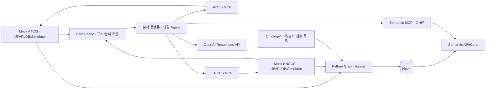

# ARCHITECTURE

현재 기준: c2-domain-demo-v3, Ontology 3.0.0 / adapter 3.0.2. 기술 설계의 단일 기준이다. 요구사항·데모는 [PRD](PRD.md), 화면은 [UI_GUIDE](UI_GUIDE.md), 실측·한계는 [IMPLEMENTATION_STATUS](IMPLEMENTATION_STATUS.md), 선택 이유는 [ADR](ADR.md)에 둔다.

## 1. 구성과 책임



화살표는 정보 흐름이다. Builder/Fabric은 원천 공개 API를 조회한다. 제품 영역은 두 원천, Data Fabric, 분석 플랫폼의 네 개다. 각 원천은 독립 UI·Python 서버·SQLite·시뮬레이터를 가지며 상대 체계·플랫폼·MCP·Neo4j·LLM·Node 없이 실행한다. 합성 데이터·가상 스키마만 사용한다. 프론트엔드 외 실행 로직은 Python이다.

| 모듈 | 기본 주소 | 책임 |
| --- | --- | --- |
| mock_atcis.app | :4100 | 지상 native API/UI/시뮬레이터/DB |
| mock_knccs.app | :4110 | 해상 native API/UI/시뮬레이터/DB |
| atcis_mcp.server | :4200/mcp | ATCIS 공개 API 읽기 어댑터 |
| knccs_mcp.server | :4210/mcp | KNCCS 공개 API 읽기 어댑터 |
| platform_api.app | :4300 | 분석 UI·대화·큐·Agent·비교 |
| semantic_api.app | :4400 | Fabric API/읽기 콘솔·Semantic API |
| semantic_mcp.server | :4410/mcp | Semantic API의 읽기 도구 |
| graph_builder.app | :4420 | 내부 Graph build 관리 API |
| Neo4j Docker | Bolt :7687 / Browser :7474 | 안정 의미·관계·근거 저장 |

Python3.12/uv workspace, FastAPI/Uvicorn, HTTPX/asyncio, Pydantic, MCP 공식 Python SDK(Streamable HTTP), OpenAI Python SDK, Neo4j 공식 Python driver를 사용한다. React/TypeScript/Vite UI는 배포 전에 빌드해 각 Python 서버가 제공한다. Node는 빌드 도구다. 별도 gateway·브로커·Agent 프레임워크는 없다.

구현 위치:

- services/mock-atcis, services/mock-knccs: native 모델·SQL·API·시뮬레이터.
- packages/source-runtime: ledger.py의 인증/snapshot/event/저장 공통 기능, native_mcp.py의 공개 HTTP 읽기 어댑터. 공통 runtime이 도메인 의미를 소유하지 않는다.
- packages/ontology: 명시적 Python adapter, domain_rules.json, 검토 문서 version/hash 목록 domain_documents.json.
- services/graph-builder, packages/semantic-core, services/semantic-api, services/semantic-mcp: 생성·저장/탐색·API·MCP 경계.
- services/platform-api: v3 domain_runtime.py, 다원천 multi_runtime.py, Agent·근거·대화·로그.
- frontend: 원천2/Fabric/플랫폼/legacy 정적 앱. scripts/build_ui.py가 Python package 정적 경로에 복사한다.

## 2. 이종 원천 계약

| 구분 | ATCIS | KNCCS |
| --- | --- | --- |
| 자원 | units/equipment/relations/reports/journal/activities/documents | formations/own-forces/contacts/tracks/associations/relations/messages/delivery-events/documents |
| 목록 | items,total,nextOffset | header,payload; header의 continuation |
| 페이지 | offset/limit, 최대100 | resource/snapshot/filter/limit에 고정한 opaque cursor |
| 장비 | equipmentId,classCode,ownerCode,maintenanceCode | pennant,hullClass,formationRef,engineering,mission |
| 상태 | FMC/PMC/NMC/UNK | engineering UP/DOWN와 mission GO/HOLD/누락 분리 |
| 위치/속도 | position x/y, vector east/north(m/s) | geo 위경도, motion knots/course |
| 관측 ID | 원천 record ID | contact는 (originator,trackNo) 복합 키, 선행0 유지 |
| 업무 | 보고·일지·활동 | 전문·수신 ACK·접촉/항적·association |

공개 /api/v1/snapshot, /snapshots/{id}, /stable-export?snapshotId=..., events/stream과 native 자원을 제공한다. 같은 snapshotId에서 페이지를 완결한다. reset은 명시적 새 epoch이며 과거 이력을 자동 삭제하지 않는다. 시작/정지/1초 진행·상태/보고/전문 변경은 원천 UI의 제어 기능이다. 읽기/제어 토큰을 분리하고 Agent MCP에는 제어 도구가 없다.

좌표는 WGS84, GeoJSON 배열은 경도→위도다. 누락 위치를 (0,0)으로 만들지 않는다. 해상 course는 북쪽0도/시계 방향이며 mps=knots×1852/3600, east=mps×sin(course), north=mps×cos(course)다. Python 시뮬레이터가 매초 원천 위치를 갱신하고 브라우저는 벡터·표시 보간을 그린다. 지도 projection은 도메인 추론이 아니며 OFF 분석 근거로 자동 첨부하지 않는다.

각 원천은 자체 master/state/report SQL을 가진다. 단독 wheel은 빌드된 UI와 source-runtime 및 공개 의존성을 포함/설치한다. v3 원천 실행에는 ontology/Neo4j/OpenAI/MCP/상대 원천이 필요 없다. 원천 DB를 다른 서비스가 직접 읽지 않는다.

## 3. Fabric과 기준 시점

Fabric은 원천 공개 REST/SSE를 수집해 catalog·projection·이벤트·분석 기준을 제공한다. 플랫폼 상황판은 Fabric 경유, Agent 원천 조회는 MCP 경유다. 화면 갱신과 모델 실행 주기를 분리한다. 상태/보고/활동/전문 등 분석 대상 이벤트를 큐에 넣으며 이동 tick마다 LLM을 호출하지 않는다.

GET /v1/sources, /catalog, /situation, /source-projections/{system}, /events와 POST /v1/analysis-contexts가 주요 계약이다. context는 sourceSnapshotSet, 필요 시 baselineSourceSnapshotSet, 문서 version/hash를 고정한다. semantic_api의 fabric.py는 수집/기준을, semantic_core/domain.py는 의미 조회를 담당한다.

- OFF는 Graph 없이 가능하다. 부분 원천은 coverage로 표시하며 전체0으로 확정하지 않는다.
- ON은 완결 원천 집합과 stable hash/catalog가 일치하는 READY Graph를 요구한다. 실패하면 준비 오류이며 OFF로 자동 전환하지 않는다.
- 비교는 같은 질문·snapshot 집합·문서·기준보고/T0·모델/예산을 가진 격리된 두 run/대화다.
- 움직이는 원천의 엄격한 동시 캡처 허용차는2초다. 정지 원천 준비/Graph 생성 시간이2초를 넘는 것과 구분한다.

epoch/sequence와 연결/시점을 추적한다. 재연결·gap·reset 때 기준을 다시 확보한다. 빈 결과·페이지 잘림·단절·Graph 지연을 구분한다. 브라우저를 닫아도 서버 수집/큐/분석은 계속된다.

## 4. Ontology·Graph 생성·저장

Graph는 검증된 의미·관계·동일성·근거를 소유한다. 위치·정비/임무 상태·활동 완료·ACK·현재 항적은 원천이 소유한다. stable export는 live 필드를 제외하며 초 단위 이동을 Graph Observation으로 누적하지 않는다.

원천 합성 문서와 규칙은 개발 시 작성하고 검토 목록으로 관리한다. **런타임 LLM이 문서에서 규칙이나 관계를 생성하지 않는다.** 문서 hash는 입력 무결성이지 군 전문가의 의미 인증이 아니다.

Builder는 공개 stable-export의 schema/dataset, 문서 version/hash·검토 revision, 미래 knownAt, 관계 endpoint, 조직 순환, association 일관성을 검증한다. 명시적 Python adapter/규칙으로 결정론적으로 생성한다. stable input hash+catalog hash로 불변 graphVersion을 식별하고 검증된 READY만 공개한다. 실패 build는 공개하지 않는다. sourceScope/checkpoint로 변경·gap/reset을 다루며 위치 tick만으로 rebuild하지 않는다.

노드: System, SourceRecord, Unit, Equipment, EquipmentType, ContactObservation, Observation(assertion 근거), Report, Incident, Activity, SourceDocument, InterpretationRule, ConceptDefinition, Procedure, StepDefinition. build manifest는 입력 snapshot·stable hash·버전·진단을 보존한다.

주요 관계는 SUBORDINATE_TO, ASSIGNED_TO, REFERS_TO, DERIVED_FROM, SUPERSEDES다. 원천 키(system/dataset/epoch/recordType/nativeId)와 canonicalId를 구분한다. assertion/source refs·규칙/version·근거로 관계를 추적한다. 기계적 SourceRecord 참조는 adapterVersion/provenanceKind이며 무관한 도메인 규칙을 붙이지 않는다. 중첩 payload는 검증된 JSON/hash로 보존한다.

Unit은 명시적 코드/parent, 장비 배정은 역할·기간·출처로 연결한다. ORG/ATT/SUP/CTRL을 하나의 parent/소유로 합치지 않는다. previousName은 단일 이전 명칭이다. Entity Resolution은 명시적 association만 확정 근거로 사용한다. 이름·거리 유사성/LLM 확신으로 병합하지 않으며 unresolved/ambiguous/conflict를 보존한다. SURFACE는 관측 영역이지 함정 유형이 아니다.

규칙12개:

- ASSET-TYPE-01, ASSET-TYPE-NAVAL-01: 원천 유형 해석.
- AVAIL-LAND-01, AVAIL-NAVAL-01: 정비/기관/임무 코드 해석.
- FORCE-SCOPE-01, AGGREGATION-POLICY-01: 범위와 P1/P2 포함 정책.
- ENTITY-LINK-01, UNIT-IDENTITY-01, ORG-ROLE-01: 동일성·명칭·역할.
- REPORT-LINEAGE-01, REPORT-REVISION-01, ACTIVITY-STEP-01: 전달/정정·절차.

JSON+Python 조건 DSL(AND/OR/EQ/EXISTS/BEFORE 등), 타입 매핑·정책·절차 정의를 사용한다. 규칙 종류마다 실행 계약이 달라 모든 규칙을 조건 평가기에 넣을 수는 없다. RDF/OWL 엔진·범용 SOP 추출은 없다. 일부 정의/Procedure/StepDefinition 연결은 payload 모델이다.

원천 문서는 체계별 REF-01/ORG-01/EX-01/SOP-01 총8개이며 documentId는 systemId로 한정한다. EX-01은 연습 해석 문서 ID이며 관측 생성 이벤트가 아니다. 현재 공통 통합 정책 일부도 원천 문서에 포함돼 책임 분리가 완전하지 않다.

## 5. Semantic API와 MCP

Semantic core→API→MCP로 나누어 Agent 밖에서도 재사용한다. 7개 도구는 interpret_concept, resolve_unit_scope, find_equipment_refs, resolve_entity, get_semantic_evidence, query_relations, get_procedure_definition이다. graphVersion 고정·bounded 읽기만 제공하며 임의 Cypher/Graph 쓰기는 없다.

사단 전차 질문은 Semantic에서 조직 범위·배정·정의 근거를 읽고 현재 상태는 ATCIS MCP에서 읽는다. Graph가 현재 가용 목록을 대신 확정하지 않는다. 콘솔에는 실제 graphVersion을 입력한다. active는 /v1/builds/active 조회 별칭이며 모든 의미 조회에서 쓰는 버전 별칭은 아니다.

## 6. 단일 동적 Agent

하나의 Python Agent가 OpenAI Responses API의 native function calling을 반복한다. 별도 Orchestrator·전문 Agent·위임·고정 DAG는 없다. 직접 답변할 수도 있다.

1. run의 모드·정책·snapshot 집합·Graph·예산을 고정한다.
2. 신뢰 MCP의 tools/list 전체 페이지를 발견해 namespace와 strict schema를 구성하고 run 내 고정한다.
3. 모델이 실제 function_call을 반환하면 이름/인수/시점/예산을 검증해 호출한다.
4. 원래 call_id에 연결한 function_call_output과 후속 입력용 model output을 컨텍스트에 추가한다.
5. 모델이 다음 조회나 답변을 선택한다. 최종 구조·현재 run 근거/규칙 참조를 검증해 저장한다.

시스템 프롬프트는 정체성·앱 역할·loop/근거 원칙을, 서버 소유 도구 설명/schema는 개별 입력/출력·해석 범위를 담당한다. 텍스트에서 행동 JSON을 파싱하지 않는다. discovery 실패를 로컬 정의 복사로 위장하지 않는다. 이름 충돌·지원하지 않는 schema는 오류다. optional/nullable/default를 보존해 strict 변환하며 실행 전 원래 계약도 검증한다. 한 번에 하나의 도구를 처리한다.

원천 조회는 **MCP Python Client→MCP Server→공개 C4I API**이며 직접 REST/DB/내부 모듈 fallback은 없다. v3 원천 MCP는 ATCIS8개(snapshot+자원7), KNCCS10개(snapshot+자원9)다. 실제 함수명/계약은 discovery가 기준이다. API ID 필터가 모두 MCP에 노출된 것은 아니다.

로컬 read_evidence는 현재 run 근거 재열람, aggregate_evidence는 계산, ON의 evaluate_evidence는 조회한 조건 규칙 평가다. 임의 HTTP/SQL/코드 실행 도구는 없다.

| 모드 | 허용 | 경계 |
| --- | --- | --- |
| OFF | native MCP·원천 문서·일반 계산 | Semantic 연결/근거/해석·조직 해소·ER helper 간접 호출 금지 |
| ON | 위 기능+Semantic MCP·근거 기반 평가/집계 | 현재 run의 의미/원천 근거 없이 공통 분류·동일성 확정 금지 |

OFF도 원천 문서/코드표로 올바르게 해석할 수 있다. 오답을 강제하지 않는다. 지도 projection·이전 ON 대화에서 의미 결과를 유출하지 않는다. 다른 정책의 과거 대화/대기 run을 자동 재사용하지 않는다.

ON 집계는 완결 scope·조직별 identity 조회·원천 전체 페이지·상태 평가·정책 근거를 요구한다. 일부 빈 결과를 전체0으로 확정하지 않는다. canonical 지원 중복을 병합하고 유형/상태/유형×상태 집계를 제공한다. unknown과 unavailable을 구분한다. P1/P2 포함 정책은 원래 분류를 바꾸지 않는다. 활동 완료에는 원본 보고 근거가 필요하며 ACK만으로 완료 판정하지 않는다.

v3 예산은 model24/tool20/loop120초이며 준비 시간은 별도다. legacy model 기본12다. 반복 guard·오류 관찰·출력 교정1회·취소/timeout을 둔다. claims의 observation/inference/semantic/calculation 성격과 현재 근거 참조를 검사하지만 문장 의미의 정확성을 완전히 판정하지는 않는다.

컨텍스트는 instructions+질문+짧은 대화 맥락+현재 run의 model output/도구 결과다. 이전 질문/최종 답변/선택은 참고이며 새 턴 사실은 새 snapshot에서 읽는다. 대화·run·근거·trace·방책/선택·비교 manifest는 플랫폼 SQLite에 저장한다. 방책 선택은 C4I 명령 실행이 아니다.

서버가 영속 큐/worker와 진행 SSE를 소유한다. 재시작 시 미완료 run은 interrupted로 복구한다. 없는 대화는 전용 conversation_not_found이며 UI는 그 경우에만 질문/모드를 보존해 새 대화로 한 번 복구한다. 일반404/500은 자동 재요청하지 않는다.

## 7. 실행 로그

platform_api/run_log.py가 UTF-8 var/logs/agent/<runId>.log에 준비→discovery→모델/도구 시작·성공·실패→검증→최종 상태를 기록한다. 질문·모드·snapshot/Graph·callId/evidenceId·usage·시간을 DB/UI trace와 대조한다. 요청 시도/응답 수를 나누고 usage 미제공은 unavailable/partial로 둔다.

AGENT_LOG_ENABLED=false로 끄고 AGENT_LOG_DIR로 경로를 변경한다. 설정 후 플랫폼을 재시작한다. 비밀값/중첩 credential/JSON 문자열을 마스킹한 뒤 필드별8,000자에서 생략한다. private reasoning·SDK 전체 요청·전체 대화는 기록하지 않는다. 전체 근거는 DB/UI trace가 기준이다. append lock·thread offload·flush를 사용하고 취소 시 진행 중 쓰기를 정리한다. I/O 실패는 stderr Agent log failure 경고로 격리한다. 자동 retention·비용 환산은 없다.

## 8. 설치와 실행

Python3.12, uv, UI 빌드용 Node20.19+ 또는22.12+, Docker Desktop을 사용한다. .env.example을 참고해 로컬 .env에 OPENAI_API_KEY, OPENAI_MODEL, NEO4J_PASSWORD와 각 읽기/제어/MCP/내부 Builder 토큰을 설정한다. 키를 문서/UI/로그에 넣지 않는다. 기존 Neo4j volume 비밀번호를 유지한다.

```powershell
uv sync --all-packages
uv run python scripts/export_contracts.py
npm.cmd --prefix frontend ci
npm.cmd --prefix frontend run build
uv run python scripts/build_ui.py
docker compose up -d neo4j
uv run python scripts/dev.py --profile full
```

| 프로필 | 실행 범위 |
| --- | --- |
| sources | 원천2만, MCP/Graph/LLM 불필요 |
| fabric | 원천 MCP2+Fabric API+Builder+Semantic MCP, 원천 별도 실행 |
| platform | 플랫폼만, 외부 Fabric/MCP 주소 필요 |
| off | 원천2+원천 MCP2+Fabric core+플랫폼, Neo4j 불필요 |
| full | Python8개+별도 Docker Neo4j |
| legacy | 기존 C4I/MCP/플랫폼3개, 프로필 생략 시 기본값 |

현재 데모는 --profile full을 명시한다. 비legacy launcher는 기본 contract3, --contract-version 2는 호환 경로다. v3 기본 DB는 var/atcis-v3.db, var/knccs-v3.db, var/platform-v3.db이며 ATCIS_V3_DB/KNCCS_V3_DB/PLATFORM_V3_DB로 변경한다. 이전 DB/Graph/대화는 자동 reset하지 않는다.

단독 CLI: uv run --package mock-atcis mock-atcis / uv run --package mock-knccs mock-knccs. 기본 v3이며 독립 v2 handler 설치에는 source-runtime의 legacy extra가 필요하다. 읽기 토큰을 해당 MCP/Fabric과 일치시킨다. 포트가 사용 중이면 원인을 확인하거나 --port-offset 1000을 사용한다. offset은 Python만 바꾸고 Neo4j는 그대로다. Ctrl+C는 launcher가 시작한 프로세스만 종료한다. 사용자 프로세스·데이터·volume을 임의 삭제하지 않는다.

원천은 처음 정지 상태다. UI :4100/:4110에서1초 진행/시작/정지·상태 변경, Fabric :4400에서 근거 확인, 플랫폼 :4300에서 F1~F7/기준보고·동일 기준 비교를 사용한다.

### 검증

```powershell
uv run pytest -m "not live and not performance and not neo4j and not ui" -q
docker compose --profile test up -d neo4j-test
uv run pytest -m "neo4j and not live" -q
uv run ruff check services packages scripts tests
uv run ruff format --check services packages scripts tests
uv run mypy services packages scripts
```

기본 uv run pytest -q는 neo4j/live/performance를 제외하지만 UI를 포함한다. UI는 정적 빌드·Playwright Chromium, 일부 지도 테스트는 외부 지도 연결이 필요하다. 테스트 Neo4j는 Bolt17687/Browser17474의 별도 컨테이너/volume이며 데모 DB를 초기화하지 않는다.

실제 GPT는 비용이 발생하는 opt-in: uv run pytest tests/test_domain_live.py -m "live and neo4j" -q -s. scripts/grade_domain.py <입력.json> --output <새-평가.json>으로 평가하고 원본을 보존한다. 정상 .venv에서는 uv를 사용한다. 이전 별도 검증 환경은 STATUS를 참고한다.

## 9. 호환과 공개 참고 자료

legacy 단일 C4I, v2 semantic-demo-v2는 호환·역사 기록이다. legacy 접경120개/연안 시나리오를 v3 고유7개 기대값과 혼용하지 않는다. 과거 다중 Agent 제안·전체 SQLite 한정·v1 상태 충돌 시연은 현행 기준이 아니다.

다음은 일반 개념 참고 자료이며 실제 한국군 내부 schema·권한·표준절차를 확보했다는 뜻이 아니다. 합성 SOP는 인증된 한국군 교리가 아니다. 원천 문서의 과거 조사명과 KR-1/INT-1 표기는 아래 출처 식별자로 보존한다. 문서 통합만으로 seed/fixture의 문서 내용·hash를 변경하지 않는다.

- KR-1: [해군 지휘통제체계 연구, 2019](https://journal.kci.go.kr/jksci/archive/articlePdf?artiId=ART002524973): 2장 pp.220~221, KNCCS 업무와 KNTDS 접촉자료 구분.
- [미 육군 CPCE](https://www.army.mil/article/168119/command_post_computing_environment), [2024 포트폴리오](https://api.army.mil/e2/c/downloads/2024/07/19/ab2038a9/u-s-army-portfolio-2024.pdf): 지도·공통 서비스·업무 앱 구성.
- [FM6-0, 2022](https://armypubs.army.mil/epubs/DR_pubs/DR_a/ARN35404-FM_6-0-000-WEB-1.pdf): 참모 정보관리·보고·지속 판단.
- [GCCS-M 교육, 2021](https://www.navy.mil/DesktopModules/ArticleCS/Print.aspx?Article=2570377&ModuleId=523&PortalId=1): 상황도와 원천 DB 유지.
- INT-1: [MIP Information Model](https://www.mimworld.org/portal/projects/welcome/wiki/Welcome): 의미 모델과 교환 인터페이스 구분; MIP 준수를 주장하지 않는다.
- [국방 정보화업무 훈령 별표](https://law.go.kr/LSW/flDownload.do?flSeq=141017339), [작전통제권 개념](https://archives.go.kr/next/newsearch/listSubjectDescription.do?id=010239&pageFlag=C&sitePage=1-2-2): 조직 기준정보와 통제/행정 책임 구분.
