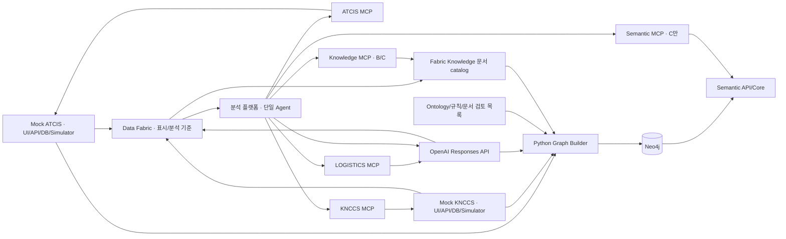

# ARCHITECTURE

현재 기준: c2-logistics-demo-v5 원천 + v6 지식 계층(선언적 온톨로지·업무 질의, 비교 정책6-ontology-abc, `--ontology-profile 6` 기본), source/ontology/adapter5.0.0. v5 지식 계층(정책5-logistics-abc)은 `--ontology-profile 5`로 보존한다. v4(두 원천 A/B/C)·v3(문서 허용 OFF/ON)는 호환 이력으로 보존한다. 기술 설계의 단일 기준이다. 요구사항·데모는 [PRD](PRD.md), 화면은 [UI_GUIDE](UI_GUIDE.md), 실측·한계는 [IMPLEMENTATION_STATUS](IMPLEMENTATION_STATUS.md), 선택 이유는 [ADR](ADR.md)에 둔다.

## 1. 구성과 책임



화살표는 정보 흐름이다. Builder/Fabric은 원천 공개 API를 조회한다. 제품 영역은 세 원천, Data Fabric, 분석 플랫폼의 다섯 개다. 각 원천은 독립 UI·Python 서버·SQLite·시뮬레이터를 가지며 상대 체계·플랫폼·MCP·Neo4j·LLM·Node 없이 실행한다. 합성 데이터·가상 스키마만 사용한다. 프론트엔드 외 실행 로직은 Python이다.

| 모듈 | 기본 주소 | 책임 |
| --- | --- | --- |
| mock_atcis.app | :4100 | 지상 native API/UI/시뮬레이터/DB |
| mock_knccs.app | :4110 | 해상 native API/UI/시뮬레이터/DB |
| mock_logistics.app | :4120 | 군수 native API/UI/시뮬레이터/DB |
| mock_logistics.mcp | :4220/mcp | 군수 공개 API 읽기 어댑터 |
| atcis_mcp.server | :4200/mcp | ATCIS 공개 API 읽기 어댑터 |
| knccs_mcp.server | :4210/mcp | KNCCS 공개 API 읽기 어댑터 |
| platform_api.app | :4300 | 분석 UI·대화·큐·Agent·비교 |
| semantic_api.app | :4400 | Fabric API/읽기 콘솔·Semantic API |
| semantic_mcp.server | :4410/mcp | Semantic API의 읽기 도구 |
| graph_builder.app | :4420 | 내부 Graph build 관리 API |
| semantic_mcp.knowledge | :4430/mcp | Fabric 지식 문서 읽기 도구·Graph 독립 |
| Neo4j Docker | Bolt :7687 / Browser :7474 | 안정 의미·관계·근거 저장 |

Python3.12/uv workspace, FastAPI/Uvicorn, HTTPX/asyncio, Pydantic, MCP 공식 Python SDK(Streamable HTTP), OpenAI Python SDK, Neo4j 공식 Python driver를 사용한다. React/TypeScript/Vite UI는 배포 전에 빌드해 각 Python 서버가 제공한다. Node는 빌드 도구다. 별도 gateway·브로커·Agent 프레임워크는 없다.

구현 위치:

- services/mock-atcis, services/mock-knccs, services/mock-logistics: native 모델·SQL·API·시뮬레이터.
- packages/source-runtime: ledger.py의 인증/snapshot/event/저장 공통 기능, native_mcp.py의 공개 HTTP 읽기 어댑터. 공통 runtime이 도메인 의미를 소유하지 않는다.
- packages/ontology: 명시적 Python adapter, domain_rules.json, 검토 문서 version/hash 목록 domain_documents.json.
- services/graph-builder, packages/semantic-core, services/semantic-api, services/semantic-mcp: 생성·저장/탐색·API·MCP 경계.
- services/platform-api: v5/v4 knowledge_runtime.py/agent/knowledge_tools.py, v3 domain_runtime.py, 공통 multi_runtime.py, Agent·근거·대화·로그.
- frontend: 원천3/Fabric/플랫폼/legacy 정적 앱. scripts/build_ui.py가 Python package 정적 경로에 복사한다.

## 2. 이종 원천 계약

| 구분 | ATCIS | KNCCS |
| --- | --- | --- |
| 자원 | units/equipment/relations/reports/journal/activities | formations/own-forces/contacts/tracks/associations/relations/messages/delivery-events |
| 목록 | items,total,nextOffset | header,payload; header의 continuation |
| 페이지 | offset/limit, 최대100 | resource/snapshot/filter/limit에 고정한 opaque cursor |
| 장비 | equipmentId,classCode,ownerCode,maintenanceCode | pennant,hullClass,formationRef,engineering,mission |
| 상태 | FMC/PMC/NMC/UNK | engineering UP/DOWN와 mission GO/HOLD/누락 분리 |
| 위치/속도 | position x/y, vector east/north(m/s) | geo 위경도, motion knots/course |
| 관측 ID | 원천 record ID | contact는 (originator,trackNo) 복합 키, 선행0 유지 |
| 업무 | 보고·일지·활동 | 전문·수신 ACK·접촉/항적·association |

공개 /api/v1/snapshot, /snapshots/{id}, /stable-export?snapshotId=..., events/stream과 native 자원을 제공한다. 같은 snapshotId에서 페이지를 완결한다. reset은 명시적 새 epoch이며 과거 이력을 자동 삭제하지 않는다. 시작/정지/1초 진행·상태/보고/전문 변경은 원천 UI의 제어 기능이다. 읽기/제어 토큰을 분리하고 Agent MCP에는 제어 도구가 없다.

좌표는 WGS84, GeoJSON 배열은 경도→위도다. 누락 위치를 (0,0)으로 만들지 않는다. 해상 course는 북쪽0도/시계 방향이며 mps=knots×1852/3600, east=mps×sin(course), north=mps×cos(course)다. Python 시뮬레이터가 매초 원천 위치를 갱신하고 브라우저는 벡터·표시 보간을 그린다. 지도 projection은 도메인 추론이 아니며 OFF 분석 근거로 자동 첨부하지 않는다.

각 원천은 자체 master/state/report SQL을 가진다. 단독 wheel은 빌드된 UI와 source-runtime 및 공개 의존성을 포함/설치한다. v4 원천 실행에는 ontology/Neo4j/OpenAI/MCP/상대 원천이 필요 없다. 원천 DB를 다른 서비스가 직접 읽지 않는다.

## v5 세 체계·객체 상세·페이지 context

v5는 기존 v4 경로를 확장하되 별도 seed/DB/dataset/policy로 실행한다. `mock-logistics` wheel은 독립 Ledger 기반 원천 서버와 별도 프로세스로 실행하는 MCP adapter를 포함한다. 원천 API 실행에는 다른 원천·ontology·Graph·OpenAI가 필요 없다. `logistics_records`와 snapshot/event/state SQL을 소유한다. KNCCS는 별도 `navy_transports` 업무 테이블을 소유한다. 군수 상태 변경과 수송 지연은 immutable snapshot을 만들고, live 상태/예정 시각만 바뀌면 stable hash를 바꾸지 않는다.

원천 MCP는 ATCIS7·KNCCS10·LOGISTICS8 도구이며 모두 공개 HTTP 읽기만 한다. source ID는 `logistics`, 기본 :4120/:4220이다. 군수 API는 assets/work-orders/parts/inventory/reservations/supply-requests/cargo를 snapshotId·offset·limit로 읽는다. KNCCS transports는 기존 continuation envelope를 따른다. 수정은 별도 control 토큰의 work-orders PATCH와 transports PATCH(delayHours), 기존 simulation 제어다. Agent에 수정 도구를 노출하지 않는다.

`knowledge_documents_v5.json`과 불변 archive는 기존9개+군수 LOG-01+표시 DISPLAY-01의11개 문서다. 이전10개 archive는 보존한다. 기본 catalog 선택은 contract5에서만 바뀌고 명시적 archive 읽기는 유지한다. B/C는 같은 manifest/hash를 고정한다. `battlefield_ontology/logistics.py`는 검토된 문서와 명시적 등록·업무 참조를 검증해 SAME_AS/MAINTAINS/REQUIRES/STOCK_OF/RESERVES/FOR_WORK/FULFILLED_BY/CARRIED_BY/CONTAINS_PART를 만든다. 신규 노드는 LogisticsAsset/WorkOrder/Part/Inventory/Reservation/SupplyRequest/Cargo/Transport다. 상태·재고·ETA는 stable Graph에 현재값으로 복제하지 않는다.

Semantic의 동일성 조회는 군수 등록 기간·복수 후보/충돌을 확인하고 같은 sourceRef 의미를 UI와 MCP가 재사용한다. `SourceSnapshotSetV5`는 세 원천을 요구한다. Builder는 공개 stable-export·지식 API를 검증하고 세 입력 hash·지식·catalog에 고정된 READY Graph를 발행한다. v4의 두 원천 snapshot 계약은 별도 타입으로 보존한다.

### 객체 상세의 책임과 계약

`semantic_core/objects.py`의 ObjectService는 모델 의존성이 없는 조회 서비스다. Fabric의 `POST /v1/object-details` 입력은 systemId/recordType/nativeId, 선택 graphVersion/sourceSnapshotSet이다. Graph를 지정하지 않은 C 최초 조회는 세 원천 capture와 관리 build를 준비한다. 지정한 Graph 조회는 현재 원천의 dataset/epoch/stable hash와 맞는지 확인한다. Semantic은 동일성·관계·근거를 해소하고 Fabric이 공개 원천 snapshot을 조회/조합한다. Agent는 이 live 상세 API를 원천 MCP의 대체 경로로 사용하지 않는다. Semantic MCP는 고정된 의미/참조를 제공하고 Agent의 현재 사실 조회는 각 원천 MCP다.

응답은 identityStatus/canonicalId, graphVersion·knowledgeSetVersion/hash·adapterVersion, 출처별 records(sourceRef/snapshotId/sourceTime/recordUpdatedAt/lastReceivedAt), links(관계·근거·규칙/문서), coverage/partial이다. 기준 불일치(stale)는 연결을 확정하지 않고 선택 원천 기본 정보만 반환한다. unresolved/ambiguous/conflict도 임의 병합하지 않는다. 기존 Graph가 있으면 일부 원천 단절에도 조회 가능한 원천과 관계 provenance를 반환한다. 최초 Graph 준비의 전체 원천/Builder 장애는 오류로 보존한다. depth7·200노드·300관계 상한과 graphCompleteness로 제한 결과를 표시한다. lastReceivedAt은 원천 HTTP 성공 수신 시각이며 원천 기준/상태 변경 시각과 다르다. 누락된 변경 시각은 만들어 내지 않는다.

### 페이지와 서버 capability

v5 `/`는 조건 선택, `/demo/a|b|c|compare`는 동일 KnowledgeApp shell의 고정 조건이다. `platform_api/demo.py`의 `POST /api/v1/demo-sessions`가 요청한 명시적 진입 조건과 policy/dataset에 대응하는 임시 context를 만든다. opaque sessionId는 `x-demo-session`으로 전달하고 서버가8시간·최대1,000개를 메모리에 관리한다. 재시작/새로고침 진입은 새 context를 얻는다. URL이나 body의 knowledgeMode만 신뢰하지 않는다. 이는 로컬 데모 조건 분리이며 외부 사용자 인증/역할 인가를 구현한 것은 아니다. 사용자는 C/비교에 명시적으로 다시 진입할 수 있다.

- 세 조건 공통: `/api/v1/native-records/{system}/{resource}`에서 공개 원천 API를 조회한다. 페이지/검색·원천 snapshot·수신 시각을 제공하고 Semantic helper는 호출하지 않는다.
- B/C만: `/api/v1/knowledge/{path}`가 Fabric 문서를 proxy한다. 전체 Fabric 토큰을 브라우저에 전달하지 않는다.
- C만: `/api/v1/objects/detail`가 독립 Fabric 상세를 proxy한다. A/B에서 직접 요청해도 거부한다.
- compare만: 비교 생성/이력·해당 비교 run 조회를 허용한다. 개별 mode는 자기 mode의 비비교 run/대화만 열고 mode/body·conversation 불일치를 거부한다. SSE 이력 우회는 차단하고 화면은 범위가 고정된 polling을 사용한다.

페이지별 storage key·대화·선택/상세·문서·요청 수명은 격리한다. 객체 선택은 모델에 자동 주입하지 않고 명시적 질문 초안에는 원천 ID만 쓴다. 공식 비교는 세 원천 pins·같은 질문/기준보고·B/C 지식 집합·C Graph를 고정하며 세 대화를 비운다. C UI 결과를 A/B 질문에 자동 첨부하지 않는다. 단일 KnowledgeRuntime/native tool loop를 유지한다.

## 3. Fabric과 기준 시점

Fabric은 원천 공개 REST/SSE를 수집해 catalog·projection·이벤트·분석 기준을 제공한다. 플랫폼 상황판은 Fabric 경유, Agent 원천 조회는 MCP 경유다. 화면 갱신과 모델 실행 주기를 분리한다. 상태/보고/활동/전문 등 분석 대상 이벤트를 큐에 넣으며 이동 tick마다 LLM을 호출하지 않는다.

v4 `KnowledgeApp.tsx`는 동일한 SituationMap 인스턴스와 conversation별 RunPanel 타임라인을 함께 유지한다. 독립 polling은 이력/비교·상황 projection·연결 상태를 갱신하며 선택 대화와 비교는 전용 API로 추가 복원한다(목록 상한 밖의 과거 비교 포함). 늦은 제출 응답은 선택 epoch를 확인해 현재 초안/모드를 덮어쓰지 않는다. sessionStorage에는 UI 식별자·지도 camera/선택·스크롤만 저장하고 응답·지식·근거는 서버에서 읽는다. 지도 선택/필터는 모델 입력에 추가하지 않는다. 반응형 배치·비교 확대·입력 동작은 [UI_GUIDE](UI_GUIDE.md)를 따른다. v3/원천/Fabric CSS와 분리된 `.bf-shell` 범위를 사용한다.

GET /v1/sources, /catalog, /situation, /source-projections/{system}, /events와 POST /v1/analysis-contexts가 주요 계약이다. context는 sourceSnapshotSet, 필요 시 baselineSourceSnapshotSet, 지식 집합 version/hash(B/C)를 고정한다. semantic_api의 fabric.py는 수집/기준을, semantic_core/domain.py는 의미 조회를 담당한다.

- A(native)는 추가 지식 없이, B(documents)는 Fabric 지식 문서만 추가해 Graph 없이 동작한다. 부분 원천은 coverage로 표시하며 전체0으로 확정하지 않는다.
- C(structured)는 완결 원천 집합과 stable hash/지식 집합/catalog가 일치하는 READY Graph를 요구한다. 실패 시 C 준비 오류를 보존하고 A/B run을 버리거나 다른 모드로 자동 전환하지 않는다.
- 비교는 같은 질문·snapshot 집합·기준보고/T0·모델/예산의 격리된 세 run/대화다. B/C만 동일한 지식 집합에 접근한다. knowledgeMode=native/documents/structured이며 새 계약은 semanticMode 요청을 거부한다.
- 움직이는 원천의 엄격한 동시 캡처 허용차는2초다. 정지 원천 준비/Graph 생성 시간이2초를 넘는 것과 구분한다.

epoch/sequence와 연결/시점을 추적한다. 재연결·gap·reset 때 기준을 다시 확보한다. 빈 결과·페이지 잘림·단절·Graph 지연을 구분한다. 브라우저를 닫아도 서버 수집/큐/분석은 계속된다.

### Fabric 지식 catalog/API/MCP

`semantic_core/knowledge.py`는 Graph를 import하지 않는 불변 문서 catalog다. 현재 집합은 `knowledge_documents.json`, 보존 버전은 `knowledge_sets/knowledge-<hash>.json`으로 패키징하며 version/hash를 검증한다. 임의 업로드/LLM 추출은 없고 새 내용은 개발 시 검토·archive·배포한다. 문서 자체 hash와 관리 namespace/적용 범위를 분리한다.

인증된 `GET /v1/knowledge/sets`, `/sets/{version}`, `/documents`, `/documents/{documentKey}`, `/search`를 제공한다. 문서 목록/검색은 knowledgeSetVersion, cursor, limit(기본20/최대50)을 사용한다. 검색은 literal text이며 Graph/임베딩/생성 요약이 없다. 현재 문서는 전체 본문을 반환하고 completeness=complete를 명시한다. 문서 version/hash·issuer/section/knownAt/effectiveFrom·검토 revision을 보존한다.

별도 `semantic_mcp.knowledge`(:4430/mcp)는 list_knowledge_documents/search_knowledge_documents/get_knowledge_document 3개를 제공한다. Agent→실제 Knowledge MCP→Fabric 읽기 API이며 인증은 KNOWLEDGE_MCP_TOKEN과 Fabric SEMANTIC_READ_TOKEN을 분리한다. A는 이 클라이언트를 만들지 않고 B/C만 연결한다. B는 Semantic MCP/Neo4j/Builder 없이 실행한다. Builder도 같은 공개 지식 API에서 고정 manifest와 각 본문을 읽어 검증한다. 지식 읽기는 Graph 준비를 호출하지 않아 순환 의존이 없다.

## 4. Ontology·Graph 생성·저장

Graph는 검증된 의미·관계·동일성·근거를 소유한다. 위치·정비/임무 상태·활동 완료·ACK·현재 항적은 원천이 소유한다. stable export는 live 필드를 제외하며 초 단위 이동을 Graph Observation으로 누적하지 않는다.

Fabric 합성 지식 문서와 규칙은 개발 시 작성하고 검토 목록으로 관리한다. **런타임 LLM이 문서에서 규칙이나 관계를 생성하지 않는다.** 문서 hash는 입력 무결성이지 군 전문가의 의미 인증이 아니다.

Builder는 공개 stable-export의 schema/dataset, 문서 version/hash·검토 revision, 미래 knownAt, 관계 endpoint, 조직 순환, association 일관성을 검증한다. 명시적 Python adapter/규칙으로 결정론적으로 생성한다. stable input hash+knowledge manifest+ontology/adapter catalog hash로 불변 graphVersion을 식별하고 검증된 READY만 공개한다. 실패 build는 공개하지 않는다. sourceScope/checkpoint로 변경·gap/reset을 다루며 위치 tick만으로 rebuild하지 않는다.

노드: System, SourceRecord, Unit, Equipment, EquipmentType, ContactObservation, Observation(assertion 근거), Report, Incident, Activity, SourceDocument, InterpretationRule, ConceptDefinition, Procedure, StepDefinition. build manifest는 입력 snapshot·stable hash·버전·진단을 보존한다.

주요 관계는 SUBORDINATE_TO, ASSIGNED_TO, REFERS_TO, DERIVED_FROM, SUPERSEDES다. 원천 키(system/dataset/epoch/recordType/nativeId)와 canonicalId를 구분한다. assertion/source refs·규칙/version·근거로 관계를 추적한다. 기계적 SourceRecord 참조는 adapterVersion/provenanceKind이며 무관한 도메인 규칙을 붙이지 않는다. 중첩 payload는 검증된 JSON/hash로 보존한다.

Unit은 명시적 코드/parent, 장비 배정은 역할·기간·출처로 연결한다. ORG/ATT/SUP/CTRL을 하나의 parent/소유로 합치지 않는다. previousName은 단일 이전 명칭이다. Entity Resolution은 명시적 association만 확정 근거로 사용한다. 이름·거리 유사성/LLM 확신으로 병합하지 않으며 unresolved/ambiguous/conflict를 보존한다. SURFACE는 관측 영역이지 함정 유형이 아니다.

규칙12개:

- ASSET-TYPE-01, ASSET-TYPE-NAVAL-01: 원천 유형 해석.
- AVAIL-LAND-01, AVAIL-NAVAL-01: 정비/기관/임무 코드 해석.
- FORCE-SCOPE-01, AGGREGATION-POLICY-01: 범위와 P1/P2 포함 정책.
- ENTITY-LINK-01, UNIT-IDENTITY-01, ORG-ROLE-01: 동일성·명칭·역할.
- REPORT-LINEAGE-01, REPORT-REVISION-01, ACTIVITY-STEP-01: 전달/정정·절차.

JSON+Python 조건 DSL(AND/OR/EQ/EXISTS/BEFORE 등), 타입 매핑·정책·절차 정의를 사용한다. 규칙 종류마다 실행 계약이 달라 모든 규칙을 조건 평가기에 넣을 수는 없다. RDF/OWL 엔진·범용 SOP 추출은 없다. 일부 정의/Procedure/StepDefinition 연결은 payload 모델이다.

기존 체계별 REF-01/ORG-01/EX-01/SOP-01 8개 문서는 본문/version/hash를 보존해 Fabric으로 이관했다. 공통 정책의 기본값·기간·unknown·집계·완료 조건을 설명하는 fabric:POLICY-01을 추가해 현재9개다. 문서 key는 atcis/knccs/fabric namespace를 가진다. EX-01은 연습 해석 문서 ID이며 관측 생성 이벤트가 아니다. 기존 문서의 발행/적용 체계와 Fabric의 등록·관리 책임을 구분한다. 신규 Graph의 documentRefs는 Fabric documentKey/knowledgeSetVersion/version/hash를 보존한다.

## 5. Semantic API와 MCP

Semantic core→API→MCP로 나누어 Agent 밖에서도 재사용한다. 7개 도구는 interpret_concept, resolve_unit_scope, find_equipment_refs, resolve_entity, get_semantic_evidence, query_relations, get_procedure_definition이다. graphVersion 고정·bounded 읽기만 제공하며 임의 Cypher/Graph 쓰기는 없다.

`interpret_concept`는 정규화된 용어에서 검토된 시작 ruleId와 명시적 의존 ruleId만 반환한다. 예외적으로 `all`은 구형 전체 규칙 조회를 명시적으로 요청한 경우에만 사용한다. `query_relations`는 요청한 relationTypes만 순회하고 간선의 원래 방향을 유지한다. ATCIS 장비에서 군수 관계를 찾으려면 `SAME_AS`를 포함해 깊이2 이상을 지정하거나 군수 자산 key부터 조회한다. 절차 도구는 사고 보고/활동 완료 SOP-01만 지원하며 정비·복구 절차가 아니다.

사단 전차 질문은 Semantic에서 조직 범위·배정·정의 근거를 읽고 현재 상태는 ATCIS MCP에서 읽는다. Graph가 현재 가용 목록을 대신 확정하지 않는다. Fabric 콘솔은 공통 선택기로 실제 READY v3/v4/v5 graphVersion을 고정한다. active는 /v1/builds/active 조회 별칭이며 모든 의미 조회에서 쓰는 버전 별칭은 아니다.

### Fabric Graph 탐색 읽기 API

`semantic_api/explorer.py`→`semantic_core/explorer.py`→GraphRepository→Neo4j 경로다. 기존 Semantic 읽기 토큰을 사용하고 Agent/MCP 도구는 추가하지 않는다. Graph 생성/변경이나 내부 Builder 자격증명은 노출하지 않는다.

| 경로 | 계약 |
| --- | --- |
| GET /v1/graph-builds | READY v3/v4/v5 목록, q/dataset/date(UTC 날짜)/cursor, limit 기본20·최대50. 생성 시각 내림차순/전체 ID 오름차순의 keyset 페이지, 실제 activeGraphVersion·입력 snapshot 메타데이터 |
| GET /v1/graph-summary | graphVersion의 build 메타데이터·domain 노드/관계 유형별 정확한 개수. 내부 GraphBuild/GraphState 제외 |
| GET /v1/graph-nodes | graphVersion, q(키/저장 payload 문자열), system, type, cursor, limit 기본30·최대100. key 순 요약 목록 |
| GET /v1/graph-node | graphVersion/nodeKey의 저장 payload·원천 참조 상세 |
| GET /v1/graph-neighborhood | graphVersion/subject/relationTypes/depth(기본1·최대2), nodeLimit 기본100·최대200, edgeLimit 기본150·최대300 |

탐색 응답은 실제 버전과 노드/방향 관계, completeness/omittedReasons(depth/nodeLimit/edgeLimit)를 제공한다. 모든 관계 endpoint를 반환 노드에 포함하고 evidenceId를 유지한다. 검색 페이지와 그래프 잘림은 구분한다. cursor는 조회 버전/필터에 고정한다. 비READY/다른 ontology는422, 없는 버전/객체404, 저장소 장애503이다.

탐색은 기존 `DomainService.model()` 전체 로드를 호출하지 않는다. 버전·조건·frontier·반환 상한을 Cypher에 적용하고 제한된 결과만 Python에서 decode한다. 기존 불변 Graph의 domainJson을 사용하여 migration/rebuild 없이 조회하지만 JSON 문자열 필터·정렬·집계가 DB 스캔을 일으킬 수 있다. 대규모 검색 인덱스/최적화 구현은 아니다. 임의 Cypher는 허용하지 않는다.

UI는 React SVG의 결정론적 배치로 제한된 부분 그래프를 그린다. 추가 확장은 ID로 병합하며 누적200노드/300관계 상한을 적용한다. 노드/관계 선택과 문서·규칙·evidence는 동일 버전을 사용한다. 렌더 배치는 의미 관계를 추가하지 않고 실제 저장 관계만 표시한다. 전체 Graph 자동 펼치기와 자동 build는 없다.

### A/B/C 실행·호환

새 플랫폼 계약은 knowledgeMode=native/documents/structured를 요구한다. 내부 공통 runner의 off/on 값은 계산 기능 선택을 위한 구현 세부이며 새 A/B/C의 정책 식별자는 4-knowledge-abc다. 원천 문서 허용이던 과거 v3 OFF를 A로 재해석하지 않는다. 새 DB가 과거 source contract의 run을 가진 DB를 열려고 하면 읽기 검사에서 거부한다. 원래 이력은 해당 계약으로 실행해 조회한다.

A/B는 Semantic 평가·helper 간접 집계와 이전 원천 list_documents를 차단한다. B/C의 Knowledge 응답은 고정 knowledgeSetVersion/hash·본문 hash를 검증한다. C는 Graph의 지식 hash·source stable hash까지 일치해야 한다. mode 변경은 새 대화이며 같은 지식 대화는 기존 지식 버전을 유지한다. 비교는 하나의 공유 manifest와 세 빈 대화/run을 원자적으로 만들고 model/prompt/budget/order/pins/knowledge/hash를 기록한다. C 준비 실패는 C run 실패로 남기고 A/B를 계속 실행한다.

실제 모델 평가 opt-in: `uv run python scripts/evaluate_knowledge.py --live --output <새-artifact.json>` (기본 F1~F7, --scenario로 선택). 순서를 회전하고 원본 comparison/run·usage를 보존한다. `scripts/grade_domain.py`는 A/B에 C 규칙 ID를 요구하지 않고 경계·참조·정형 사실과 자연어 Human Review를 구분한다. 지식 접근 효과와 구조화 체계 효과를 분리하며 실제 측정 없이는 우열을 주장하지 않는다.

## 6. 단일 동적 Agent

하나의 Python Agent가 OpenAI Responses API의 native function calling을 반복한다. 별도 Orchestrator·전문 Agent·위임·고정 DAG는 없다. 직접 답변할 수도 있다.

1. run의 모드·정책·snapshot 집합·Graph·예산을 고정한다.
2. 신뢰 MCP의 tools/list 전체 페이지를 발견해 namespace와 strict schema를 구성하고 run 내 고정한다.
3. 모델이 실제 function_call을 반환하면 이름/인수/시점/예산을 검증해 호출한다.
4. 원래 call_id에 연결한 function_call_output과 후속 입력용 model output을 컨텍스트에 추가한다.
5. 모델이 다음 조회나 답변을 선택한다. 최종 구조·현재 run 근거/규칙 참조를 검증해 저장한다.

시스템 프롬프트는 정체성·앱 역할·loop/근거 원칙을, 서버 소유 도구 설명/schema는 개별 입력/출력·해석 범위를 담당한다. 텍스트에서 행동 JSON을 파싱하지 않는다. discovery 실패를 로컬 정의 복사로 위장하지 않는다. 이름 충돌·지원하지 않는 schema는 오류다. optional/nullable/default를 보존해 strict 변환하며 실행 전 원래 계약도 검증한다. 한 번에 하나의 도구를 처리한다.

원천 조회는 **MCP Python Client→MCP Server→공개 C4I API**이며 직접 REST/DB/내부 모듈 fallback은 없다. v4 원천 MCP는 ATCIS7개(snapshot+자원6), KNCCS9개(snapshot+자원8)다. v3 호환 MCP는 각각 documents를 포함한8개/10개다. 실제 함수명/계약은 discovery가 기준이다. API ID 필터가 모두 MCP에 노출된 것은 아니다.

로컬 read_evidence는 현재 run 근거 재열람, aggregate_evidence는 계산, C의 evaluate_evidence는 조회한 조건 규칙 평가다. 임의 HTTP/SQL/코드 실행 도구는 없다.

| 모드 | 허용 | 경계 |
| --- | --- | --- |
| A native | 원천 MCP·일반 계산 | Fabric 지식·Semantic·helper 금지; 원천 설명 문서 API 없음 |
| B documents | A+Knowledge MCP 문서 검색/본문 | Graph·Semantic·평가 helper·간접 의미 집계 금지 |
| C structured | B+Semantic MCP·근거 기반 평가/집계 | 현재 run의 의미/원천 근거 없이 공통 분류·동일성 확정 금지 |

A/B도 모델의 자체 해석 또는 제공된 문서로 올바르게 답할 수 있으며 오답을 강제하지 않는다. 지도 projection·이전 C 대화에서 의미 결과를 유출하지 않는다. v3 OFF의 원천 문서 허용은 원래 호환 정책으로 보존한다. 다른 정책의 과거 대화/대기 run을 자동 재사용하지 않는다.

C 집계는 완결 scope·조직별 identity 조회·원천 전체 페이지·상태 평가·정책 근거를 요구한다. 일부 빈 결과를 전체0으로 확정하지 않는다. canonical 지원 중복을 병합하고 유형/상태/유형×상태 집계를 제공한다. unknown과 unavailable을 구분한다. P1/P2 포함 정책은 원래 분류를 바꾸지 않는다. 활동 완료에는 원본 보고 근거가 필요하며 ACK만으로 완료 판정하지 않는다.

v3/v4 예산은 model24/tool20/loop120초이며 준비 시간은 별도다. legacy model 기본12다. 반복 guard·오류 관찰·출력 교정1회·취소/timeout을 둔다. claims의 observation/inference/semantic/calculation 성격과 현재 근거 참조를 검사하지만 문장 의미의 정확성을 완전히 판정하지는 않는다.

원천 MCP의 동일한 읽기 요청은 run 안에서 서버/도구/정규화 인자와 sourceSnapshotSet 핀을 키로 원래 evidenceId까지 재사용한다. 실패/partial 응답은 재사용하지 않는다. 다른 run의 결과는 재사용하지 않는다. run의 toolCalls에는 호출 기록과 cacheHit를 남겨 모델 호출 수와 실제 원천 조회 절감을 구분한다. 도구/반복 한도 마지막 응답은 도구 없이 요청해 이미 확보한 근거로 답변 또는 partial을 작성하게 한다. 예산 종료 안내는 출력 교정이 이어져도 한 번만 추가한다. 캐시 적중도 모델의 도구 호출이므로 도구 예산에 포함된다. 이때 모델이 답변을 완성하지 못하거나 deadline을 넘기면 실패 상태를 유지한다. A/B/C 공통 프롬프트에는 Fabric 문서 전용 `laborHours` 해석을 넣지 않는다.

컨텍스트는 instructions+질문+짧은 대화 맥락+현재 run의 model output/도구 결과다. 이전 질문/최종 답변/선택은 참고이며 새 턴 사실은 새 snapshot에서 읽는다. 대화·run·근거·trace·방책/선택·비교 manifest는 플랫폼 SQLite에 저장한다. 방책 선택은 C4I 명령 실행이 아니다.

서버가 영속 큐/worker와 진행 SSE를 소유한다. 재시작 시 미완료 run은 interrupted로 복구한다. 없는 대화는 전용 conversation_not_found이며 UI는 그 경우에만 질문/모드를 보존해 새 대화로 한 번 복구한다. 일반404/500은 자동 재요청하지 않는다.

### 주장 분류와 서버 출처 — provenance1

v4/v5 A/B/C의 모델 출력과 서버 응답 계약을 분리한다. 모델에는 기존 AnalysisResult의 claim.kind 중 observation/inference/calculation만 요청한다. 이것은 모델이 분류한 주장 성격이며 정답 판정이 아니다. 이전 응답의 semantic 표기는 호환 처리로 inference에 두고 원래 reportedKind를 보존한다. v3/legacy의 기존 출력 검증 경로와 과거 run은 변경하지 않는다.

AgentLoop는 먼저 JSON·필드·이번 run의 evidenceId·방책 수/ID를 검사한다. A/B가 실제 Semantic 근거를 인용하거나 A가 Knowledge 근거를 인용하면 계속 거부한다. non-inference의 빈 근거도 거부한다. 이 제한과 MCP capability 경계는 모델의 kind 표기에 의존하지 않는다.

`agent/provenance.py`는 실제 인용한 runner.evidence의 systemId에서 source/document/semantic/calculation 출처를 산출한다. 문서는 실제 documentKey·지식 집합·문서 version/hash를 연결한다. C의 Semantic/계산 도구 결과에 구조화된 ruleId가 있는 경우에만 해당 ruleRefs를 확인한다. 문서 본문의 정확한 규칙 이름 표기는 documentRuleRefs로 분리하며, 그 문장을 지지하거나 규칙을 실행했다고 판정하지 않는다. 확인되지 않은 표기는 unverifiedRuleRefs·한계 경고로 보존하고 answer를 partial로 낮춘다. 답변을 null로 폐기하거나 가짜 규칙을 검증된 근거로 승격하지 않는다.

서버만 ProvenancedAnalysisResult/ClaimProvenance를 추가한다. 원래 모델 응답 스키마에는 provenance 필드가 없고 모델이 보내면 extra 필드로 거부된다. 결과의 provenanceVersion=1과 claim_provenance 로그가 모델 분류·실제 출처·문서 표기·미확인 참조를 구분한다. 실제 없는 evidenceId 같은 오류는 기존1회 교정 후 실패 종료를 유지한다. 자연어 주장과 근거 사이의 논리적 지지·도메인 정답은 이 구조 검사로 검증하지 않는다.

## 7. 실행 로그

platform_api/run_log.py가 UTF-8 var/logs/agent/<runId>.log에 준비→discovery→모델/도구 시작·성공·실패→검증→최종 상태를 기록한다. 질문·모드·snapshot/Graph·callId/evidenceId·usage·시간을 DB/UI trace와 대조한다. 요청 시도/응답 수를 나누고 usage 미제공은 unavailable/partial로 둔다.

AGENT_LOG_ENABLED=false로 끄고 AGENT_LOG_DIR로 경로를 변경한다. 설정 후 플랫폼을 재시작한다. 비밀값/중첩 credential/JSON 문자열을 마스킹한 뒤 필드별8,000자에서 생략한다. private reasoning·SDK 전체 요청·전체 대화는 기록하지 않는다. 전체 근거는 DB/UI trace가 기준이다. append lock·thread offload·flush를 사용하고 취소 시 진행 중 쓰기를 정리한다. I/O 실패는 stderr Agent log failure 경고로 격리한다. 자동 retention·비용 환산은 없다.

## v6 선언적 온톨로지·업무 질의 (정책6-ontology-abc)

원천 3체계·schema5.0.0·dataset은 v5와 같고 지식 계층만 바뀐다. `C4I_CONTRACT_VERSION=5`와 `C4I_ONTOLOGY_PROFILE=6`일 때 동작하며 `scripts/dev.py`의 기본값이다. 플랫폼 DB는 `var/platform-v6.db`로 분리한다.

**단일 원천.** `packages/ontology/.../ontology_v6.json`이 개념·관계 유형·규칙(기존12+LOG-LINK-01)과 명시적 의존·용어→시작 규칙·업무 질의 정의·편집 가능 항목·영향 화면을 선언한다. `declaration.py`가 검증(미정의 참조·의존 순환·중복 거부)·렌더링·편집·diff·영향 분석을 담당한다. 선언은 Fabric 문서 `fabric:ONTOLOGY-01`로 지식 집합에 들어간다. 이 문서의 `text`는 B가 읽는 렌더링 본문, `declaration`은 같은 내용의 구조화 원본이다. 지식 집합 version/hash 하나가 B 문서와 C Graph를 함께 고정한다. 기본 집합은 `scripts/render_ontology.py`가 v5 문서11개+ONTOLOGY-01로 생성한다(`knowledge_documents_v6.json`, archive `knowledge-52b73da405a6e1cd0a83f8bb`).

**컴파일.** `build_domain`은 ONTOLOGY-01이 있으면 코드의 `domain_rules.json` 대신 선언 규칙으로 InterpretationRule을 만들고 각 규칙의 documentRefs에 ONTOLOGY-01을 더한다. OntologyDeclaration·BusinessQuery 노드와 BusinessQuery→규칙 `APPLIES_RULE` 간선을 추가한다. v6 `interpret_concept`는 Graph의 선언 노드에서 용어·의존을 읽는다. 렌더링 문서와 Graph의 규칙/업무 질의 ID 집합은 테스트로 일치를 검사한다.

**업무 질의.** `semantic_core/business_queries.py`의 연산자 3개(`asset_status_summary`, `asset_dependency_chain`, `part_supply_status`)가 선언된 업무 질의(asset-availability-summary, asset-maintenance-chain, part-supply-status)를 실행한다. 범위·동일성·의존 연결은 Graph에서, 상태·수량·시각은 같은 Graph build에 고정된 원천 snapshot(`Fabric.capture(inputSnapshotSet)`)에서 읽는다. 규칙·정책 값은 질의 시점에 선언에서 읽으므로 정의 변경에 코드 수정이 필요 없다. 연산자 종류 자체는 코드다. 응답은 Graph 도장(graphVersion·inputStableHashes·ontology/mapping/resolution 버전), declarationVersion, appliedRules, graphEvidence, sourceRecords, unknowns/completeness를 싣는다. 복구 전망은 인도 예정+작업 경과 시간(laborHours)의 조건부 값이며 가정과 함께 반환하고 다른 고장 여부가 미확인이면 산출하지 않는다. Semantic API `GET /v1/business-queries`, `POST /v1/business-queries/{queryId}`와 Semantic MCP `list_business_queries`, `run_business_query`(선택 문자열 인자만, strict 변환 가능)로 노출하며 C만 사용한다. 업무 질의 근거를 인용한 주장은 구조화 ruleId로 규칙 근거가 검증되어 미확인 경고로 답변이 partial로 강등되지 않는다.

**Fabric 정의 변경.** `semantic_core/ontology_store.py`와 Semantic API `/v1/ontology`, `/v1/ontology/drafts`, `/v1/ontology/drafts/{id}/approve`가 초안→검증→diff·영향 분석·업무 질의 전후 미리보기→작성자와 다른 승인자의 승인→발행을 제공한다. 편집은 선언의 `editable` 항목(현재 `AGGREGATION-POLICY-01.defaultAvailablePolicy` P1/P2)만 허용한다. 영향 분석은 선언된 의존·참조를 따른 결정론적 계산이다. 발행은 새 지식 집합 파일을 `FABRIC_KNOWLEDGE_STORE`(기본 `var/fabric-knowledge`)의 `sets/`에 쓰고 `current.json`을 바꾸며 `history.json`에 작성자·승인자·diff·영향을 남긴다. 기존 집합·Graph·완료 run은 수정하지 않는다. `KnowledgeCatalog(version)`은 패키지 archive 다음 store를 조회하므로 Fabric·Graph Builder·플랫폼이 같은 경로로 새 버전을 검증한다. 발행 직후 현재 snapshot의 새 Graph를 백그라운드로 미리 빌드한다. 진행 중인 대화는 기존 정책대로 시작 시 지식 버전을 유지하고 새 대화부터 새 버전을 쓴다. 승인은 데모 capability이며 운영 인증이 아니다. Agent에는 편집 도구가 없다.

**Neo4j 역할.** 소규모 데모에서는 Semantic API가 버전 Graph 전체를 읽어 Python에서 순회하는 기존 방식을 유지한다. Neo4j는 현재 버전 고정 의미 저장소이며 규모 확장 시 Cypher 순회 전환을 재검토한다.

## 8. 설치와 실행

Python3.12, uv, UI 빌드용 Node20.19+ 또는22.12+, Docker Desktop을 사용한다. .env.example을 참고해 로컬 .env에 OPENAI_API_KEY, OPENAI_MODEL, NEO4J_PASSWORD와 각 읽기/제어/MCP/내부 Builder 토큰을 설정한다. 키를 문서/UI/로그에 넣지 않는다. 기존 Neo4j volume 비밀번호를 유지한다.

```powershell
uv sync --all-packages
uv run python scripts/export_contracts.py
npm.cmd --prefix frontend ci
npm.cmd --prefix frontend run build
uv run python scripts/build_ui.py
docker compose up -d neo4j
uv run python scripts/dev.py --profile full
```

| 프로필 | 실행 범위 |
| --- | --- |
| sources | v5 원천3만, MCP/Graph/LLM 불필요 |
| fabric | v5 원천 MCP3+Fabric API+Knowledge MCP+Builder+Semantic MCP, 원천 별도 실행 |
| platform | 플랫폼만, 외부 Fabric/MCP 주소 필요 |
| off | v5 원천3+원천 MCP3+Fabric core+Knowledge MCP+플랫폼, Neo4j 불필요 |
| full | v5 Python11개+별도 Docker Neo4j; v4는9개·v3는8개 |
| legacy | 기존 C4I/MCP/플랫폼3개, 프로필 생략 시 기본값 |

현재 데모는 --profile full을 명시한다. --contract-version 5는 기본값이며 v4는 명시적으로 선택한다. 비legacy launcher는 기본 contract5다. v5 DB는 var/atcis-v5.db, var/knccs-v5.db, var/logistics-v5.db, var/platform-v5.db다. LOGISTICS_DB와 ATCIS_V5_DB/KNCCS_V5_DB/PLATFORM_V5_DB로 지정한다. --contract-version 4/3/2는 원래 정책·DB의 호환 경로다. v4 기본 DB는 var/atcis-v4.db, var/knccs-v4.db, var/platform-v4.db이며 ATCIS_V4_DB/KNCCS_V4_DB/PLATFORM_V4_DB로 변경한다. 이전 DB/Graph/대화는 자동 reset하지 않는다.

단독 CLI: uv run --package mock-atcis mock-atcis / uv run --package mock-knccs mock-knccs. 기본 v4이며 단독 source CLI도 ATCIS_V4_DB/KNCCS_V4_DB를 사용해 기존 generic v2/v3 DB 경로를 보호한다. 독립 v2 handler 설치에는 source-runtime의 legacy extra가 필요하다. 읽기 토큰을 해당 MCP/Fabric과 일치시킨다. 포트가 사용 중이면 원인을 확인하거나 --port-offset 1000을 사용한다. offset은 Python만 바꾸고 Neo4j는 그대로다. Ctrl+C는 launcher가 시작한 프로세스만 종료한다. 사용자 프로세스·데이터·volume을 임의 삭제하지 않는다.

원천은 처음 정지 상태다. UI :4100/:4110/:4120에서1초 진행/시작/정지·업무 상태를 바꾼다. 군수 단독 실행은 uv run --package mock-logistics mock-logistics다. Fabric :4400은 운영자 근거 조회, 플랫폼 :4300은 A/B/C 진입·L0~L5/별도 동일 기준 비교다. v4 호환 화면은 F1~F7를 유지한다.

### 검증

```powershell
uv run pytest -m "not live and not performance and not neo4j and not ui" -q
docker compose --profile test up -d neo4j-test
uv run pytest -m "neo4j and not live" -q
uv run ruff check services packages scripts tests
uv run ruff format --check services packages scripts tests
uv run mypy services packages scripts
```

기본 uv run pytest -q는 neo4j/live/performance를 제외하지만 UI를 포함한다. UI는 정적 빌드·Playwright Chromium, 일부 지도 테스트는 외부 지도 연결이 필요하다. 테스트 Neo4j는 Bolt17687/Browser17474의 별도 컨테이너/volume이며 데모 DB를 초기화하지 않는다.

실제 GPT는 비용이 발생하는 opt-in: uv run pytest tests/test_domain_live.py -m "live and neo4j" -q -s. scripts/grade_domain.py <입력.json> --output <새-평가.json>으로 평가하고 원본을 보존한다. 정상 .venv에서는 uv를 사용한다. 이전 별도 검증 환경은 STATUS를 참고한다.

## 9. 호환과 공개 참고 자료

### 업무 view·메타데이터·의미 관측

`semantic_core.metadata.MetadataCatalog`는 고정 knowledgeSetVersion의 `fabric:DISPLAY-01` 본문 JSON을 읽는다. 현재 문서1.1/review-display-2, schemaVersion display-1/locale ko-KR이며 체계·자원·field별 displayName/description/aliases/values/unit/quantityKind·namespace/sourceSchemaVersion/validFrom/validTo와 문서 version/hash/knownAt을 보존한다. 미지원 검토 revision은 거부한다. ruleId와 표시 설명은 분리하며 aliases를 동일성 판정에 사용하지 않는다. laborHours는 elapsed_time/h다. 미정의 코드는 미확인, 누락은 정보 없음이다. 과거 archive에 표시 문서가 없으면 available=false다.

`GET /v1/semantic-metadata?graphVersion=...`와 C의 Semantic MCP `get_display_metadata`는 같은 MetadataCatalog를 사용한다. Graph·지식·원천 stable hash·ontology/mapping/resolution rule stamp를 반환한다. B는 같은 문서를 Knowledge MCP로 읽는다. 원천 UI의 NativePresentation은 로컬 표시용이며 Agent 입력과 원천 API를 변경하지 않는다.

ObjectService는 검증된 연결 범위에서 소속 참조를 추가 조회하고, C의 business에 현재 원천 상태/소속/제약·작업별 정비/부품·관련 재고·수송·기록별 시점/queriedAt을 결정론적으로 구성한다. 원본 records/links/시각은 유지한다. sourceSnapshotSet/stale/metadata도 반환한다. 오래된 Graph 또는 미확정 동일성에서는 business=null이다.

`POST /v1/semantic-map`은 graphVersion/sourceSnapshotSet을 선택적으로 받는다. 최초 전체 원천 준비 후 고정 Graph를 재사용하며 stable hash/epoch 불일치 시 연결 확정을 보류한다. observations는 원천10개 위치를 유지하고 groups는 유효한 명시적 동일성만 묶는다. counts는 관측/확인된 고유 자산/미확정 관측, coverage는 원천 상태다. 대표 위치 선정·근접 병합·LLM 호출은 없다. platform의 동명 proxy와 metadata proxy는 C/비교 context만, 객체 상세는 C만 허용한다.

### 반복 평가 실행과 한계

`POST /api/v1/evaluation-context`는 모델 호출 없이 immutable pins·B/C 지식·모델/설정·prompt hash·loop budget을 고정한다(v5 비교 context 전용). 비교 요청의 fixedContext로 반복 간 같은 pins/knowledge를 재사용한다. `--manifest`는 모델/예산/prompt/설정 변경을 거부하며 각 run의 원천·지식·금지 registry를 검사한다. 새 output만 허용하고 checkpoint에 원본 comparison/run과 요청·중단 상태를 남긴다.

```powershell
# full 서버에서 준비만 실행: 모델 비용 없음. 기존 파일을 덮어쓰지 않음.
uv run python scripts/evaluate_knowledge.py --dry-run --contract-version 5 --scenario L0 --scenario L2 --scenario L3 --max-runs 9 --max-model-responses 216 --output artifacts/pilot-manifest.json
# --live는 유료 실행이며 현재 코드/평가 기준에서 새 manifest를 만든 뒤 별도 batch로 실행.
uv run python scripts/evaluate_knowledge.py --live --contract-version 5 --manifest artifacts/pilot-manifest.json --scenario L0 --scenario L2 --scenario L3 --max-runs 9 --max-model-responses 216 --output artifacts/pilot-results.json
uv run python scripts/evaluation_metrics.py artifacts/pilot-results.json --export-review --output artifacts/pilot-review.json
```

v6 평가는 `tests/fixtures/c2-ontology-demo-v6/expected.json`의 K1~K9(포함·조합·미포함·대조군·정의 변경 그룹, hold-out K5·K7)를 쓴다. 정의 변경 그룹은 Fabric 화면에서 발행한 지식 집합을 `--variant-knowledge-set`으로 지정해 같은 pins로 다시 실행하고 `variantGold`로 판정한다. 결과에는 run별 `autoGrade`(핵심 사실·금지 결론 정규식, 참고용)와 `summaryV6`(그룹×조건별 판정·금지 결론·반복 일관성·추적 완결성·업무 질의 선택 정확도·새 정의 준수율)를 저장하며 전체 평균 하나를 만들지 않는다.

```powershell
uv run python scripts/evaluate_knowledge.py --dry-run --contract-version 5 --ontology-profile 6 --max-runs 27 --output artifacts/v6-manifest.json
# 유료: 승인 후. 정의 변경 그룹은 Fabric 발행 버전으로 추가 실행
uv run python scripts/evaluate_knowledge.py --live --contract-version 5 --ontology-profile 6 --manifest artifacts/v6-manifest.json --variant-knowledge-set <발행된 knowledge-...> --repeat 3 --max-runs 99 --output artifacts/v6-results.json
```

UI 변경은 `cd frontend; npm run build` 후 `uv run python scripts/build_ui.py`로 반영한다. `build_ui.py`는 빌드 결과를 복사만 한다.

`--repeat 3 --phase formal`은 별도 본 측정이며 pilot과 합산하지 않는다. 순서는 회전하고 대화는 격리한다. 최대 runs/모델 응답 예약 한도와 ABC 사이의 관측 token 중단 기준을 적용한다. 후자는 진행 중인 ABC의 하드 비용 상한이 아니다. SDK transport 재시도(max_retries=1)의 별도 과금/누락 usage까지 응답 수로 추정하지 않는다. 누락 usage는 unavailable/partial로 표시하고 다음 비교를 중단한다. 실패도 분모에 포함하며 자연어 정답/근거 지지는 독립 gold와 사람이 검토한다. 오프라인 metrics/검토 양식은 새 파일에 출력한다. 실제 모델 우열은 미측정이다.

run에는 modelLoopStartedAt/loopFinishedAt/loopDurationSeconds, iterations별 실제 응답 model/usage/durationSeconds, validationFailures/correctionAttempts를 저장한다. metrics는 loop 시간, createdAt~finishedAt 전체 시간, startedAt~첫 모델 요청의 준비 시간, knowledgePreparationSeconds를 구분한다. 기존 run의 없는 시간·교정 횟수는 null로 남긴다. 반응/근거 경고와 토큰 지표는 자연어 정확도 점수가 아니다.

legacy 단일 C4I, v2 semantic-demo-v2는 호환·역사 기록이다. legacy 접경120개/연안 시나리오를 현재 고유7개 기대값과 혼용하지 않는다. 과거 다중 Agent 제안·전체 SQLite 한정·v1 상태 충돌 시연은 현행 기준이 아니다.

다음은 일반 개념 참고 자료이며 실제 한국군 내부 schema·권한·표준절차를 확보했다는 뜻이 아니다. 합성 SOP는 인증된 한국군 교리가 아니다. 원천 문서의 과거 조사명과 KR-1/INT-1 표기는 아래 출처 식별자로 보존한다. 문서 통합만으로 seed/fixture의 문서 내용·hash를 변경하지 않는다.

- KR-1: [해군 지휘통제체계 연구, 2019](https://journal.kci.go.kr/jksci/archive/articlePdf?artiId=ART002524973): 2장 pp.220~221, KNCCS 업무와 KNTDS 접촉자료 구분.
- [미 육군 CPCE](https://www.army.mil/article/168119/command_post_computing_environment), [2024 포트폴리오](https://api.army.mil/e2/c/downloads/2024/07/19/ab2038a9/u-s-army-portfolio-2024.pdf): 지도·공통 서비스·업무 앱 구성.
- [FM6-0, 2022](https://armypubs.army.mil/epubs/DR_pubs/DR_a/ARN35404-FM_6-0-000-WEB-1.pdf): 참모 정보관리·보고·지속 판단.
- [GCCS-M 교육, 2021](https://www.navy.mil/DesktopModules/ArticleCS/Print.aspx?Article=2570377&ModuleId=523&PortalId=1): 상황도와 원천 DB 유지.
- INT-1: [MIP Information Model](https://www.mimworld.org/portal/projects/welcome/wiki/Welcome): 의미 모델과 교환 인터페이스 구분; MIP 준수를 주장하지 않는다.
- [국방 정보화업무 훈령 별표](https://law.go.kr/LSW/flDownload.do?flSeq=141017339), [작전통제권 개념](https://archives.go.kr/next/newsearch/listSubjectDescription.do?id=010239&pageFlag=C&sitePage=1-2-2): 조직 기준정보와 통제/행정 책임 구분.
