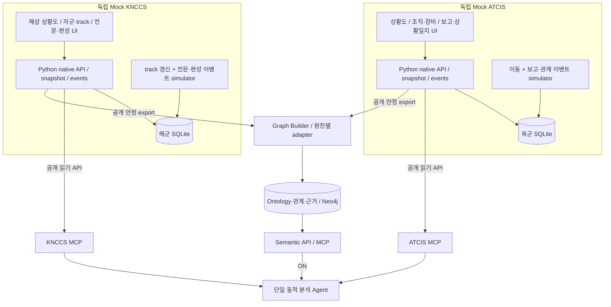

# 육군·해군 Mock C2 체계 조사와 고도화 설계

## 구현 반영 상태 (2026-10-22)

공개 조사에서 데이터 모델 분리·관측/자산 구별·전문/보고의 출처라는 일반 개념을 참고했다. 실제 ATCIS/KNCCS 내부 API/DB/군 SOP를 재현하지 않는다.

육군 native 자원은 units/equipment/relations/reports/journal/activities/documents, 해군은 formations/own-forces/contacts/tracks/associations/relations/messages/delivery-events/documents다. 육군은 offset/items, 해군은 header/payload와 snapshot에 종속된 continuation을 사용한다. 독립 wheel·DB·UI·시뮬레이터를 제공한다.

원천별 REF-01/ORG-01/EX-01/SOP-01 원문과 코드표는 양 모드에서 조회 가능하다. 관계·상태·절차 의미의 구조화는 Fabric Ontology에서 수행한다. 명칭 이력은 단일 previousName, 사건은 단일 합성 INC-1, 절차는 현장 확인/식별/검토의 제한된 모델이다. 실제 편제·권한·작전 절차의 완전성을 주장하지 않는다. 명령과 검증 결과는 [보고서](./IMPLEMENTATION_REPORT.md)를 따른다. 아래는 구현에 입력한 조사·설계 기록이다.

상태: **Design, 2026-10-20**. 사용자 지시에 따라 공개 자료를 조사해 다음 설계를 구체화한다. 구현 순서·작업량·실행 계획은 이후 별도 Plan에서 정한다. 기존 IMPLEMENTATION_PLAN.md는 이 문서 작성 과정에서 수정하거나 초기화하지 않는다.

## 1. 자료의 범위와 해석

실제 ATCIS/KNCCS의 내부 DB·API·현행 배치 구성을 재현하지 않는다. 공개 체계 설명에서 확인되는 기능, 공개 교범/교육자료의 업무 개념, 해외 C2의 참조 모델을 구별해 사용한다. 아래의 실제 출처 내용 외 schema·API·상태 코드·시뮬레이터·UI 구성은 **PoC 설계 제안**이다. 해외 개념을 한국군의 현행 교리로 표시하지 않는다.

| ID | 공개 근거와 시점 | 확인한 내용 | 이 설계에 적용하는 범위 |
| --- | --- | --- | --- |
| KR-1 | [국방대학교 연구진, 해군 지휘통제체계 연구](https://journal.kci.go.kr/jksci/archive/articlePdf?artiId=ART002524973), 2019, 2장 pp.220~221 | 당시 KNCCS의 상황도·전문·자료/협업 기능과 KNTDS의 센서 접촉자료 처리 기능을 구분해 설명 | Mock 해군 내부의 자산·관측·track·전문을 분리. 2026년 운용 구조나 내부 인터페이스의 증거로 사용하지 않음 |
| US-1 | [미 육군 CPCE 공식 설명](https://www.army.mil/article/168119/command_post_computing_environment), 2018 | 공통 지도·데이터 서비스와 여러 업무 기능을 결합하는 지휘소 환경 | 육군 Mock를 지도 위 장비 목록에서 보고·조직·업무 문서가 연결되는 앱으로 확장 |
| US-2 | [미 육군 획득 포트폴리오 CPCE](https://api.army.mil/e2/c/downloads/2024/07/19/ab2038a9/u-s-army-portfolio-2024.pdf), 2024, MISSION COMMAND p.126 | 웹 브라우저 접근, 공통 지리·데이터 서비스와 통합 기능 설명 | 정적 웹 UI+독립 Python 서버라는 기존 PoC 경계와 비교. 미군 서버 제품/설치를 복제하지 않음 |
| US-3 | [미 육군 FM 6-0](https://armypubs.army.mil/epubs/DR_pubs/DR_a/ARN35404-FM_6-0-000-WEB-1.pdf), 2022, 5-47·6-35~37·7-11·9-15 | COP는 사용자 요구에 맞춘 정보 표현이며 참모 정보관리·보고·지속 판단과 연결됨 | report, journal, 판단/출처 구분과 참모 업무 화면. 한국군 표준절차로 간주하지 않음 |
| US-4 | [미 해군 GCCS-M 공식 소개](https://www.secnav.navy.mil/rda/Pages/Programs/GCCSM.aspx), 발행일 미표기 | 다출처 위치/속성 정보의 상관·유지·전시, COP 및 변경 이력 설명 | track 이력·다출처 표시·환경 layer. 이번 조회는 검색 수록 본문을 확인했으며 직접 페이지는 접근 거부됨. 최신 버전/설치 수는 채택하지 않음 |
| US-5 | [미 해군 GCCS-M 교육 기사](https://www.navy.mil/DesktopModules/ArticleCS/Print.aspx?Article=2570377&ModuleId=523&PortalId=1), 2021 | GCCS-M 교육에서 DB 편성/유지를 통한 상황도 구성을 설명 | source record 유지·track 관리가 상황도 앱의 일부임을 보완 |
| INT-1 | [MIP Information Model 공식 포털](https://www.mimworld.org/portal/projects/welcome/wiki/Welcome), 2026-10-20 열람 | 공통 정보모델·문서·모델 탐색 도구를 제공하며 교환 규격의 일부 자료는 별도 접근이 필요 | 공통 의미 모델과 교환 인터페이스를 구별. MIM 전체 구현·MIP 준수·한국군 적용 여부를 주장하지 않음 |
| KR-2 | [국방 정보화업무 훈령 공개 별표](https://law.go.kr/LSW/flDownload.do?flSeq=141017339), 공개된 해당 별표 기준, pp.3~4 | UCMS의 부대코드·변동내역/연습부대 관리, IIMS의 연동/표준 관리 설명 | 합성 부대 기준정보·변경 이력·원천 코드 crosswalk. 실제 코드/접근 권한을 확보했다는 뜻이 아님 |
| KR-3 | [국가기록원 작전통제권 설명](https://archives.go.kr/next/newsearch/listSubjectDescription.do?id=010239&pageFlag=C&sitePage=1-2-2), 역사/개념 자료 | 작전통제와 행정·군수 책임을 구별하고 작전통제 이양 개념 설명 | 단일 조직 parent로 권한·지원·보고 관계를 대체하지 않음. 구체 담당과 승인 조건은 합성 연습 문서로 정의 |

원문이 확인되지 않은 국내 교범 조항이나 실제 체계의 필드·판정표를 창작해 출처와 연결하지 않는다. 교리/절차의 추가 구조화에는 문서명·버전·발행 주체·적용 범위·확인된 문단이 필요하다.

## 2. 조사로부터 정한 설계 방향

두 Mock 모두 **조직·자산·상황도·보고/전문·활동 기록·기준 문서**를 가진 작은 C2 업무 시스템으로 만든다. 육군은 부대/장비/보고·상황일지를 탐색하는 관점, 해군은 자군 자산과 접촉/관측/track·전문을 연결하는 관점에 무게를 둔다. 이는 PoC에서 차이를 드러내기 위한 구성이지 어느 군만 해당 기능을 가진다는 뜻이 아니다.

특히 이전의 '육군은 고정 조직, 해군은 동적 편성'만으로 차이를 정의하지 않는다. 양쪽 모두 고정 조직과 기간 있는 배속·통제·지원 관계를 가질 수 있다. 원천 표현과 업무 중심이 다르고, 공통 해석은 Data Fabric이 담당한다.



화살표는 자료 흐름이다. 실제 읽기 요청은 MCP/Builder가 source API에 보낸다. 각각은 자체 UI·API·DB·시뮬레이터로 단독 실행하고 MCP와 플랫폼은 없어도 된다. 두 원천 내부를 microservice로 더 나누지 않는다.

## 3. Mock ATCIS — 부대·장비·보고 중심 지휘소

아래 화면과 테이블은 합성 계약 제안이다. CPCE의 공통 지도/업무 통합과 FM 6-0의 정보관리 관점을 참고하지만 실제 ATCIS 화면·DB와 동일하다고 설명하지 않는다.

| 모듈 | 저장/표현할 것 | 사용자 조작 |
| --- | --- | --- |
| 지상 상황도 | 부대 위치와 장비 위치 구분, 표기 시각, 구역·상황 표식 | 지도/조직 선택, 출처·관측 이력 열기 |
| 부대/관계 | 원소속 parent, 약칭/코드 이력, 기간 있는 배속·통제·지원 기록 | 조직 트리와 관계 종류 전환, 변경 근거 문서 열기 |
| 장비 대장 | equipmentNo, 유형/형식, 소속 기록, 별도 상태 보고 | 장비 master와 최근 상태·관측을 나눠 보기 |
| 상황보고 | reportNo/revision, 작성 부대, 관측자, 대상, 발생/관측/보고/수신 시각, 관련 보고/활동 | 보고 접수·정정 이력, 원문과 구조 필드 확인 |
| 상황일지/활동 | 순서 있는 journal entry, 보고 접수, 확인 활동, 담당 인계·검토 상태 | 사건 관련 기록 타임라인, 완료 코드가 가리키는 활동 열기 |
| 기준 문서 | 합성 조직 변경 문서·코드표·용어·연습 절차와 버전 | 원문/관련 기록 조회. 일반 채팅 UI로 대체하지 않음 |

SQLite 논리 테이블은 `units`, `unit_designations`, `command_relations`, `equipment`, `equipment_reports`, `situation_reports`, `journal_entries`, `activities`, `documents`, 기존 snapshot/event 테이블이다. 한 장비 row에 모든 보고·관계·상태를 덮어쓰지 않는다. 재전파 보고는 원 관측과 다른 reportNo를 가지며 sourceReportRef를 보존한다.

UI 기본 배치는 좌측 조직 탐색, 중앙 지도/표식, 우측 선택 부대·장비·보고의 상세, 하단 상황일지다. 모든 모듈을 한 화면에 펼치지 않고 보고함/관계/문서는 탭으로 전환한다.

## 4. Mock KNCCS — 자군·관측·track·전문 중심 해상 상황도

한국군 공개 연구의 KNCCS/KNTDS 구분과 미 해군 상황도 기능을 참고한다. **별도 KNTDS 서버를 추가하지 않고**, Mock KNCCS 안에 모의 접촉 입력 어댑터를 둔다. 현행 한국 해군의 제품 경계/DB 통합 방식을 단정하지 않는다.

| 모듈 | 저장/표현할 것 | 사용자 조작 |
| --- | --- | --- |
| 해상 상황도 | 자군 등록 자산, source contact, track, 시각/출처·갱신 이력 | 자산/track/관측 layer 전환, stale 표시와 원문 열기 |
| 자군 자산 | ownUnitRef, platformRef, 함정/UAV 유형, 자체 위치/상태 보고 | 자산 master와 관측 track이 별개임을 표시 |
| 접촉·관측 | originator + localTrackNo + epoch, 센서/관측 시각·수신 시각·원문 | 같은 번호의 서로 다른 출처, 한 track의 여러 관측 확인 |
| track 관리 | trackRef/revision, 관련 contact refs, 원천이 명시한 association과 상태 | 연결 근거/미연결 확인. 거리·이름만으로 자동 확정하지 않음 |
| 편성/관계 | 고정 소속, 기간 있는 formation membership·지원/통제 문서 | 해당 시점 구성과 소속·통제 차이 확인 |
| 전문함 | envelope, messageId, originator, references, payload, 전송/수신확인 이력 | thread·정정·재전파 관계와 payload 활동 상태를 구분 |
| 문서/환경 | 코드표·기준 문서, 간단한 구역/환경 레이어 | 원문·적용 버전 조회. 날씨 기반 작전 추천 엔진은 만들지 않음 |

SQLite 논리 테이블은 `own_units`, `platforms`, `formation_memberships`, `contact_observations`, `tracks`, `track_associations`, `messages`, `message_delivery_events`, `documents`, snapshot/event 테이블이다. 네트워크 메시지가 수신됐다는 사실과 message payload가 묘사하는 활동 완료는 독립 상태다.

UI는 중앙 해상 지도, 좌측 자군/track 목록·편성 탭, 우측 track provenance·관측 이력, 하단 전문함을 기본으로 한다. 추정 위치를 원 관측 위치처럼 표시하지 않으며 원천에 없는 식별을 지도 심벌로 확정하지 않는다.

## 5. 실제로 다른 native 계약

두 API 모두 HTTP/JSON을 사용해도 데이터 모델·관계·시간·조회 방식이 다르면 충분하다. 계층 표현과 code만 바꾸는 장비 CRUD는 이번 목표에서 벗어난다. 아래 예시는 실제 전문 표준이 아니다.

```json
{
  "reportNo": "L-R017",
  "revision": 2,
  "reportingUnitCode": "B11",
  "subject": {"recordType": "equipment", "equipmentNo": "L-E01"},
  "observedAtMs": 1792458000000,
  "sourceReportNo": "L-R015",
  "activityRef": "L-A03",
  "activityCode": "SITE_CHECK",
  "progressCode": "DONE"
}
```

```json
{
  "header": {
    "originator": "NORTH",
    "messageId": "N-M041",
    "dtg": "2026-10-20T01:05:00Z",
    "references": [{"originator": "NORTH", "messageId": "N-M039"}]
  },
  "body": {
    "contactRef": {"originator": "NORTH", "localTrackNo": "007"},
    "observationRef": "N-O12",
    "activity": {"ref": "N-A08", "kind": "IDENTIFICATION", "state": "IN_PROGRESS"}
  },
  "delivery": {"receipt": "ACKNOWLEDGED"}
}
```

위의 세 상태는 각각 현장 확인 활동 완료, 식별 활동 진행, 전문 수신확인이라는 **다른 사실**이다. source 문서가 각 의미를 설명하고 Semantic Layer가 공통 개념으로 연결한다. 수신확인으로 식별/사건 종결을 추정하지 않는다. 정수 관측 시각과 메시지 시각 역시 같은 의미의 timestamp가 아니다.

육군 API는 `units/equipment/reports/journal/activities` 같은 resource별 조회와 offset 페이지를, 해군 API는 `own-forces/contacts/tracks/message-inbox/formations`와 envelope/continuation을 사용하도록 제안한다. 기존 snapshot·stable-export·이벤트 재생 개념은 유지하지만 payload와 상세 API는 원천별이다. 인수 이름·URL의 최종 확정은 이후 Plan의 계약 검토 대상이다.

## 6. 조직·교리·절차를 해석하는 공통 모델

| 구분 | 공통 개념·관계 | 원천에서 보존해야 하는 사실 |
| --- | --- | --- |
| 실체/유형 | Unit, Equipment, EquipmentType | 부대코드/약칭/장비 형식과 적용기간. 해상 관측이라는 이유로 함정으로 분류하지 않음 |
| 관측/track | ContactObservation, Track, OBSERVES, ASSOCIATED_WITH | 관측 출처/시간, source track key, 명시적 association. Track은 실체 자체가 아님 |
| 보고 | Report, REFERS_TO, DERIVED_FROM, SUPERSEDES | 보고 원문·revision·원 보고/정정 관계. 문서 전달과 독립 관측을 구분 |
| 사건/활동 | Incident, Activity, PART_OF_INCIDENT, REPORTS_ACTIVITY | 사건 참조, 수행한 활동의 종류/대상, 해당 활동의 상태 |
| 조직 관계 | SUBORDINATE_TO, ASSIGNED_TO, MEMBER_OF 및 구분된 통제/지원 관계 | 원소속·배속·작전통제·군수지원·보고 수신자를 하나의 parent로 합치지 않음 |
| 절차 | ProcedureDefinition, StepDefinition, EVIDENCES_STEP | 완료 조건·선행 관계·담당 역할·합성 연습 문서의 명시적 정의 |
| 근거/규범 | ConceptDefinition, InterpretationRule, SourceDocument | 발행 주체·출처 수준·문서/규칙 버전·기간·근거 문단 |

공통 이름은 설계 용어다. 기존 Graph의 `Observation`은 assertion 근거를 저장하는 모델이므로 센서 관측 `ContactObservation`과 무조건 같은 노드 타입으로 합치지 않는다. 두 용도를 타입/namespace로 구분하고 참조로 연결한다.

규범 출처는 `public_reference`, `exercise_directive`, `synthetic_sop`로 구분한다. 한국군 개념·미군 개념·PoC 규칙을 출처 없이 하나로 섞지 않는다. 일반 정의만으로 특정 부대의 담당/권한을 확정하지 않고 해당 연습의 유효한 문서와 관계를 요구한다. 미확인 현행 교범의 빈칸을 LLM이 채우지 않는다.

## 7. 의미를 소유하는 위치와 재사용

- 각 원천: native schema/코드표, 자신의 보고·활동·조직 기록, 원문 문서와 조회 API를 소유한다. native 자료로부터 원천 내부 관계를 명시하는 것은 허용하되 cross-system 동일성/공통 의미를 몰래 계산하지 않는다.
- Ontology/adapter: 공통 개념·관계, 검토된 매핑·문서 기반 규칙을 소유한다. Python typed 정의를 재사용하고 MIM 전체·RDF/OWL·범용 규칙 엔진은 도입하지 않는다.
- Neo4j/Builder: 안정 조직·명시적 연결·보고 provenance·규칙 근거를 versioned assertion으로 저장한다. live 위치/상태·전문 원문 전체의 새 master가 아니다.
- Semantic API/MCP: 이름·ID·개념·활동·보고 관계를 조회해 source selector와 해석/근거를 반환한다. 근거 없는 관계 쓰기나 LLM 기반 Graph 생성은 없다.
- 플랫폼/Agent: 의미 MCP와 각 source MCP를 동적으로 조회하고 현재 run에 고정된 근거로 답변한다. source-specific doctrine table을 prompt/로컬 fallback에 복사하지 않는다.

원천 내부의 명시적 track association은 그 원천이 제시한 주장으로 보존한다. Semantic ER는 이를 참고할 수 있지만 source claim을 무조건 전역 실체 동일성으로 승격하지 않는다. 관측되지 않았다는 것과 사건이 종료됐다는 것도 구분한다.

## 8. MCP 조회 범위의 확장

MCP는 각 API의 읽기 어댑터로 유지한다. 실제 schema/description은 각 서버가 소유하고 플랫폼은 discovery한다. 최종 도구명·개수는 다음 Plan에서 정한다. 기존 다섯 Semantic 도구만으로 모든 사건/절차 조회를 처리한다고 미리 고정하지 않는다.

| MCP | 필요한 조회 묶음 |
| --- | --- |
| ATCIS | snapshot, 부대·장비·관계/명칭 이력, 보고/정정/원 보고, 상황일지/활동 상태, 원문 문서/코드표 |
| KNCCS | snapshot, 자군 자산, contact/track/관측 이력/명시적 association, 편성 관계, 전문/thread/수신 이력, 원문 문서/코드표 |
| Semantic | 개념·객체 대응, 조직 관계 해소, 실체와 source record 연결, 사건/보고 provenance 탐색, 절차 단계와 근거, bounded evidence 조회 |

모든 조회는 snapshot·source epoch·문서 revision 또는 Graph version을 고정한다. 임의 SQL/Cypher·임의 API 주소 도구를 제공하지 않는다. Agent가 명령/전문을 실제 체계로 송신하지 않는다. 합성 보고 입력·관계 변경은 원천 UI/시뮬레이터의 운영자 제어다.

OFF도 동일한 원천 코드표·합성 명령/SOP 원문과 native 관계를 조회한다. ON만 그 지식의 구조화된 공통 의미·검증된 관계를 Semantic MCP로 받는다. OFF의 근거 있는 추론은 허용하며 결과 차이뿐 아니라 적용 근거·추측·재현성을 평가한다.

## 9. 저장·시간·시뮬레이션 경계

각 원천은 독립 SQLite 안에 현재 projection, append-only event/정정 revision, 불변 snapshot을 보관한다. 메시지 본문/보고서와 수신 이벤트는 같은 row의 status를 덮어쓰는 방식으로 합치지 않는다. 별도 브로커·분산 DB·실제 군 통신망은 추가하지 않는다.

발생/관측 시각, 작성/발신 시각, 수신 시각, 관계 유효기간, 시스템이 기록을 알게 된 시점을 구분한다. 연습 시간은 고정 UTC와 pause/step을 지원하도록 제안한다. snapshot 이후 수신된 정정 보고를 과거 분석에 섞지 않는다.

위치 tick은 source 상태와 상황도를 갱신한다. 보고 접수/정정/원 출처 연결·조직 관계·기준 문서 변경은 의미 연결에 영향을 줄 때 새 안정 export/build를 만든다. 같은 보고의 위치 관측 tick마다 Graph를 rebuild하지 않는다. source envelope에 event kind와 영향을 명시하고 Builder가 안정 hash로 확인한다.

모의 입력은 waypoint 이동, 보고 접수/재전파/정정, 전문 ACK, 활동 단계 기록, 관계 유효기간 변화의 작은 event script로 한정한다. 센서 탐지 성능·무장/교전·작전 배치 최적화를 재현하지 않는다. 망 장애는 추상적인 report channel 상태로 표현하고 실제 군 네트워크 구성을 복제하지 않는다.

## 10. 통합 데모 — '지난 보고 이후 상황보고 갱신해줘'

합동연습에서 하나의 합성 사건을 배경으로 한다. 장비 목록/가용 수는 보조 회귀 사례로 두고 아래 해석을 주 데모로 한다. 이 사례의 객체·절차는 PoC 가정이며 실제 군 사건 처리 절차가 아니다.

| 원천 입력 | 단순 요약에서 생길 오류 | Semantic 해석과 기대 결과 |
| --- | --- | --- |
| 육군 장비 L-E01과 해군 source track NORTH/007에 검증된 연습 참조가 존재 | 장비 2개로 간주하거나 근거 없이 합침 | Equipment와 관측/track을 분리하고 명시적 연결만 확정 |
| 부대코드/약칭 변경 문서와 두 시점 보고 | 같은 부대를 신규 조직으로 처리 | 기준정보의 동일 부대·명칭 기간을 적용해 이력 연결 |
| 원소속은 A, 연습 활동 보고는 통제 관계 B, 정비 보고는 별도 지원 관계 A | 보고 계통 불일치로 오류 판정 | 부대/시점/문서에 따른 관계 종류를 구분. 통제 관계로 군수 책임을 자동 추정하지 않음 |
| 육군 SITE_CHECK=DONE, 해군 IDENTIFICATION=IN_PROGRESS, 전문 ACK | 사건 전체가 완료됐다고 판단 | 각 상태가 다른 활동/전달 계층을 가리킴을 설명 |
| 두 보고가 같은 원 관측을 reference | 독립적으로 두 번 확인됐다고 판단 | 원출처 하나와 재전파를 구분. 임의 신뢰도 점수를 만들지 않음 |
| 이후 정정 보고가 특정 문장을 supersede | 최신 위치 갱신/문서 정정을 모두 신규 사건으로 설명 | 실제 새 관측·관계 변화·표현 변경·정정된 주장을 나눠 보고서 갱신 |

최종 출력은 단순 도구별 요약이 아니라 새 확인 사실, 변경된 조직/보고 의미, 아직 미확인인 사항과 각 근거다. 변화 판정 기준·절차는 연습 문서에서 조회하고 사용자가 질문에 해석 규칙을 나열하지 않는다.

## 11. 최소 규모와 미확정 사항

기존 장비 fixture는 별도 회귀 사례로 보존한다. 이전의 '원천 레코드 총 10개'는 새 보고/관측/문서까지 합친 상한으로 사용하지 않는다. 첫 후보 규모는 두 원천 합계 조직 4~6개, 장비 6~10개, 하나의 사건, 보고/전문 6~8개, 활동 2~3개, 근거 문서 3~4개다. 독립 snapshot과 추가 관측은 이 실체 수와 별개이며 다음 Plan에서 최종 범위를 정한다.

필수 화면은 원천당 지도, 해당 원천의 탐색 패널, 보고/전문함, 관계/근거 상세다. 화상회의·실시간 채팅·대규모 교리 편집기는 공개 체계에 존재하더라도 이번 구현 대상으로 자동 포함하지 않는다. 두 원천의 자체 절차 기록을 구현하는 것이지 분석 플랫폼에 고정 multi-agent/workflow를 추가하는 것이 아니다.

다음 Design/Plan에서 확정할 것은 native typed schema와 각 문서의 내용, 명시적 cross-system 연결 입력, 사건/활동 명칭, 원천/의미 MCP의 최종 함수 경계, source 이벤트/Graph 갱신 범위, 재현 fixture 및 독립 expected다. 공개 교범 원문이 추가 확보되면 해당 정의를 출처/버전과 함께 대체하며 실제 SOP인 것처럼 소급 표시하지 않는다.

## 12. 설계 수용 기준

- 두 source UI만 실행해도 보고·관계·관측의 차이와 원문 근거가 보인다.
- 부대/장비 master와 관측/track, 보고 문서, 사건/활동을 구분한다.
- 원소속·통제·지원·수신 관계와 유효시간을 한 parent/status로 축약하지 않는다.
- 완료/수신확인/확인 수준을 서로 대체하지 않고 정의·근거를 연결한다.
- 원문에 없는 동일성·사건 연결·교리 조건을 LLM이 Graph에 만들지 않는다.
- OFF에는 같은 native 자료/문서를, ON에는 그 위의 검증된 의미 해석을 제공한다.
- 각 결론의 source snapshot·원문 revision·관계/규칙 version과 미확정 이유를 역추적한다.
- 현재 구현·과거 S8/S9 계획·이번 조사 기반 제안을 명시적으로 구별한다.
