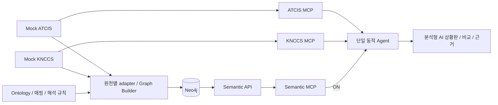

# 분석형 AI PoC — 이기종·이형식 C4I와 Data Fabric

## 현재 구현 시연 기준 (2026-10-22)

아래는 이전 설계 제안을 보존한 기록이다. 현재 구현은 `c2-domain-demo-v3`, F1~F7, 육군/해군 독립 native 체계와 Data Fabric 콘솔을 사용한다. 확정 질문·기대값·실제 평가 한계는 [SEMANTIC_DEMO](./SEMANTIC_DEMO.md)의 v3 절과 [구현 보고서](./IMPLEMENTATION_REPORT.md)가 기준이다. D1~D7/옛 fixture 규모를 현재 구현으로 간주하지 않는다.

주 시연은 F5 상황보고 갱신과 F7 유형·상태 통합이다. F1~F4/F6은 유형·동일성·조직·lineage·절차·상태 해석을 분리해서 보여준다. OFF에서도 동일 원천 문서를 제공하며 ON의 구조화된 해석 근거와 비교한다. 도구 실행 완료만으로 Ontology 효용이 입증됐다고 결론내지 않는다.

상태: **S9 고도화 설계·Plan 제안**, 2026-10-20. 아직 구현되지 않았다. [구현 계획](./IMPLEMENTATION_PLAN.md), [PRD](./PRD.md), [Semantic 아키텍처](./SEMANTIC_ARCHITECTURE.md)를 함께 따른다. 아래 스키마·업무 규칙은 실제 군 체계와 무관한 합성 예시다.

## 최신 조사 반영 — 아래 집계 제안과 구분

사용자의 후속 지시에 따라 현재는 **Design**이다. [C4I_SYSTEM_DESIGN](./C4I_SYSTEM_DESIGN.md)에 한국군/미군 공개 자료와 원천별 업무·데이터·화면·MCP·Ontology 확장을 반영했다. 육군과 해군을 각각 고정/동적 편제로만 나누지 않고 보고·관측·track·활동·통제/지원 관계의 차이를 표현한다.

주 시연은 '지난 보고 이후 상황보고 갱신'으로 전환한다. 아래 D1~D7·10개 fixture·실험 횟수·도구 5개 확장 범위는 종전 집계 데모 제안이며 새 Plan의 확정 범위/예산이 아니다. 기존 PLAN의 초기화는 사용자가 수행하고 새 계획은 이후 작성한다. 당시 제안/기대값을 삭제하거나 새 조사로 검증된 구현처럼 표시하지 않는다.

## 1. 데모 개요와 핵심 가설

**이기종·이형식 육군/해군 체계 → Data Fabric(Semantic Layer + MCP) → 분석형 AI**를 End-to-End로 연결해 문제와 기술적 해결 지점을 확인한다.

가정은 다음과 같다. 두 원천과 데이터 규모를 작게 유지하고 기존 실행 환경을 재사용해도, 데이터 구조와 업무 해석이 실제로 다르면 통합 문제가 드러날 것이다. 모든 원천에 접근할 수 있는 LLM도 조직 범위, 코드 의미, 포함 기준을 매 질의마다 안정적으로 재구성한다고 보장할 수 없다. 검증할 가설은 **Ontology가 도메인 개념과 체계별 해석을 명시적으로 연결하고 MCP가 그 의미와 근거를 제공하면, Agent의 통합 분석을 더 정확하고 재현·검증 가능하게 할 수 있다**는 것이다.

산출물은 ① 독립 UI·API·DB·시뮬레이터·MCP를 가진 육군/해군 Mock 2개, ② Ontology·원천별 매핑·Neo4j·Graph Builder·Semantic API/MCP로 구성된 Data Fabric, ③ 기존 단일 동적 Agent를 유지하는 분석형 AI 플랫폼이다.

## 2. 기존 데모에서 보완할 점

S8 OFF는 실제로 원천 `list_units`의 `parentCode`만 읽어 D1→B11→C111 관계를 따라갈 수 있었다. Semantic 호출 차단과 별개로 원천이 이미 충분한 관계를 제공한 경우다. 원천 관계를 숨기거나 OFF의 추론을 금지하는 방식으로 해결하지 않는다.

S9는 구조·관계 의미·가용 판정의 차이를 결합한다. 한 체계의 parent나 READY 코드를 다른 체계에 그대로 적용하면 정답이 달라져야 한다. Semantic의 역할은 관계를 독점하는 것이 아니라 **원천 사실을 조직이 합의한 공통 개념과 규칙에 연결해 반복 적용 가능한 해석을 제공하는 것**이다.

## 3. 작은 두 체계의 구조적 차이

REST와 MCP의 전송 형식은 JSON으로 유지한다. JSON 내부의 원천 데이터 모델과 조회 계약을 다르게 만들면 충분하며 XML 서버·메시지 브로커를 추가하지 않는다.

| 항목 | Mock ATCIS — 육군 | Mock KNCCS — 해군 | 통합 지점 |
| --- | --- | --- | --- |
| 데이터 모델 | 조직/장비 master + 별도 상태표, 평탄한 record | 보고서 header + 중첩 contact 항목 + 별도 편성 membership | 원천별 adapter, 공통 SourceRecord/Observation |
| 객체 식별 | `equipmentNo` 단일 키 | `{originator, trackNo}` 복합 키 | 복합 SourceRef, 검증된 공통 연습 ID로 ER |
| 조직 관계 | 상급 코드 기반 고정 편제 | 원소속과 별개인 기간 있는 기동편성 참여 | SUBORDINATE_TO와 MEMBER_OF 구분 |
| 자원 관계 | `ORG/ATT/SUP`: 전속/배속/지원 | `ASSIGNED/SUPPORT/OBSERVE`: 편성 자원/지원/관측 | ASSIGNED_TO 역할과 포함 정책 |
| 유형 | `equipmentType=MBT/APC/UAS` | `category=SURFACE/AIR`, `subtype=FRIGATE/UNMANNED` | 공통 tank/naval_vessel/uav |
| 가용 입력 | `serviceState=FMC/PMC/NMC/UNK` | `engineering.state`, `mission.state` 두 입력 | 단일 상태 매핑과 복합 판정 |
| 위치·이동 | decimal WGS84, 동·북 m/s | 중첩 위경도, course degree·speed knot | 기존 표시용 변환 재사용, 단위 명시 |
| 시간 | epoch milliseconds | timezone이 명시된 ISO 8601 문자열 | UTC 기준 시각과 기간 판정 |
| 페이지 | record 목록 + offset/limit | 보고서 envelope + 불투명 continuation token | 원천별 완결성 검증 |

예를 들어 육군은 `equipmentNo=L-T01, assignedUnit=B11, serviceState=FMC`이고, 해군은 `header.originator=NORTH, contacts[].trackNo=007, engineering.state=UP, mission.state=HOLD`처럼 제공한다. `007`은 문자열로 보존해 선행 0이 사라지지 않게 한다. 두 contact가 같은 trackNo여도 originator가 다르면 다른 원천 기록이다.

해군 contact에는 `classification=OWN_ASSET/OBSERVED`가 있다. 지도에 보이는 OBSERVED contact는 실제 자원 보유를 뜻하지 않는다. 형식의 차이뿐 아니라 같은 '객체 수'를 '가용 전력 수'로 치환할 수 없다는 문제를 드러낸다.

## 4. 최소 업무 규칙과 고정 fixture

아래 규칙을 PoC 전용 `demo-force-availability/v1`로 버전 관리한다. '전력'은 유형별 장비 목록/수량이며 전투력 점수나 교전 추천이 아니다. 질문에 다른 업무 목적이 필요하면 정의되지 않은 개념으로 반환하며 새 규칙을 LLM이 만들지 않는다.

| 규칙 ID | 정의 |
| --- | --- |
| SCOPE-LAND-1 | D1의 명시적 고정 예하를 확장한다. ORG/ATT 포함, SUP는 지원 자산으로 별도 표시하며 합산 시 canonical 기준 한 번만 센다. |
| SCOPE-NAVAL-1 | F1의 소속 코드만으로 범위를 확장하지 않는다. 기준 시각 t에 `validFrom <= t < validTo`인 membership와 ASSIGNED/SUPPORT 역할을 적용한다. null validTo는 열린 종료다. OBSERVE와 OBSERVED contact는 가용 자원에서 제외한다. |
| AVAIL-LAND-1 | FMC=available, PMC=limited, NMC=unavailable, UNK/누락/모르는 코드=unknown. limited는 확정 가용 수에 포함하지 않는다. |
| AVAIL-NAVAL-1 | engineering=DOWN 또는 mission=HOLD이면 unavailable. 둘 다 UP/GO이면 available. 그 밖은 unknown. 누락을 정상으로 간주하지 않는다. |
| IDENTITY-1 | 검증된 연습 식별참조와 호환 유형으로만 연결한다. 같은 이름·위치·trackNo로 병합하지 않는다. 두 체계의 공동지원 UAV 상태/역할은 일관되게 생성한다. |

초기 fixture는 ATCIS 5개 레코드와 KNCCS 5개 레코드, 총 10개로 제한한다. D1→B11→C111과 F1의 활성/만료 membership만 준비한다. 독립 expected 파일에서 아래 결과를 수작업 명세하고 production seed/규칙 코드를 import해 정답을 생성하지 않는다.

| 원천 자산 | 조직·관계 | 원천 상태 | 기대 분류 |
| --- | --- | --- | --- |
| 육군 L-T01 | B11 ORG | FMC | 가용 전차 |
| 육군 L-T02 | C111 ATT | PMC | 제한 전차 |
| 육군 L-T03 | C111 ORG | NMC | 불가 전차 |
| 육군 L-T04 | B11 ORG | UNK | 미확인 전차 |
| 육군 L-U01 | B11 SUP | FMC | 가용 공동지원 UAV |
| 해군 NORTH/007 | F1 활성 ASSIGNED | UP/GO | 가용 함정 |
| 해군 NORTH/008 | F1 활성 ASSIGNED | UP/HOLD | 불가 함정 |
| 해군 NORTH/009 | F1 만료 ASSIGNED | UP/GO | 범위 제외 |
| 해군 NORTH/077 | F1 활성 SUPPORT | UP/GO | L-U01과 같은 공동지원 UAV |
| 해군 SOUTH/007 | OBSERVED | UP/GO | 보유 전력 제외, NORTH/007과 병합 금지 |

통합 대상은 raw 8건, 검증된 고유 자산 7개다. 가용 3개(전차 1·함정 1·UAV 1), 제한 1, 불가 2, 미확인 1이며 동일 객체 상태 충돌은 0이다. 제외 2건은 만료 편성/관측 contact 사유로 따로 표시한다. 기존 v2 기대값에 이 숫자를 소급 적용하지 않는다.

## 5. Ontology와 Data Fabric 책임

기존 System, Unit, Equipment, SourceRecord, Observation을 재사용한다. Unit의 조직 종류로 고정 부대/함대/기동편성을 구분하고, **MEMBER_OF**를 추가해 편제 SUBORDINATE_TO와 구별한다. 관계는 role, validFrom/validTo, 원천 참조·규칙·근거를 가진다. Observation에서 관측된 contact가 있다고 Equipment를 자동 생성하지 않는다.

공통 개념 사전과 해석 규칙은 conceptId, definition, sourceSchemaVersion, ruleId/version, requiredFields, 허용 연산, unknown 처리, evidenceRefs를 가진 typed Python 모델로 정의한다. RDF/OWL 추론기나 일반 rule language를 도입하지 않는다. Graph에는 안정 관계와 버전 있는 규칙 설명/참조·근거를 저장한다. 최신 위치·상태 및 그 판정 결과를 매초 Graph에 적재하지 않는다.

Data Fabric은 위의 adapter·Ontology/매핑·Graph Builder/Neo4j·Semantic API/MCP를 묶는 논리 계층이다. 새 플랫폼이나 별도 서버 묶음을 추가하지 않고 기존 Python 서비스와 Docker Neo4j를 재사용한다. Graph Builder는 공개 원천 API를, Agent는 실제 MCP를 이용한다. 표시 projection은 Agent 근거와 분리한다.

## 6. Semantic MCP가 Agent에게 제공하는 것

기존 다섯 도구를 우선 확장한다. S9-1에서 typed 계약을 먼저 고정하며 도구 이름은 기존 이름을 재사용한다.

| 도구 | S9 확장 |
| --- | --- |
| interpret_concept | 전차/함정/가용 전력의 정의, 원천별 필수 필드, 단일/복합 판정 규칙, unknown 처리, rule/version/evidence |
| resolve_unit_scope | 공통 조직 이름 → 원천 조직/기간 있는 membership/포함 역할/경로·근거. 분석 기준 시각은 run이 고정 |
| find_equipment_refs | 공통 유형과 scope → source refs와 native selector, 제외 이유. live 가용성을 Graph에서 확정하지 않음 |
| resolve_entity | 복합 키와 검증된 IDENTITY-1로 canonical/source refs 연결, unresolved/ambiguous 반환 |
| get_semantic_evidence | 관계와 규칙의 원천 레코드·문서·버전·유효기간 조회 |

ON 예시 흐름은 개념 조회 → 범위/참조 해소 → 원천별 MCP에서 live 상태 조회 → 일반 계산 도구에 Semantic 근거와 원천 근거 전달 → 설명이다. 이 순서를 workflow로 하드코딩하지 않고 기존 native tool-calling loop가 필요에 따라 선택·반복한다.

복합 상태 계산의 책임도 명시한다. Semantic 서비스가 AND/OR/필드 동등 비교로 표현되는 검증된 typed 판정표를 반환하고, 플랫폼의 일반 계산기는 해당 근거를 검증해 적용한다. 임의 Python/Cypher/eval 실행은 금지한다. 체계별 규칙은 플랫폼 계산 코드에 복사하지 않는다. 모든 필수 필드·페이지·현재 run의 evidence가 없으면 partial/unknown으로 처리한다.

## 7. OFF/ON 비교의 공정성

두 모드는 같은 원천 snapshot, 질문, 모델 설정·예산, 빈 대화를 사용한다. source MCP의 native schema·코드표·편성 보고 의미는 양쪽에 동일 공개한다. 새로운 `read_reference_document` 원천 도구로 사람이 읽을 코드표/업무 정의를 제공하고, 공통 집계 정책 문서도 양쪽이 같은 버전/hash로 조회할 수 있게 한다. 문서 조회는 Graph 해석 helper를 실행하지 않는다.

OFF는 이 원문을 읽고 자체 추론할 수 있다. ON은 같은 지식의 구조화된 Ontology·검증된 관계·typed 판정 근거를 추가 사용한다. OFF 정답도 정답으로 평가하며, Semantic assertion이 없는 결과는 모델 추론으로 표시한다. source 문서를 공개하지 않는 실험을 추가하면 '추가 지식 효과'로 별도 보고하고 구조화 효과와 혼합하지 않는다.

## 8. 시연 순서와 세 질문

1. 두 원천 UI에서 육군 master/status join과 해군 report/membership/contact의 차이를 보여준다.
2. OFF로 질의하고 원천 레코드·참조 문서·모델의 해석 과정을 확인한다.
3. 같은 질문/snapshot으로 ON을 실행하고 Semantic concept/rule/관계 경로와 native 상태 근거를 펼친다.
4. 결과 표에서 가용·제한·불가·미확인, 제외 사유와 중복 제거를 비교한다.
5. 해군 NORTH/008의 HOLD→GO 변경 후 새 snapshot으로 재질의한다. 안정 hash가 같으면 Graph rebuild 없이 가용 함정 1→2, 통합 가용 3→4가 되어야 한다.
6. NORTH/009 membership를 기준 시각에 유효하게 변경하면 새 안정 build에서만 해당 함정이 범위에 들어온다. 과거 run의 결과는 바뀌지 않는다.

| 질문 | 고정 기대값 | 기술적 해결 지점 |
| --- | --- | --- |
| 모의 1사단의 가용한 전차를 보여줘 | 전차 4대 중 확정 가용 L-T01 1대, 제한 1·불가 1·미확인 1 | 고정 예하와 ORG/ATT 포함, PMC 분리 |
| 모의 1함대의 가용한 함정을 보여줘 | NORTH/007 1척 | 활성 membership, 보유/관측 구별, UP 하나만으로 가용 판정하지 않음 |
| 모의 1사단과 1함대의 가용 전력을 통합해줘 | raw 8/unique 7, 가용 3·제한 1·불가 2·미확인 1 | 유형/상태/범위 공통화, 공동지원 UAV 중복 제거와 근거 |

## 9. 추가 핵심 시나리오 — 관계·시간·동일성·정책

기존 세 질문을 D1~D3으로, 아래 네 시나리오를 D4~D7로 식별한다. 새 자산·서비스 없이 같은 10개 레코드를 사용한다. D4/D6은 첫 시연의 우선 항목이고 D5/D7은 시간·버전 효과를 확인하는 심화 항목이다. 모두 구현·결정론적 검증 범위에 포함하며 실제 GPT 검증 범위는 10절에서 구분한다.

### D4. 같은 '1사단 자원'도 관계에 따라 다른 집합

질문: **“모의 1사단의 원편제 장비, 배속 장비, 지원 장비를 구분해줘. 전부 소유 장비로 세어도 돼?”**

원천 owner/assigned 코드나 예하 경로 하나만 읽으면 지원 UAV까지 소유 자산으로 설명하기 쉽다. Ontology는 조직 예하와 자산-조직 관계를 구별하고 역할을 보존한다. 이 데모의 '원편제'는 ORG 관계를 뜻하는 가상 용어이며 법적 소유권이나 실체계의 편제 정의를 주장하지 않는다.

| 관계 기준 | 기대 자산 집합 | 수량 |
| --- | --- | --- |
| 원편제 ORG | L-T01, L-T03, L-T04 | 3 |
| 배속 ATT | L-T02 | 1 |
| 지원 SUP | L-U01 | 1 |
| 원편제+배속 | L-T01~L-T04 | 4 |
| 지원 포함 현황 | 위 4대 + L-U01 | 5 |

이 표는 가용성과 무관한 관계 기준 현황이다. 지원 포함 집합을 '소유 5대'로 바꾸거나 NMC/UNK 자산을 가용으로 바꾸면 실패다. 기존 D1~D3의 기본 scope/수량은 바꾸지 않는다.

추가 구현: resolve_unit_scope/find_equipment_refs에 허용된 `scopeView=organic_only/organic_and_attached/support_inclusive`와 relationRole/path 근거를 추가한다. scopeView는 ORG/ATT/SUP 의미를 Ontology에서 선택하는 인수이며 Agent가 임의 관계 표현식을 제출하지 않는다. UI는 관계별 표와 포함 이유를 제공한다. 같은 자산이 여러 경로로 포함돼도 해당 view 안의 합계는 canonical 기준으로 중복 제거한다.

검증: ORG↔ATT로 한 관계만 바꾼 별도 fixture에서 두 분류만 이동하고 전체 5개 집합은 유지돼야 한다. 분류별 수량과 합집합 수량을 독립 검사하며 OFF의 근거 있는 역할 추론도 정답으로 인정한다.

### D5. 장비 상태는 같은데 편성 기간 때문에 수량이 바뀜

질문: **“모의 1함대의 가용 함정이 어제와 오늘 왜 달라졌어? 장비 상태가 바뀐 거야, 편성이 바뀐 거야?”**

시간 fixture를 `t_before=2026-10-19T00:00:00Z`, `t_after=2026-10-20T00:00:00Z`로 고정한다. NORTH/009의 membership 종료는 t_after이며 시작은 t_before보다 이르다. 다른 대상의 membership는 두 시점 모두 유효하다. 함정의 UP/GO·UP/HOLD는 두 시점에서 동일하다. t_before/t_after의 원천 불변 snapshot을 각각 준비하며 모든 관측 시각은 해당 분석 시각 이하여야 한다.

| 기준 시각 | 함대 가용 함정 | 육·해군 통합 값 |
| --- | --- | --- |
| t_before | NORTH/007, NORTH/009: 2척 | raw 9/unique 8, 가용 4·제한 1·불가 2·미확인 1 |
| t_after, 종료 경계 포함 | NORTH/007: 1척 | 기존 raw 8/unique 7, 가용 3·제한 1·불가 2·미확인 1 |

정답 이유는 '009 고장'이 아니라 membership 종료다. 유효성은 `[validFrom, validTo)`로 계산한다. 분석 시각은 고정 run 기준이며 LLM이 서버 시계나 임의 날짜로 대체하지 못한다. 관측 시점과 관계 유효 시점도 구분해 표시한다.

추가 구현: snapshot/build를 각각 고정한 시점별 분석 실행과 결과 비교 묶음을 제공한다. 사전에 알려진 기간이 두 snapshot의 안정 export에서 동일하면 같은 Graph를 재사용할 수 있다. 뒤늦게 알게 된 관계를 과거 snapshot에 삽입하지 않는다. Agent가 두 시점의 raw 근거를 한 run에 섞지 않도록 각 시점은 독립 run으로 분석하고 비교 서비스/UI가 두 결과·source/관계 근거를 연결한다. OFF/ON은 각 시점 안에서 같은 snapshot을 사용한다.

검증: t_after 직전/정각, 열린 종료, 미래 관측 유입 금지, 비교 후 과거 run 불변, snapshot 만료/미수집 시 '재현 불가'를 검사한다. 오늘 상태를 어제 상태로 대신 쓰면 실패다.

### D6. 두 기록은 같은 자산, 같은 번호는 다른 기록

질문: **“L-U01과 NORTH/077은 두 대야? NORTH/007과 SOUTH/007은 같은 객체야? 근거를 보여줘.”**

L-U01/NORTH/077은 같은 검증된 연습 식별참조와 호환 유형으로 연결된 UAV 1개다. 반면 NORTH/007과 SOUTH/007은 복합 원천 키가 다르고 연결 근거도 없다. 007 일치만으로 같은 실제 객체라고 확정하지 않는다. SOUTH/007은 관측 기록이므로 '함정 자산 2개'라고 단정하지도 않는다. 서로 다른 원천 기록이라는 사실과 서로 다른 실물이라고 확정하는 판단을 구분한다.

추가 구현: resolve_entity 응답에 `sourceRecordKey`, `status`, `canonicalId?`, `sourceRefs`, `appliedRule`, `evidenceRefs`, 미해결 이유를 제공한다. 확정 canonical 연결은 근거가 있을 때만 생성한다. UI는 두 원천 기록 → canonical UAV 1개 경로와, 단순 번호 일치만 있는 미연결 기록을 대비한다. 지원 관계 두 개를 전속 소속 충돌로 바꾸지 않는다.

검증: UAV의 연습 식별참조를 제거한 별도 overlay에서는 unresolved로 바뀌고 고유 7개를 확정하면 안 된다. 선행 0, originator 변경, ID 재사용 epoch, 유형 불일치, 표시명 변경도 검사한다. '병합하지 않음'이 곧 '서로 다른 실물로 검증됨'을 뜻하지 않는다.

### D7. 데이터는 그대로, 집계 기준만 바꾸기

질문: **“현황 집계에 제한 가용도 포함하면 대상이 어떻게 달라져? 기존 확정 가용 수와 구분해줘.”**

원천 snapshot과 자산의 상태 분류는 그대로 두고 versioned **집계 정책**만 선택한다. P1은 available만, P2는 available+limited를 대상으로 한다. P2가 PMC 자체를 available로 재분류하지는 않는다. P2는 미래 가상 전투 효과나 임무 적합성이 아니라 현황 집계 포함 기준이다.

| 정책 | 대상 집합 | 대상 수 | 상태 분류 |
| --- | --- | --- | --- |
| P1 확정 가용 | L-T01, NORTH/007, 공동지원 UAV | 3 | available 3, limited 1은 별도 |
| P2 제한 가용 포함 | P1 + L-T02 | 4 | available 3, limited 1 유지 |

추가 구현: `aggregationPolicyId/version`을 `availabilityRuleId/version`과 분리한다. 공통 정책 문서와 structured Semantic 정의는 같은 원문 버전을 참조한다. interpret_concept/근거 조회와 계산이 선택한 정책을 고정하며, 새 정책은 별도 immutable build/bundle을 사용한다. UI는 추가된 L-T02, 포함 규칙과 원천 PMC 관측을 표시한다. 런타임에 LLM이 정책을 작성하거나 기존 build를 수정하지 않는다.

이 비교는 `policy_contrast`이고 같은 정책을 고정하는 `semantic_ab`와 구분한다. 동일 원천 데이터라도 Graph/policy가 다르므로 '동일 조건 ON/OFF' 결과로 합치지 않는다. OFF/ON 비교를 한다면 P1 안에서 한 쌍, P2 안에서 한 쌍을 따로 구성한다. 새 정책은 새 대화/run으로 실행해 이전 정책 대화의 의미가 재사용되지 않게 한다.

검증: P1→P2의 차집합은 정확히 L-T02이고 모든 live 값·상태 분류는 동일해야 한다. P1 재조회 결과는 여전히 3이어야 한다. '가용이 4개가 됐다'고 PMC를 정상 상태로 변경하거나 source를 수정하면 실패다.

### 시나리오별 핵심 효용과 구현 연결

| ID | 보여주는 Ontology/Semantic 효용 | MCP/계산·화면 | 검증 축 |
| --- | --- | --- | --- |
| D4 | 같은 조직 이름 아래 관계의 의미로 집계 범위를 선택 | scopeView, role/path, 관계별 표 | 포함 집합과 중복 제거 |
| D5 | 관계 유효시간과 관측 시각을 구별 | 시점별 고정 scope/run·비교 묶음 | 기간 경계와 과거 재현 |
| D6 | source record와 실제 자산의 동일성을 구별 | ER 판정/미해결 이유·canonical 경로 | 잘못된 병합/확정 방지 |
| D7 | 상태 해석과 업무 집계 정책을 구별 | policy version·차집합·정책 비교 | 데이터 불변과 정책 영향 |

## 10. 평가·완료 조건

결정론적 규칙/실제 MCP/실제 Neo4j/브라우저 검증과 실제 GPT 효용 실험을 구분한다. D1~D7과 반례는 모두 결정론적/통합 검증 대상이다. 기본 GPT 실험은 D1~D4/D6의 5질문×OFF/ON 각 1회, 총 5쌍/10 run이다. D5의 두 시점과 D7의 두 정책은 각각 두 쌍/4 run의 추가 실제 GPT 검증으로 분리한다. 전 시나리오를 실제 GPT로 검증하면 총 9쌍/18 run이며 기본 결과와 추가 결과를 따로 보존한다. 실행하지 않은 D5/D7을 GPT 검증 완료로 표시하지 않는다. 소표본은 탐색적 결과이며 반복 안정성을 주장하려면 양쪽 동일 조건으로 추가 반복한다. ON 실패·OFF 성공·토큰/시간 증가도 기록한다.

평가는 정답 자산 집합·분류·scope, 근거가 연결된 해석 비율, 무근거 관계/동일성 주장, 도구·모델 호출/토큰·시간, snapshot/rule/policy/version 재현성을 포함한다. 도구 호출 성공만으로 가설을 입증하지 않는다. 상태 해석을 유지한 채 제한 가용의 집계 포함 정책만 바꾸는 D7, live 상태만 바꾸는 실험, 유효시점만 바꾸는 D5를 분리해 어느 계층 때문에 결과가 달라졌는지 검증한다.

추가 서버, Agent framework/Multi-Agent, 범용 ETL/CDC, 벡터 DB, 고급 온톨로지 편집 UI, 실제 군 체계 재현은 범위 밖이다. 단순한 예제에서 관계·코드의 조합, 근거, 변경 영향이 관찰되면 첫 고도화의 목적을 달성한다.
