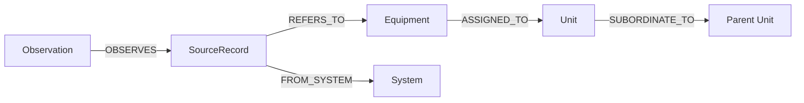

# Ontology·매핑·Knowledge Graph 설계

## v3 구현 모델·검증 경계 (2026-10-22)

`battlefield_ontology/domain.py`의 명시적 native adapter, `domain_rules.json`, 검토된 문서 version/hash 목록 `domain_documents.json`을 분리한다. Ontology 3.0.0, adapter 3.0.2를 catalog hash에 포함한다. 생산 코드가 테스트 gold를 읽지 않는다. SourceRecord→공통 객체의 기계적인 원천 참조에는 adapterVersion/provenanceKind를 기록하고 관련 없는 도메인 규칙을 근거로 붙이지 않는다.

타입은 System, SourceRecord, Unit, Equipment, EquipmentType, ContactObservation, Observation(관계 assertion 근거), Report, Incident, Activity, SourceDocument, InterpretationRule, ConceptDefinition, Procedure, StepDefinition이다. 주요 탐색 관계는 SUBORDINATE_TO, ASSIGNED_TO, REFERS_TO, DERIVED_FROM, SUPERSEDES이다. Procedure/StepDefinition과 일부 정의 노드는 payload로 연결 정보를 보유하며 범용 절차 Graph 엔진이나 RDF/OWL 추론을 구현한 것은 아니다.

- 원천별 native ID·epoch·recordType을 보존한다. contact는 originator/trackNo 복합 키이며 선행 0을 유지한다. SURFACE 관측 영역은 함정 유형을 뜻하지 않는다.
- Entity Resolution은 명시적 association과 문서 근거만 사용한다. NORTH/077→UAV, NORTH/007→상륙장갑차를 연결하고 SOUTH/007은 미연결이다.
- 부대 코드는 동일성을, previousName은 단일 이전 명칭을 보존한다. 지원 관계의 시작/만료와 소속·배속·지원·통제 역할을 구분한다. 완전한 시점별 조직 이력 저장소는 이번 범위가 아니다.
- 원천 export의 schema/dataset, 문서 hash/검토 revision, 관계 endpoint, 조직 순환, 상충 association, sourceTime 이후 알려진 자료를 검증한다. 규칙을 LLM이 생성하지 않는다.
- 원천의 live 정비·임무·위치·활동 상태와 ACK는 안정 Graph에 저장하지 않는다. 상태 정의와 P1/P2 포함 정책만 저장하고 run의 native evidence를 계산한다.
- 가용 상태는 available/limited/unavailable/unknown으로 분리한다. P1 가용 4개, P2 제한 가용 포함 5개여도 원래 분류는 유지한다.

문서는 체계별 REF-01/ORG-01/EX-01/SOP-01 총 8개 원문이다. 같은 documentId도 systemId로 한정한다. 공개 일반 개념과 합성 연습 지침/SOP를 구분하며 실제 군 권한·교리의 재현을 주장하지 않는다. 이하 v2 매핑/seed는 역사적 호환 기록이다.

상태: v0.6 S8 구현 명세, 2026-10-16. Ontology/매핑 버전은 2.0.0, ER 규칙 버전은 1.0.0이다. 모든 데이터·조직·코드는 이 PoC 전용 합성이며 실제 ATCIS/KNCCS 스키마를 설명하지 않는다. 서비스/동기화 경계는 [SEMANTIC_ARCHITECTURE](./SEMANTIC_ARCHITECTURE.md)를 따른다.

## 1. 의미를 정의하는 곳

Ontology는 `packages/ontology`의 Python/Pydantic 타입·관계 enum·명시적 매핑/ER 함수로 정의한다. 원천 seed는 독립 JSON이며 개념 별칭은 `semantic_core/service.py`의 검토된 사전이다. 별도 YAML 규칙 엔진과 RDF/OWL은 도입하지 않는다. Neo4j label만으로 도메인 정의를 대신하지 않는다.

규칙 ID·버전은 생성된 assertion/Observation에 남긴다. 입력 필드·출력 타입·검증은 명시적 Python 함수와 타입, 독립 fixture 테스트가 정의한다. 변경은 코드처럼 검토한다. LLM은 규칙을 작성·수정·Graph에 저장할 권한이 없다. 매핑 수정 시 기존 build를 덮어쓰지 않고 새 버전/build를 만든다.

“모의 1사단의 탱크”는 명시적으로 선택한 조직 + 그 예하 조직에 ASSIGNED_TO된 Equipment 중 kind=tank다. 이름에 “1사단”이 포함됐는지로 판단하지 않는다. “가용”은 원천이 제공한 상태의 명시적 코드 매핑이고 정비 상태·이동 여부로 추론하지 않는다. “전력”은 이 데모에서 장비 목록/유형별 수량을 뜻하며 전투 효과나 임무 적합성 점수가 아니다.

## 2. 노드와 관계

모든 노드/관계는 build의 graphVersion에 속한다. canonicalId는 논리 식별자이고 실제 Neo4j 노드 식별자와 다르다.

| 노드 | 주요 속성 | 경계 |
| --- | --- | --- |
| System | systemId, name, synthetic | atcis / knccs 원천 체계 |
| Unit | canonicalId, displayName, domain, aliases | 모의 조직. 별칭은 유일 ID가 아님 |
| Equipment | canonicalId, kind | 합성 장비 1개. 실시간 위치·가용성 없음 |
| SourceRecord | sourceRecordKey, systemId, datasetId, epochId, recordType, nativeId | 한 원천 기록. 복합 ID 전체로 구분 |
| Observation | observationId, assertionType, sourceRef, snapshotRef, observedAt, payloadHash, payloadJson | 조직·배속·식별 assertion의 근거 관측 및 안정 정보 원문 |
| GraphBuild | graphVersion, status, inputSnapshotSet, stableHashes, versions, builtAt, diagnostics | build manifest 및 공개 상태 |

Unit의 원천 기록도 SourceRecord→REFERS_TO→Unit으로 표현한다. OBSERVES는 근거 관측과 원천 기록 연결이며, 실제 주장 대상·관계는 assertionId로 추적한다. 각 SUBORDINATE_TO / ASSIGNED_TO / REFERS_TO 관계에는 `assertionId, evidenceIds, sourceRefs, ruleId, ruleVersion, effectiveFrom?, effectiveTo?`가 필수다(기간이 없으면 null). evidenceIds는 Observation을 가리킨다. 근거 없는 edge는 공개하지 않는다.

Graph 속성으로 중첩 JSON 객체를 직접 저장하지 않는다. 복합 원천 참조·manifest는 검증된 canonical JSON 문자열/해시 또는 정규화 노드로 저장하고 API에서 타입을 복원한다. 키 필드는 별도 scalar 속성으로 인덱싱한다. 관계 생성에 사용한 작은 안정 정보 원문은 Observation.payloadJson에 내용 hash와 함께 보존한다. 따라서 snapshot 보존 기간이 끝나도 생성 근거를 확인할 수 있고 Semantic API가 Builder의 파일시스템을 공유할 필요가 없다. 원문 크기 상한을 검증하며 live 상태 근거 원문은 플랫폼 run 저장소에 보관한다.

1초 위치 이벤트를 Observation 노드로 전부 저장하지 않는다. 이 노드는 안정 정보의 assertion 증거를 표현하며, live 위치/상태 이력은 각 원천 DB에 둔다. 상태 충돌 시 Graph가 현재 상태를 하나로 갱신하는 대신 Agent가 고정 snapshot의 두 관측을 나란히 제시한다.

조직 관계는 cycle 금지, 예하 탐색은 descendant→parent 방향이다. PoC의 유효 시점에는 조직의 주 상급 조직을 최대 하나로 제한한다. 장비는 같은 원천 내 활성 배속 하나를 기본으로 하되, 서로 다른 원천의 배속 충돌은 provenance별 assertion으로 유지한다. 보조 배속·작전 통제 관계를 주 배속과 섞지 않는다. 향후 요구 시 별도 관계 타입으로 추가한다.

## 3. 가상 원천 스키마와 정규화

두 체계 모두 안정 정보와 live 상태를 공개하지만 표현을 다르게 만든다. 아래 필드·코드·API는 구현할 목표 계약의 예시다.

| 의미 | Mock ATCIS | Mock KNCCS | 공통 해석 |
| --- | --- | --- | --- |
| 객체 ID | trackKey | contactNo | SourceRef.nativeId, 체계 간 유일성 없음 |
| 조직 | ownerUnitCode | orgRef | 원천 조직 SourceRecord 참조 |
| 상급 조직 | units[].parentCode | formations[].superiorRef | SUBORDINATE_TO 생성 |
| 유형 | classCode: TANK/APC/SUPPORT/UAV | platformCategory: SURFACE/AIR | tank/armored_vehicle/support_vehicle/uav/naval_vessel |
| 가용 | readyCode: R/N/U | serviceability: READY/NOT_READY/UNCONFIRMED | available/unavailable/unknown |
| 소속 | sideCode: F/H/X | identity: FRIEND/HOSTILE/UNKNOWN | friendly/hostile/unknown |
| 위치 | pos: {lon, lat} | geo: {latitude, longitude} | WGS84 {longitude, latitude} |
| 속도 | velocity: {eastMps,northMps} | motion: {courseDeg,speedKnots} | 동·북 m/s |
| 공통 연습 ID | exerciseAssetRef | exerciseAssetRef | 검증된 연습 ID의 일치가 ER 근거 |
| 원천 관측 시각 | observedAt | reportTime | UTC ISO 8601, sourceTime과 구분 |

KNCCS의 course는 북쪽 0도/시계 방향이다. `mps = knots × 1852 / 3600`, `east = mps × sin(course)`, `north = mps × cos(course)`로 명시한다. 지도 GeoJSON은 [longitude, latitude]이며 비어 있거나 잘못된 좌표를 (0,0)으로 대체하지 않는다.

AIR를 무조건 uav로 매핑하지 않는다. 가상 필드 `aircraftType=UNMANNED`가 있어야 uav이고, 그 외는 unknown이다. 공통 유형/가용 코드 해석은 Semantic 서비스의 책임이다. ON은 interpret_concept의 sourceMappings와 mappingRule 근거로 공통 코드를 해석하며 상태 관측은 원천 MCP에서 읽는다. OFF의 원천 조회/집계는 native 코드만 사용하고 normalize_equipment·resolve_identity를 호출하지 않는다. 지도/시뮬레이터/Builder의 변환 결과는 OFF 분석 근거로 주입하지 않는다.

예하 조직, 배속, 공통 연습 ID는 OFF도 읽을 수 있는 각 원천의 원시 공개 API/MCP 데이터다. Ontology ON에서만 존재하는 비밀 정답표로 시연하지 않는다. 공통 식별자가 없는 crosswalk는 별도 버전 관리 입력으로 출처를 밝히며, 같은 정보 조건의 비교에서는 원시 crosswalk도 OFF 도구에 읽기 공개한다. 공개하지 않는 실험은 “추가 지식 제공” 실험으로 별도 표시한다.

## 4. Entity Resolution 정책

| 순서 | 규칙 | 결과 |
| --- | --- | --- |
| 1 | 정확한 source 복합 키 | 원천 기록 식별, 다른 체계와 자동 병합하지 않음 |
| 2 | 같은 dataset의 유효하고 유일한 exerciseAssetRef + 호환 타입 | 동일 Equipment 연결, ruleId=ER-EXERCISE-ID |
| 향후 확장 | 버전·근거·유효 범위가 있는 명시적 crosswalk | 현재 미구현. 이번 PoC는 공개 exerciseAssetRef 사용 |
| 4 | 이름/위치 유사, 식별자 없음, 상충 식별자/타입 | unresolved 또는 conflict. 확정 연결 금지 |

연습 ID는 단순 문자열 일치만 확인하지 않고 네임스페이스·데이터셋·유일성·유효 범위를 검증한다. 동일 식별자가 서로 다른 유형에 재사용되면 오류로 격리한다. Unit은 명시적 조직 코드 crosswalk 없이 체계 간 이름만으로 합치지 않는다. seed에서 canonicalId를 부여할 수 있지만 Builder가 seed의 비공개 정답표를 조회해서 관계를 만드는 것은 금지한다.

ER 응답은 `status=resolved/unresolved/ambiguous/conflict`, canonicalId(확정 때만), sourceRefs, appliedRule, evidenceRefs, candidates를 가진다. fuzzy 점수나 LLM 확신도를 확정 근거처럼 표시하지 않는다. reset 후 epoch가 달라진 기록은 규칙을 재검증하고 새 SourceRecord로 만든다. dataset 연습 ID가 유효할 때만 이전 canonicalId와 연결한다.

기본 v2 데모는 동일 UAV를 양쪽 가용·아군·동일 초기 위치/벡터로 제공한다. 두 조직 관계는 assignmentRole=shared_support인 비전속 공동지원 배속이며 Graph 관계·Observation 원문에 역할과 출처를 보존한다. 실제 오류/negative fixture에서 상태가 충돌하면 ON 집계가 conflicting으로 분리하고 확정 가용에 넣지 않는다. 원천 누락이나 미완결 페이지도 확정 합계로 숨기지 않는다. OFF는 이런 공통 의미 분류를 서버 코드로 실행하지 않는다.

## 5. 조회 예시와 근거

질문: “모의 1사단의 가용한 탱크를 보여줘.”

1. resolve_unit_scope가 별칭을 검토된 Unit에 연결하고 예하 조직 경로를 반환한다. 동명이면 후보를 제시한다.
2. find_equipment_refs가 scope 내 탱크의 canonical/source refs와 배속 assertion을 반환한다.
3. Agent가 해당 source refs로 ATCIS MCP를 호출해 고정 snapshot의 가용 상태를 조회한다.
4. 현재 run의 목록/집계 근거로 가용·불가·미확인을 구분한다. 관계 경로와 상태 관측은 서로 다른 근거다.

예시 경로: `ATCIS:T-A01 → Equipment:EX-T01 → Unit:DEMO-B11 → Unit:DEMO-D1`. 경로의 처음 화살표는 REFERS_TO, 다음은 ASSIGNED_TO, 마지막은 SUBORDINATE_TO다. 화면에는 원천 이름·조직 경로·규칙 버전·관측 시각을 함께 표시한다. Graph가 가용 탱크 목록을 캐시해서 원천 MCP 조회를 생략하지 않는다.

## 6. 검증 조건

현재 구현은 정확한 조직 이름/ID 탐색과 동명 후보 반환을 제공한다. 일반 별칭 관리, crosswalk 편집, 유효 기간 추론은 향후 확장이다. 기간이 없는 합성 데이터에 유효 기간을 만들어 넣지 않는다. 화면 표시명은 Python/Graph의 `name`을 사용한다.

- 규칙별 입력/출력 fixture, unknown 코드, 좌표/속도 단위, 동명 조직, 하위 조직 cycle, 누락 조직, 유효 기간 경계.
- 동일 ID가 다른 system/epoch에 존재하는 경우, 공통 ID 중복/타입 충돌, 원천 1개에서만 관측된 객체, 동일 객체의 배속·상태 충돌.
- 같은 입력+버전의 재구축에서 canonical 결과/hash 일치, 중복 없음, 실패 build 비공개, 원천 gap/reset 복구.
- 관계 하나를 삭제/변경한 반례에서 해당 scope/evidence가 실제로 달라짐. 관계가 없는데 이름만 보고 결과를 유지하면 실패.
- run이 고정한 graphVersion과 모든 반환 경로/근거의 버전 일치. Graph의 미래 관계가 과거 snapshot 분석에 유입되지 않음.
