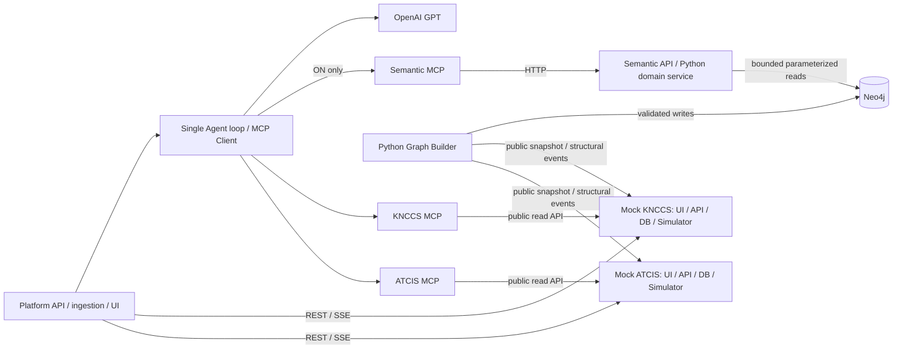

# 이종 C4I·Semantic Layer 아키텍처

## v3: Data Fabric의 core와 의미 기능 분리 (2026-10-22)

현재 `semantic-api`는 Data Fabric API/콘솔의 독립 진입점이다. `fabric.py`는 원천 접근·catalog·표시 projection·snapshot 준비를, `semantic_core/domain.py`는 검증된 Graph 조회를 담당한다. 설정된 원천 URL만 접근하며 원천 DB를 공유하지 않는다.

- core: GET /v1/sources, /v1/catalog, /v1/situation, /v1/source-projections/{system}, /v1/events와 POST /v1/analysis-contexts.
- OFF context는 Graph를 준비하지 않는다. Graph 미설정에서도 catalog·원천 도구·OFF를 실행할 수 있다. 허용된 부분 수집은 coverage로 명시하며 ON에는 불완전 원천 집합을 조용히 허용하지 않는다.
- ON은 Builder의 인증된 관리 API로 snapshot 안정 hash와 catalog hash에 맞는 READY build를 준비한다. 실패하면 native 해석으로 몰래 대체하지 않는다.
- Builder는 독립 프로세스다. sourceScope, checkpoint/재시도, 검증 후 공개를 재사용하며 보고/구조 변경은 안정 자료 동기화 대상이다. 위치·상태만 변하면 안정 Graph를 새로 만들지 않는다.
- Semantic MCP: interpret_concept, resolve_unit_scope, find_equipment_refs, resolve_entity, get_semantic_evidence, query_relations, get_procedure_definition. 임의 Cypher나 Graph 쓰기 도구는 없다.
- 응답은 graphVersion·입력 안정 hash·ontology/mapping/resolution 버전과 문서/규칙/원천 참조를 포함한다. 범위·페이지가 잘리면 partial로 표시한다.
- 동일 질문 비교는 두 독립 대화에 동일 sourceSnapshotSet·기준 T0·선택 기준보고·문서 version/hash·모델/예산을 적용한다. 정지 원천의 긴 준비 시간과 움직이는 원천의 capture 편차를 구분한다.

실제 Neo4j Python 공식 드라이버와 Docker를 사용한다. 세부 한계·검증은 [현재 보고서](./IMPLEMENTATION_REPORT.md), 이하 내용은 기존 v2 구조의 기록이다.

상태: v0.6 S8 구현 명세, 2026-10-16. [PRD FR-10~18](./PRD.md)의 구현 기준이다. 실제 검증은 [구현 보고서](./IMPLEMENTATION_REPORT.md)에 기록한다. 기존 구조와의 변경에는 이 문서를 우선 적용하고, 유지하는 동작은 [ARCHITECTURE](./ARCHITECTURE.md)를 따른다.

## 1. 책임과 데이터 흐름

각 Mock는 상대 체계·플랫폼·Neo4j를 import하거나 DB를 공유하지 않는다. UI는 자기 Python API만 호출한다. 플랫폼 수집기와 Builder는 공개 REST/SSE를 사용할 수 있지만, Agent의 원천/의미 조회는 반드시 해당 MCP를 통한다. Semantic API는 Agent 밖의 플랫폼 서비스에서도 재사용한다.

| 구성 | 소유 책임 | 소유하지 않는 것 |
| --- | --- | --- |
| Ontology 정의 | 공통 타입·관계·별칭·가상 코드 매핑·ER 규칙의 버전 관리 | 상태 저장·LLM 호출 |
| Mock ATCIS / KNCCS | 각 원천 데이터·실시간 상태·시뮬레이션·불변 snapshot·이벤트 | 공통 Graph·상대 DB |
| Python Graph Builder | 원천 수집·정규화·ER·검증·build 공개·동기화 cursor | Agent 분석·실시간 위치 저장 |
| Graph repository / Neo4j | 버전별 의미·관계·출처의 저장·제약·조회 | 현재 가용성의 판정 |
| Semantic domain service / API | 개념 해석·조직 범위·장비 참조·동일성·근거 조회 | LLM 기반 관계 생성·C4I 상태 변경 |
| Semantic MCP | API를 읽기 도구로 노출, 도구 description/schema 소유 | 중복 도메인 규칙·Graph 직접 쓰기 |
| Platform | 원천별 projection·run/evidence·대화·비교·UI | 원천 상태/조직 데이터의 수정 |

MCP는 Ontology를 구축하는 저장 형식이 아니다. 사람이 검토한 정의와 Python 매핑 규칙으로 Graph를 구축하고, Semantic API/MCP가 이를 질의 가능하게 만든다.

## 2. 실행 단위와 기존 코드 재사용

다음 이름·주소는 구현 전 검토할 제안이다. 기존 README 실행 명령으로 아래 서비스가 이미 뜬다고 해석하지 않는다.

| 실행 단위 | localhost 기본 주소 제안 | 데이터 |
| --- | --- | --- |
| mock-atcis | :4100 | 독립 atcis.sqlite 및 자체 정적 UI |
| atcis-mcp | :4200/mcp | ATCIS 공개 API 연결 |
| mock-knccs | :4110 | 독립 knccs.sqlite 및 자체 정적 UI |
| knccs-mcp | :4210/mcp | KNCCS 공개 API 연결 |
| platform-api | :4300 | platform.sqlite, 통합 UI·Agent |
| semantic-api | :4400 | Neo4j read, 공통 도메인 로직 |
| semantic-mcp | :4410/mcp | Semantic API 연결 |
| graph-builder | Python CLI / 단일 worker, 내부 관리 :4420 | source cursor·build 상태를 Neo4j에 기록 |
| neo4j | :7474 HTTP, :7687 Bolt | Docker named volume |

기존 `services/mock-c4i`, `c4i-mcp`를 먼저 회귀 기준으로 보존하고 ATCIS로 단계적으로 전환한다. KNCCS를 독립 추가한 뒤 플랫폼 연결을 원천 registry로 확장한다. 별도 제품처럼 두 번 전면 재작성하지 않는다. 기존 loop·MCP schema 변환·근거·SSE 복구·정적 UI 배포·지리 계산·방책 선택을 재사용한다.

목표 디렉터리는 `services/mock-atcis`, `mock-knccs`, `atcis-mcp`, `knccs-mcp`, `semantic-api`, `semantic-mcp`, `graph-builder`, 기존 `platform-api`다. 순수 타입·규칙·매핑은 `packages/ontology`, 의미 서비스/Graph 접근 공통 코드는 `packages/semantic-core`를 제안한다. Builder와 Semantic API가 이 라이브러리를 사용하되 API 간 호출을 대체하는 전역 서비스 객체는 두지 않는다. 프론트엔드는 기존 `map-ui`·시각 토큰을 재사용해 원천 UI 두 개와 플랫폼 UI를 제공한다.

각 Mock wheel에 해당 UI·시나리오를 포함한다. 필요한 순수 Python wheel 외 플랫폼·상대 Mock·Neo4j·OpenAI·Node가 실행 의존성이 되어서는 안 된다. 원천별 설정·DB 파일·포트·시뮬레이터 수명·reset을 분리한다.

## 3. 원천 계약과 시점

상세 가상 스키마는 [ONTOLOGY_DESIGN](./ONTOLOGY_DESIGN.md)을 따른다. 두 체계에 동일 JSON을 이름만 바꾸어 제공하지 않는다. 각 공개 API는 최소 다음 기능을 제공한다.

- 원천 정보, 독립 health/readiness, 시나리오/epoch, pause/resume/reset.
- 불변 snapshot 생성·보존·ID 재조회, snapshot 기준 객체 목록/상세/집계와 페이지 처리.
- 조직 목록·직속 상하위 관계·장비 배속·공통 연습 식별자 등 원시 관계 데이터 조회. OFF도 이 사실에 접근할 수 있어야 한다.
- 순서 있는 SSE 및 cursor 이후 이벤트 조회. 조직·배속·식별 정보 변경과 이동·상태 변경을 구분한다.
- 안정 정보 export: 특정 snapshot의 조직·배속·식별 속성과 그 내용 hash를 공개 API로 반환한다. Builder가 DB를 읽지 않는다.

`SourceRef = {systemId, datasetId, epochId, recordType, nativeId}`다. `datasetId`는 합성 연습 데이터셋 식별자, epoch는 reset으로 바뀐다. 원천 ID가 같아도 다른 체계/epoch의 기록을 자동으로 같은 것으로 보지 않는다.

`SourceSnapshotSet = {atcis: {datasetId, epochId, snapshotId, sequence, sourceTime, stableDataHash}, knccs: {...}}`를 run/비교의 기준으로 저장한다. snapshotId·sequence는 원천별 값이며 전역 sequence를 만들지 않는다. 두 snapshot은 분산 원자 snapshot이 아니다. 채집 시각과 시각 차이를 명시한다. 시연은 두 시뮬레이터 pause 후 채집을 기본으로 하고 pause가 불가한 경우 capture skew 2초 이내를 초기 제안으로 검증한다. capture 중 reset·일관성 실패는 재시도하거나 준비 실패 처리한다.

일반 분석도 원천별 snapshot을 고정한다. 비교 실행은 두 원천을 모두 미리 고정한다. 현재 지도는 계속 갱신할 수 있지만 분석 기준 snapshot은 바꾸지 않는다. snapshot은 비교가 참조하는 동안 보존하고, 삭제·만료 시 재현 불가 상태를 표시한다.

## 4. Graph 생성·동기화

PoC에서는 작은 합성 데이터의 **불변 build 단위 전체 materialization**을 사용한다. 안정 정보 변경 때 전체 build를 다시 만드는 방식이며, 이동 tick마다 재구축하거나 범용 분산 CDC를 도입하지 않는다.

1. 원천 공개 API에서 snapshot 집합과 안정 정보 export를 확보한다.
2. 버전이 고정된 Ontology·매핑·ER 규칙으로 후보 Graph를 만든다.
3. `BUILDING` build 아래 version-scoped 노드/관계를 idempotent MERGE한다.
4. 타입·출처·참조 무결성·조직 cycle·중복 식별 충돌·관계 방향을 검증한다. 모호한 식별은 미해결로 보존한다. 무효 관계는 공개하지 않고 진단한다.
5. 검증 성공 후 짧은 transaction으로 `READY` 및 active build 포인터와 처리 cursor를 함께 공개한다. 실패 build는 기존 READY를 대체하지 않는다.

노드 키는 `(graphVersion, canonicalId)` 또는 `(graphVersion, sourceRecordKey)`다. canonicalId는 규칙상 같은 개체이면 build 사이에 유지하지만 물리 노드와 관계는 build별로 분리한다. 모든 탐색에 graphVersion을 강제한다. 비교가 참조하는 build는 GC하지 않는다. active 포인터는 일반 조회의 기본값일 뿐 실행 중 버전을 교체하지 않는다.

한 Builder만 쓰기를 소유한다. worker 재시작은 마지막 공개 cursor부터 재생한다. 이벤트 중복 키는 `(systemId, epochId, eventId)`다. 순서 공백·원천 reset은 해당 원천 snapshot 재수집 후 검증된 새 build로 복구한다. 진행 중 안정 정보 변경은 다음 build에 반영하며 입력 snapshot을 섞지 않는다. 안정 hash가 같으면 이동/가용 상태 변경에 rebuild가 필요 없다. cursor 확인 상태와 마지막으로 materialize한 안정 정보 watermark를 구분한다.

Graph build는 입력 SourceSnapshotSet·stableDataHash·ontologyVersion·mappingVersion·resolutionRuleVersion·진단 결과를 기록한다. 비교 준비 시 해당 snapshot의 안정 hash와 정확히 일치하는 READY build를 선택하거나 새로 생성한다. 다른 snapshot에서 만든 build도 안정 hash와 모든 규칙 버전이 같음을 검증한 경우에만 재사용하며 실제 build 입력 참조와 비교 snapshot 참조를 모두 남긴다. 최신 Graph를 고정 snapshot과 무조건 결합하지 않는다.

Plan 구체화: 필요한 build가 없으면 플랫폼이 Builder의 인증된 내부 `POST /internal/build-requests`로 snapshot 집합/규칙 버전을 제출한다(기본 localhost :4420). Builder 단일 worker가 처리하며 GraphBuild에 요청 상태/중복 키를 보존한다. 임의 Graph 쓰기/Cypher API가 아니며 Agent·Semantic MCP에는 노출하지 않는다. 플랫폼은 직접 Neo4j 쓰기를 하지 않고 준비 상태를 조회한다. CLI 초기 build와 배경 동기화도 같은 worker/검증 경로를 사용한다.

BuildRequest의 ID와 `sourceScope`는 Builder의 원천 URL 집합 hash를 포함한다. 작업 조회·대기 큐·재시작 RUNNING 복구·checkpoint는 같은 scope로 제한한다. 다른 포트/원천의 검증 Builder가 사용자 snapshot 요청을 인수해서는 안 된다. 독립 환경은 별도 Neo4j DB/인스턴스를 사용하며 scope 없는 기존 작업을 새 worker가 임의로 처리하지 않는다.

## 5. Semantic API와 MCP

FastAPI 라우트 → SemanticService → GraphRepository → 공식 Neo4j Python driver로 구성한다. Agent 외 서비스도 이 API를 호출한다. thin MCP 어댑터는 HTTP로 같은 API를 사용한다. Builder는 별도 관리 실행 단위이며 Graph 쓰기 기능은 공개 Semantic 조회 API/MCP에 노출하지 않는다.

| API | MCP 원래 이름 | 반환 의미 |
| --- | --- | --- |
| GET /v1/concepts?term= | interpret_concept | 검토된 별칭·타입·코드 해석, 모호성 후보 |
| GET /v1/unit-scopes | resolve_unit_scope | 조직 후보·예하 포함 범위·경로·source unit refs |
| POST /v1/equipment-refs/query | find_equipment_refs | 조직 범위와 유형의 canonical 장비·원천 ID 참조; 현재 가용 상태 없음 |
| GET /v1/entities/resolve | resolve_entity | source ref의 canonical 연결·후보·확정/미해결·적용 규칙 |
| GET /v1/evidence/:id | get_semantic_evidence | 관계 assertion·규칙·원천 참조·build 버전 |
| GET /v1/builds/:version | MCP 외 관리/플랫폼 조회 | 상태·입력 watermark·진단·버전 |

모든 도구는 graphVersion을 필수로 받는다. 범위 탐색은 bounded depth/limit, 전체 수·잘림 여부·continuation을 반환한다. maxDepth 상한 8, pageSize 기본/상한 100을 적용하며 cycle이 없다는 가정만으로 무제한 탐색하지 않는다. 임의 label/관계/Cypher를 모델 입력으로 받지 않는다. 의미 결과를 얻은 뒤 현재/고정 시점 가용 상태는 원천 MCP로 조회한다.

표준 응답은 `{graphVersion, ontologyVersion, mappingVersion, resolutionRuleVersion, items, paths, sourceRefs, evidenceRefs, completeness, warnings}`다. sourceRefs와 evidenceRefs는 구분하며 그래프 내부 element ID를 영속 API 식별자로 쓰지 않는다. 미해결·모호함·잘림·Graph 부재를 빈 결과 0개와 구분한다.

## 6. Agent·플랫폼·비교 계약

S8 정책 `2-native-off`를 적용한다. OFF는 원천 native 필드/코드 조회와 일반 계산만 수행하고 Semantic 코드 해석·조직 해소·동일성 판정을 공유 helper로 호출하지 않는다. ON은 Semantic API/MCP가 반환한 sourceMappings·조직 범위·canonical 연결 근거를 계산에 적용한다. 플랫폼 계산 모듈은 자체 매핑·ER·Graph 조회를 갖지 않는다. 원천 목록/집계는 typeCode/statusCode의 native 값만 비교한다.

interpret_concept는 sourceMappings와 SOURCE-CODE-INTERPRETATION 규칙/버전을 반환한다. 상태 코드를 읽는 시점은 원천 snapshot이며 Graph에 live 가용 상태를 저장하지 않는다. semanticPolicyVersion/sourceToolContractVersion을 run/manifest에 기록하고 다른 정책의 이전 대화는 새 실행에 재사용하지 않는다. UI 정규화·시뮬레이션·Builder 배경 작업은 분석 capability와 구분하며 그 결과를 OFF 근거로 주입하지 않는다.

단일 native loop는 유지한다. 다중 MCP server registry와 실행별 bindings만 확장한다. 자세한 규칙은 [AGENT_DESIGN](./AGENT_DESIGN.md)의 v0.5 절을 따른다.

플랫폼 추가 API:

| API | 역할 |
| --- | --- |
| POST /api/v1/analyses | semanticMode=off/on, snapshotSet·graphVersion 서버 고정 |
| POST /api/v1/comparisons | 질문 입력 → 기준 채집·Graph 준비 → 격리된 OFF/ON run 생성, 202+comparisonId |
| GET /api/v1/comparisons/:id | manifest·양 runId·준비/진행/오류·비교 결과 |
| GET /api/v1/sources | 원천별 수집/MCP/시뮬레이션 상태·watermark |
| GET /api/v1/semantic/status | Graph 준비/지연·활성 build·매핑 버전·오류 |

Comparison manifest에는 질문 원문/hash, SourceSnapshotSet, 사용 Graph build/버전, 모델 ID·실행 파라미터·시스템 프롬프트 버전·도구 변환 버전·각 registry hash, 대화 격리 정책, 두 runId, 시각을 저장한다. 도구 집합 차이는 의도된 실험 조건이다. 비교는 새 빈 대화 두 개를 기본으로 하며 과거 ON 답변·근거를 OFF에 복사하지 않는다. 모델 seed를 지원하지 않는 설정에서 결정론적 생성을 보장하지 않는다.

준비 상태는 preparing/ready/failed, 각 run은 queued/running/completed/partial/failed/cancelled다. 두 run이 끝났어도 하나가 실패·데이터 부족이면 `incomplete` 비교이며 정상 완성 비교와 구분한다. Graph 준비 실패 시 standalone OFF는 계속 가능하고 비교 ON은 준비 오류를 표시한다. ON 실패를 OFF로 조용히 재실행하지 않는다. OFF 전용 서비스 시작은 Neo4j readiness를 요구하지 않는다.

플랫폼 SQLite에는 sources·원천별 cursors·comparisons(manifest)·run mode/build refs·semantic evidence를 추가한다. 원천 수집 projection 키도 systemId/epoch/nativeId 복합키로 바꾼다. 의미 매핑을 사용한 통합 projection을 OFF 실행 컨텍스트로 전달하지 않는다. 근거 원문은 run별로 저장하고 원천 근거와 관계/동일성 근거를 구분한다.

자동 분석은 의미 있는 상태/조직 변경 이벤트로만 큐에 넣고 1초 이동으로 실행하지 않는다. enqueue 시 모드·source snapshot·필요 build를 고정한다. ON에서 일치하는 build가 준비되지 않으면 제한 시간 대기 후 명시적 지연/실패 처리하며, 미래 Graph나 OFF로 바꾸지 않는다. 자동 ON/OFF 쌍 실행은 기본 기능으로 추가하지 않는다.

## 7. Neo4j 운영과 실패 경계

Docker 공식 Community 이미지와 공식 `neo4j` Python driver를 사용한다. 정확한 image tag/digest와 driver 버전은 Plan의 호환성 검증에서 고정하고 `latest`를 재현 가능한 기본값으로 쓰지 않는다. 공식 문서는 Docker 이미지·포트와 Python 연결/parameterized query를 확인하는 기준이다: [Docker](https://neo4j.com/docs/operations-manual/current/docker/introduction/), [Python driver](https://neo4j.com/docs/python-manual/current/), [호환성](https://neo4j.com/docs/python-manual/current/install/).

- Docker Compose는 Neo4j만 우선 담당한다. Python/프론트엔드까지 컨테이너화하는 작업은 필수 범위가 아니다.
- localhost 바인딩, named volume, 인증 값은 로컬 환경변수로 관리한다. reset·volume 삭제를 시작 스크립트에 넣지 않는다.
- startup에서 verify_connectivity, 명시적 database, version-scoped uniqueness constraint, parameterized Cypher를 사용한다. APOC·GDS·OGM·LLM Text-to-Cypher는 필요하지 않다.
- Builder만 application write 경로를 가진다. Semantic repository는 읽기 함수만 노출한다. Community에 Enterprise 수준의 세밀한 RBAC를 전제하지 않으며, DB 권한 격리 수준은 선택 edition에 맞춰 검증한다.
- Neo4j 장애: Semantic API/ON은 오류·이전 근거의 기준 시각을 표시한다. 두 Mock·수집·OFF는 계속 동작한다.
- 원천 하나 장애: 다른 원천 UI/수집은 유지한다. 통합 결과는 coverage 부족을 표시하고 전체 0/완전 합계로 표현하지 않는다.
- map display 정규화 오류·Graph stale·MCP 실패·LLM 실패는 별도 상태다. 하나의 연결 표시로 합치지 않는다.

## 8. 설계 경계와 다음 결정

이번 범위는 합성 조직 소속·장비 유형·원천 ID 연결의 의미 해석이다. 복잡한 임무 가용성/작전 교리 추론이나 실제 체계 데이터 모델을 주장하지 않는다. 사용자 검토가 필요한 제안은 가상 스키마/fixture, 서비스 주소, Graph retention, maxDepth/pageSize, 2초 capture skew, run 예산과 비교 반복 횟수다. 확정된 요구사항(독립 두 원천·Neo4j·Python·단일 Agent·ON/OFF)은 미결로 돌리지 않는다.
